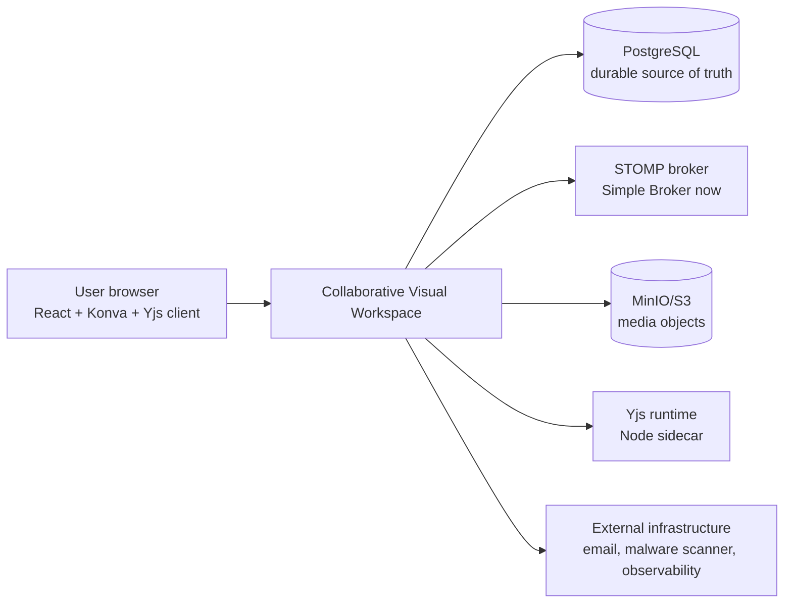
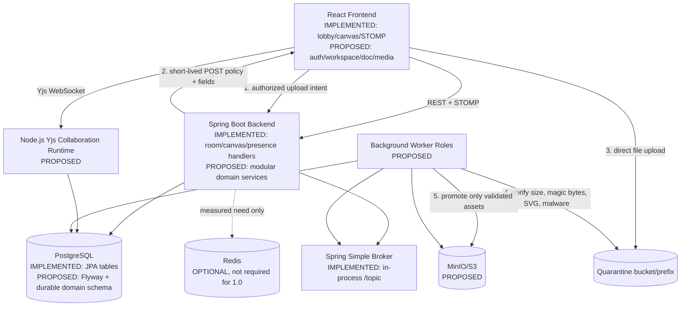
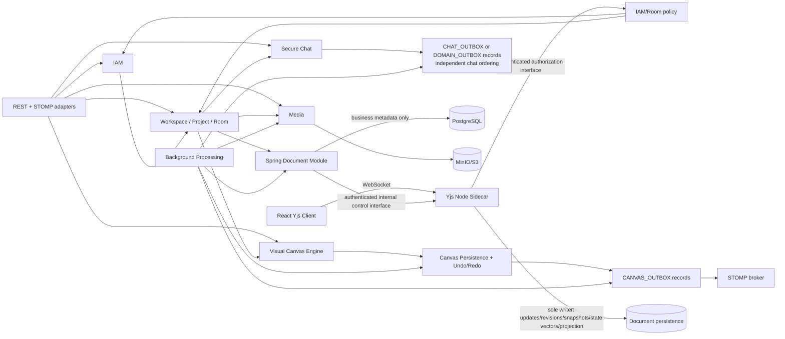
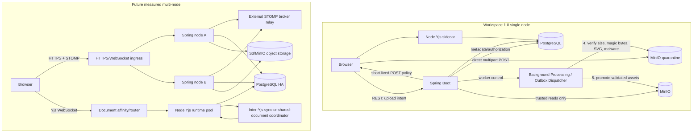

# Collaborative Visual Workspace — System Architecture Design

**Stage:** 0.3.1 — System Architecture & Technology Evaluation  
**Baseline:** PRD v1.0.9 (approved, dated 2026-11-08)  
**Status:** Pending Review; all target choices in this document are proposed, not accepted.

## 1. Scope and evidence

This document is an architecture proposal based on the repository as inspected on
2026-11-08. It does not claim that PRD functionality is implemented. Current-state
claims are anchored to source files, manifests, tests, and configuration. Earlier
manual verification is not treated as repository proof unless corroborated here.

### 1.1 Existing system audit

| Area | Implemented (repository evidence) | Implemented but not fully verified | Partial | Planned/not present |
|---|---|---|---|---|
| Backend | Repository evidence: Spring Boot in `backend/pom.xml`; room REST in `backend/src/main/java/com/wisdom/wbs/controller/RoomController.java`; JPA entities/repositories in `backend/src/main/java/com/wisdom/wbs/entity` and `repository`; STOMP endpoint/simple broker in `backend/src/main/java/com/wisdom/wbs/config/WebSocketConfig.java`; handlers in `backend/src/main/java/com/wisdom/wbs/controller`. Tests are present under `backend/src/test/java/com/wisdom/wbs` and reports under `backend/target/surefire-reports`. | Runtime database behavior and concurrent correctness are not established by source inspection alone. | Error handling often returns a generic error; controllers hold domain and in-memory state (`DrawController.java`, `EditController.java`, `PresenceService.java`). | IAM/JWT/RTR/RBAC, workspace/project/invitation, private-room authorization, chat, media, Yjs, durable outbox, snapshot worker and persistent undo/redo. Notification Bell is P1, not P0. |
| Canvas | React canvas UI with Konva/react-konva; draw/shape/text/edit/clear/undo/redo and export UI are present; REST state load/save exists. | Current test evidence covers backend classes, not an end-to-end browser collaboration contract. | State is a single `TEXT` JSON column with `lines`, optional `shapes` and `texts`; operation history and versions are process-local. | Six-object versioned unified JSONB snapshot, operation log, idempotency ledger, conflict-safe rebase, durable undo history and compaction. |
| Realtime | `@stomp/stompjs` client dependency; `/app` application prefix and `/topic` broker prefix; destinations are observable in controllers. | Authentication, authorization, receipts, ACK semantics, reconnect recovery and cross-node delivery are not implemented. | Presence is an in-memory map and cursor messages are transient. | Authenticated STOMP interceptor, secure chat, durable outbox, broker relay option, Yjs binary protocol. |
| Persistence | PostgreSQL JDBC runtime dependency; JPA `whiteboard_rooms` and `whiteboard_states`; `spring.jpa.hibernate.ddl-auto=update`. | No committed schema/migration history was found; production database behavior is not verified. | Canvas state is text, not JSONB; `room_version` is not a database column. | Flyway schema, PostgreSQL JSONB, operation/outbox/undo/Yjs/media/IAM tables. |
| Frontend | Repository evidence: `frontend/package.json`, `frontend/src/App.tsx`, `RoomLobby.tsx`, `WhiteboardCanvas.tsx`, `ParticipantsPanel.tsx` and `LiveCursorsLayer.tsx`. | Browser behavior and production API configuration are not established by repository inspection. | Backend URL is hard-coded to `http://localhost:8080`; no route/state library or auth state exists. | Auth/session UX, workspace/project navigation, chat, document editor and media upload lifecycle. Notification UI/backend remains P1 or deferred. |
| Delivery | Maven wrapper and Vite scripts exist; frontend `build` and `lint` scripts exist. | No repository deployment topology, container files, CI workflow, or production observability contract was found in the inspected project files. | Development configuration is localhost-oriented. | Workspace 1.0 single-node deployment, background workers, object storage, operational metrics and recovery runbooks. |

### 1.2 Actual technology inventory

- Backend: Java `21`, Spring Boot parent `4.1.1`, Spring Data JPA, MVC, WebSocket,
  PostgreSQL driver, Jackson databind and Lombok (`backend/pom.xml`).
- Backend configuration: PostgreSQL at `localhost:5432/whiteboard_db`,
  `ddl-auto=update`, port `8080` (`backend/src/main/resources/application.properties`).
- Frontend: React `19.2.8`, React DOM `19.2.8`, Konva `10.7.1`,
  react-konva `19.3.0`, `@stomp/stompjs` `7.3.0`, Vite `8.3.0`,
  TypeScript `~6.0.2`, jsPDF `4.2.1` (`frontend/package.json`).
- No Yjs, Redis, MinIO/S3 SDK, Flyway, Spring Security, JWT library, broker
  relay, virus scanner, or background-job library is declared.

### 1.3 Current contracts

**REST**

| Method | Path | Current behavior |
|---|---|---|
| `POST` | `/api/rooms` | Creates an eight-character random room, creates an empty `whiteboard_states` row, returns room ID/message/time. |
| `GET` | `/api/rooms/{roomId}` | Validates `[A-Za-z0-9_-]{1,50}`, returns room metadata or 400/404. |
| `GET` | `/api/rooms/{roomId}/state` | Returns saved JSON and a JVM-local `roomVersion`; missing state returns `{lines:[]}`. |
| `PUT` | `/api/rooms/{roomId}/state` | Accepts object JSON with `lines`, optional `shapes`/`texts`, max 10,000 elements, and overwrites the row. |

**STOMP**

- Endpoint: `/ws`; application prefix: `/app`; broker prefix: `/topic`.
- Client sends `/app/draw`, `/app/shape`, `/app/edit`, `/app/clear`,
  `/app/undo`, `/app/redo`, `/app/rooms/{roomId}/join`,
  `/app/rooms/{roomId}/leave`, and `/app/rooms/{roomId}/cursor`.
- Broadcasts include `/topic/rooms/{id}/draw`, `/shape`, `/edit`,
  `/edit-conflict`, `/clear`, `/undo`, `/redo`, `/presence`, and `/cursor`.
- Current draw/edit records carry `roomVersion`; edit carries operation ID,
  transaction ID, object type/ID, object payload and base version.
- The current configuration has no authentication or authorization interceptor.

## 2. Target architecture

Workspace 1.0 is a **modular monolith**: one Spring Boot deployment owns business
transactions, PostgreSQL is the durable source of truth, and React owns interaction
state/rendering. A Node.js Yjs runtime is a separate process because it is a
protocol/runtime boundary, not because the product needs microservices.

### 2.1 Boundaries and responsibilities

| Module | Owns | Depends on |
|---|---|---|
| IAM & Authentication | Users, sessions, JWT access tokens, refresh-token rotation, password policy, revocation and security context | PostgreSQL, Spring Security |
| Workspace Management | Workspace lifecycle, owner, members, invitations, archive/restore | IAM, PostgreSQL |
| Project Management | Projects and archive/restore within a workspace | IAM, Workspace |
| Room Management | Room ownership, type (`CANVAS`, `DOC`, `HYBRID`), membership and initialization | IAM, Workspace, Project |
| Visual Canvas Engine | Validation and application of six object types, object conflict metadata and canonical operations | Room, Canvas Persistence |
| Canvas Persistence & Undo/Redo | Row-locked room version, snapshot, operation log, idempotency ledger, undo history, compaction and gap recovery; transactional creation of `CANVAS_OUTBOX` records | PostgreSQL, Background Processing |
| Realtime Collaboration & Presence | STOMP command handling, subscriptions, presence/cursors, client recovery events and broker transport adapters | IAM, Room, Canvas Persistence, broker |
| Secure Room Chat | Authorized messages, history, typing and online state; transactional creation of `CHAT_OUTBOX` or `DOMAIN_OUTBOX` records | IAM, Room, PostgreSQL, Realtime |
| Collaborative Document Editor | Yjs update acceptance, revision lineage, snapshots, compaction and JSON projection | IAM, Room, PostgreSQL, Yjs runtime |
| Media Asset Management | Upload intents, quarantine, validation, sanitization, scan result, trusted promotion, reference counting | IAM, Room, object storage, worker |
| Notification & Background Processing / Outbox Dispatcher | Queue polling, advisory locks, Head-of-Line ordering, retry, scheduling and dispatch lifecycle for Canvas and Chat outboxes; canvas snapshot/Yjs compaction, media scan, orphan cleanup and archive expiry | PostgreSQL, broker, object storage |

Business rules stay in Spring services, not controllers or workers. Realtime
transport is an adapter: it must call an authorized application command, commit
durable state, then publish an outbox event. Canvas Persistence transactionally creates
Canvas outbox rows; Chat transactionally creates its own outbox rows. Background
Processing owns polling and dispatch, while Realtime owns transport adapters only.
React owns rendering, optimistic UI,
version deduplication, snapshot-aware recovery, Yjs client state and upload progress;
it never becomes the source of truth for versions, authorization or persistence.

### 2.2 Communication and process placement

- **Existing Spring Boot process:** all modules above except the Yjs runtime; use
  package-by-domain boundaries with repositories and transaction services.
- **Node.js Yjs sidecar:** WebSocket/Yjs protocol, document room connections and a
  PostgreSQL persistence adapter. It must validate the browser credential and room
  authorization itself; Spring cannot be the only authorization boundary.
- **Yjs browser authentication:** Prefer a Secure, HttpOnly, SameSite=Lax/Strict
  session cookie for a same-site browser-to-sidecar deployment. The browser
  WebSocket API does not provide a portable way to add arbitrary Authorization
  headers. If cookie routing is not viable, Spring issues an authenticated HTTPS
  request for a short-lived, single-use, room-scoped connection ticket; the browser
  presents it only during the WebSocket handshake. The exact browser transport for
  the fallback ticket remains a Stage 0.3.3 decision. The ticket must have short
  expiration, single-use atomic consumption, user/room binding, Origin validation,
  and redaction from application and proxy access logs. Long-lived access or refresh
  tokens must never appear in a WebSocket query string. The sidecar validates
  Origin, cookie/ticket signature and expiry, atomically consumes a ticket, and
  checks current workspace/room membership before joining the document.
- **Yjs revocation:** IAM publishes a signed, room/user-scoped revocation event to
  a durable PostgreSQL-backed control path consumed by the sidecar (or an
  authenticated equivalent). The sidecar indexes sessions by user and closes
  affected sessions on receipt. Notification-to-close latency must be measured and
  remain below the PRD `<1 second` target. Local JWT signature verification alone
  is insufficient because it cannot detect active session revocation.
- **Workspace 1.0 broker:** Spring Simple Broker for one node. The application
  Background Processing outbox dispatcher publishes only after commit. A future
  STOMP Broker Relay is the scale-out path; Redis Pub/Sub is not a native STOMP
  relay.
- **Redis:** not required for Workspace 1.0. Add it only for measured cross-node
  presence/session coordination or rate limiting; it must not replace PostgreSQL
  durability.
- **Workers:** initially separate worker processes or scheduled worker roles using
  the same Spring codebase and PostgreSQL leases/locks. Required P0 roles are
  Canvas Outbox, Canvas Snapshot, Yjs Compaction, Media Scanning, Orphan Cleanup
  and Archive Lifecycle. Notification Bell/notification-center processing is P1 or
  deferred and is not part of the Workspace 1.0 P0 worker scope.

### 2.3 Yjs ownership and database boundary

Ownership is intentionally single-writer per Yjs category:

| Category | Authoritative owner | Rule |
|---|---|---|
| Document business metadata (title/archive) | Spring Document module | Spring owns IAM/Room integration and business transactions. |
| Yjs binary updates | Node.js Yjs sidecar | The sidecar PostgreSQL adapter is the only writer for update rows. |
| Document revision allocation | Node.js Yjs sidecar | It locks the document row and allocates the next revision in the same transaction as the update insert. |
| Binary snapshots and state vectors | Node.js sidecar/compaction role | It writes binary snapshot and state-vector rows under the document compaction lock. |
| JSON projection | Node.js sidecar, under an explicit projection contract consumed by Spring | No second writer may independently persist the same projection. |
| Authorization decisions | Spring IAM/Room policy; sidecar enforcement | The sidecar may cache only bounded, revocation-aware results. |

Spring and the sidecar share a versioned schema contract, but there must not be two
independent writers for the same update/revision sequence. The sidecar receives a
least-privilege database role limited to document tables and required lock/
transaction operations; it has no write access to IAM, workspace membership,
Canvas or chat tables. Stage 0.3.2–0.3.3 must choose whether it obtains current
Room/Workspace membership through an authenticated internal authorization API or
restricted read-only access to the minimum membership data. Spring owns metadata
and can request sidecar operations through an authenticated internal API, but does
not write Yjs update/revision rows. Physical Database Design must prevent
conflicting revision writers through column-level grants or, if justified, a
separately owned revision/sequence record.

## 3. Required architecture invariants

1. PostgreSQL is the durable source of truth for persisted business data and Canvas state.
2. Canvas operations receive monotonically increasing per-room versions under one database transaction.
3. Database commit precedes realtime broadcast.
4. Outbox dispatch preserves per-room order and head-of-line retry blocking.
5. Clients deduplicate by operation ID and contiguous room version and recover via a snapshot-aware gap protocol.
6. Snapshot compaction validates operation continuity before deleting log rows.
7. Persistent undo/redo and durable version lineage survive restart and operation-log compaction.
8. Object conflict metadata has one authoritative owner and is atomically represented with snapshot/tombstone state.
9. Yjs updates are durable before ACK or broadcast.
10. Media objects are inaccessible until their asset state is `READY`.
11. Every HTTP and realtime entry point independently authenticates and authorizes.
12. Workspace 1.0 does not require microservices, Kubernetes or distributed infrastructure without measured justification.

### 3.1 Advisory-lock key convention

`room_id` and `document_id` are strings and are not passed directly to PostgreSQL
advisory-lock functions. Normalize the canonical identity as UTF-8, prepend a
domain separator, and deterministically map the result to one valid BIGINT key
(the exact hash/encoding is a Stage 0.3.2 physical-design decision). The Room
namespace uses `cwv:room:` plus the canonical room ID. Canvas Dispatcher and
Snapshot Worker must use that identical Room mapping. Yjs Document Compaction uses
the separate `cwv:document:` namespace and its own mapping. Every worker must use
the same convention for the same resource.

A hash collision may cause unnecessary serialization between different resources;
it must never be treated as proof that two rooms or documents are the same logical
resource. Collision monitoring and, if required, a collision-resistant two-key
encoding are part of the physical design. Locks remain transaction-level, so
commit/rollback or connection failure releases them automatically. This convention
does not weaken PRD per-room Head-of-Line ordering.

## 4. Required diagrams

### 4.1 System context

### 4.2 Container diagram

### 4.3 Backend component diagram

Chat persistence and publication are separate from Canvas sequencing. Stage 0.3.2
must choose a dedicated `CHAT_OUTBOX` or a generalized `DOMAIN_OUTBOX` with
explicit aggregate type/ID and an independent per-chat-room sequence. Chat messages
are persisted before publication; publication is at-least-once and may be delayed
or duplicated. Clients deduplicate by message identity and replay missing messages
from PostgreSQL after reconnect using the chat sequence. If persistence commits but
publication fails, the outbox row remains pending and is retried. If publication
succeeds but acknowledgement is lost, retry is safe because the client deduplicates.
Chat never consumes or advances Canvas `room_version`.

### 4.4 Deployment topology

## 5. Verification sources

Technical claims were checked on 2026-11-08 against:

- [Spring external STOMP broker documentation](https://docs.spring.io/spring-framework/reference/web/websocket/stomp/handle-broker-relay.html):
  Simple Broker is limited and not suitable for clustering; broker relay forwards
  STOMP traffic to a full broker.
- [Yjs y-websocket documentation](https://docs.yjs.dev/ecosystem/connection-provider/y-websocket):
  the provider supports a central authenticated server, WebSocket cookies/headers,
  awareness and extensible persistence.
- [Yjs document updates](https://docs.yjs.dev/api/document-updates):
  updates are binary, commutative, associative and idempotent; persistence is an
  application responsibility.
- [AWS S3 POST policy](https://docs.aws.amazon.com/AmazonS3/latest/developerguide/sigv4-HTTPPOSTConstructPolicy.html):
  documents POST policy conditions including `content-length-range`.
- [MinIO Java PostPolicy API](https://minio-java.min.io/io/minio/PostPolicy.html) and
  [MinIO Java Client API](https://minio-java.min.io/io/minio/MinioClient.html):
  candidate SDK APIs for POST policies and object operations. Compatibility must be
  verified against the actual MinIO/AiStor server and selected SDK versions; an SDK
  reference alone does not prove server compatibility.
- [PostgreSQL advisory locks](https://www.postgresql.org/docs/current/explicit-locking.html#ADVISORY-LOCKS):
  advisory locks are application-defined locks and transaction-level locks release
  automatically at transaction end.

## 6. Open questions

The following require explicit review rather than silent assumptions: final JWT
cookie/access-token placement; exact STOMP broker for a future relay; malware scanner
choice and SLA; Yjs schema/JSON projection; media retention and deletion policy;
multi-node trigger threshold; chat outbox versus generalized domain outbox; exact
revocation transport and measured SLA; and whether worker roles run as separate
processes or profiles in the same deployable artifact.
