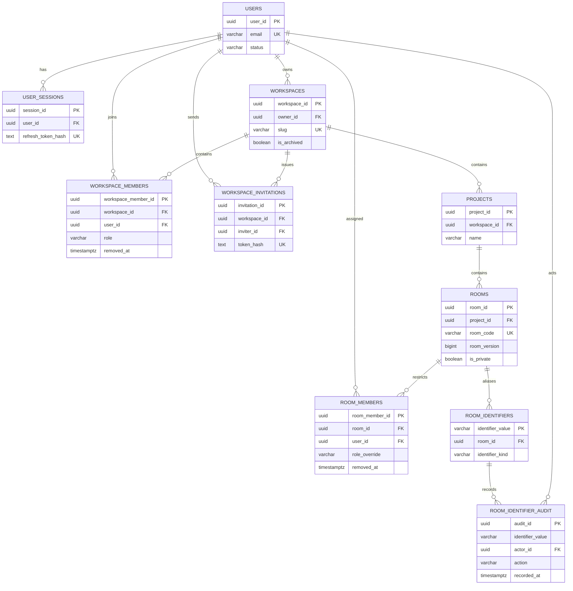
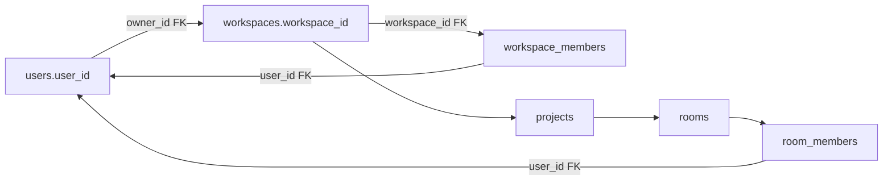
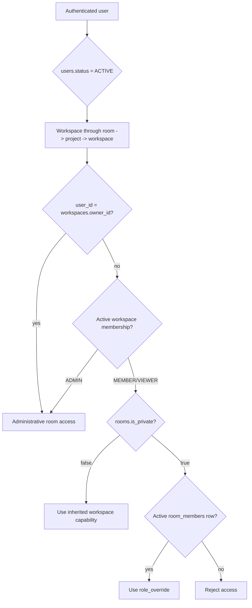

# Core Schema Design

**Stage:** 0.3.2.2 — Core Schema Design  
**Project:** Collaborative Visual Workspace  
**Baseline:** PRD v1.0.9 (approved 2026-11-08), Stage 0.3.1 architecture documents,
and reviewed Stage 0.3.2.1 inventory  
**Status:** Pending Review  
**Artifact type:** Reviewed design proposal; the DDL in this document is
illustrative and must not be executed as a migration.

## 1. Scope and baseline

This design covers only the core relational domains:

1. IAM
2. Workspace
3. Workspace Membership
4. Project
5. Room
6. Room Membership

It does not define Canvas, Yjs, Chat, Media, Outbox, Snapshot, or worker tables.
Those domains are referenced only where a core foreign key or authorization
boundary requires context.

The repository currently has only the legacy JPA mappings
`whiteboard_rooms(room_id, created_at, updated_at)` and
`whiteboard_states(room_id, data, updated_at)`. PostgreSQL is configured through
JPA `ddl-auto=update`; no migration history exists. The existing room identifier
is simultaneously an internal key and public join value. This design does not
silently discard that identifier.

The proposed tables and constraints below are not implemented in the source
repository or the database. All OTD decisions in Stage 0.3.1 remain Proposed;
this document does not accept or change them.

## 2. Design principles

1. **PostgreSQL is the durable source of truth.** Schema changes must later be
   delivered by reviewed Flyway migrations, not Hibernate auto-update.
2. **Owner SSOT.** `workspaces.owner_id` is the only owner authority.
   `workspace_members.role` excludes `OWNER`.
3. **Least destructive lifecycle.** Archive and soft-removal preserve business
   and audit history. Physical deletion is exceptional and must be explicitly
   authorized.
4. **No ProjectMember table.** Project permissions inherit from active workspace
   membership as required by the PRD.
5. **Room identity is separated from public addressing.** The recommended target
   uses an internal UUID and a public room code, with a compatibility mapping for
   legacy IDs.
6. **Database constraints handle local facts.** Checks, foreign keys, and
   uniqueness enforce row-local or directly relational invariants. Cross-row
   authorization and ownership-transfer rules require a locked service
   transaction.
7. **No content cascade deletion.** Core-row deletion must not silently remove
   future Canvas, Document, Chat, or Media data.
8. **Timestamps are UTC-aware.** `timestamptz` is used for audit and lifecycle
   timestamps.

## 3. Room identity decision analysis

### 3.1 Alternatives

| Option | Design | Advantages | Costs/risks |
|---|---|---|---|
| A | Preserve string `room_id` as internal PK and public code | Lowest migration effort; existing URLs and JPA repositories continue to work | Public identifier exposure; longer joins/FKs; no clean separation of identity and share code; difficult future code rotation |
| B | UUID internal `room_id` plus unique public `room_code` | Stable opaque joins; clear relationship target; public code can rotate or be regenerated independently; conventional UUID FKs | Requires mapping existing IDs; URL/API compatibility work; two identifiers must be handled consistently |
| C | Staged compatibility strategy | Allows legacy reads and controlled cutover; can preserve old links while moving toward B | Requires temporary mapping and dual-read/dual-write discipline; more migration states |

### 3.2 Recommendation

**Recommend B as the target physical model, implemented through C as the
migration strategy.**

`rooms.room_id` should be an application-generated UUID used by foreign keys.
`rooms.room_code` should be a unique, user-facing value. New codes should use
an intended eight-character public-code format; the exact alphabet, case
policy, and rotation policy remain unresolved service/product decisions. This
document does not invent an alphabet.

This recommendation improves referential integrity and separates internal
authorization/version identity from a value intentionally shared in URLs. UUID
joins are predictable and maintainable at future scale, while a public code can
remain short and human-friendly. The migration cost is accepted because
silently retaining the current conflation would preserve a known architectural
gap.

### 3.3 Legacy mapping

- Each existing `whiteboard_rooms.room_id` becomes a legacy identifier recorded
  in `room_identifiers.identifier_value` with
  `identifier_kind = 'LEGACY_ALIAS'`.
- A migrated `rooms` row receives a new UUID `room_id` and a compatible
  `room_code`. To preserve existing room URLs, the legacy value is also retained
  as an alias during the compatibility period.
- `whiteboard_states.room_id` is resolved through the legacy mapping to the new
  internal room UUID when the later Canvas migration moves the state. This core
  design does not define the Canvas state table or its JSON conversion.
- The special `room-1` value is not discarded. If a matching legacy state exists,
  it receives an explicit mapping row and a generated internal UUID. Its public
  compatibility alias remains `room-1`; new room creation does not reuse it.
- During staged cutover, reads may resolve either a new `room_code` or an active
  legacy alias. New writes must use the internal UUID after resolution. The
  mapping must be immutable once created, except for an explicitly audited
  deactivation. The service/database role must reject changing
  `identifier_value`, `identifier_kind`, or `room_id` after insertion; a
  deactivation may update only the deactivation audit fields.

`room_identifiers` is the only additional core table introduced here. It
provides one namespace for public codes and legacy aliases, preventing an
incoming identifier from resolving to two rooms. It does not represent Canvas
state.

### 3.4 Public-code and legacy-alias collision strategy

The `room_identifiers` registry is the canonical identifier source. Every public
code and imported legacy alias is inserted there in the same transaction that
creates or maps the room. Its primary key on `identifier_value` prevents a
public code and a legacy alias from sharing a value. A deferred constraint
trigger (shown in the DDL) requires each room to have exactly one active
`PUBLIC_CODE` row and requires that row's value to equal `rooms.room_code`.
Therefore `rooms.room_code` is a maintained relational projection, not a second
authority. Direct application updates to either representation are revoked;
creation, rotation, and deactivation use one service operation and one
transaction.

The registry also has a partial unique index allowing at most one active public
code per room. Identifier resolution locks or reads the single registry row and
rejects ambiguity or inactive aliases. Rotation locks the Room row and current
identifier, deactivates the old identifier, inserts the replacement, updates
`rooms.room_code`, records both audit events, and commits only after the
deferred trigger verifies the final state. The old identifier must be
deactivated before the replacement is inserted because the partial unique index
is immediate. A deactivated current code therefore cannot remain presented as
the room's active code. Deactivated values remain reserved and cannot be reused.

## 4. Table-by-table schema specification

Types and constraints below are the proposed physical contract. Names use
lowercase `snake_case`.

### 4.1 `users`

| Column | Type | Null/default | Rules and purpose |
|---|---|---|---|
| `user_id` | `uuid` | NOT NULL; application-generated | Primary key |
| `email` | `varchar(320)` | NOT NULL | Canonical trimmed lowercase login identity; unique |
| `password_hash` | `text` | NOT NULL | Password hash only; never plaintext |
| `display_name` | `varchar(120)` | NOT NULL | User-visible name |
| `avatar_url` | `text` | NULL | Optional profile image URL |
| `status` | `varchar(16)` | NOT NULL; `ACTIVE` | `ACTIVE` or `SUSPENDED` |
| `created_at` | `timestamptz` | NOT NULL; `now()` | Creation audit |
| `updated_at` | `timestamptz` | NOT NULL; `now()` | Modification audit |
| `suspended_at` | `timestamptz` | NULL | Suspension audit |

Email input is trimmed and normalized to lowercase before persistence. Lookups
and comparisons use the same normalized value. This design does not require the
PostgreSQL `citext` extension.

Candidate indexes: unique normalized email for login; `(status)` only if
operational suspension queries require it.

### 4.2 `user_sessions`

| Column | Type | Null/default | Rules and purpose |
|---|---|---|---|
| `session_id` | `uuid` | NOT NULL; application-generated | Primary key |
| `user_id` | `uuid` | NOT NULL | FK to `users` |
| `refresh_token_hash` | `text` | NOT NULL | Unique stored hash, never raw token |
| `family_id` | `uuid` | NOT NULL | Refresh-token rotation/reuse family |
| `device_info` | `text` | NULL | Non-authoritative device description |
| `ip_address` | `inet` | NULL | Audit value; retention policy later |
| `expires_at` | `timestamptz` | NOT NULL | Session expiry |
| `revoked_at` | `timestamptz` | NULL | Revocation marker |
| `created_at` | `timestamptz` | NOT NULL; `now()` | Creation audit |

Unique `refresh_token_hash` prevents duplicate token hashes. The recommended
session-family invariant is at most one non-revoked refresh token per
`(user_id, family_id)`, enforced by a partial unique index. Rotation locks the
family's current row, revokes the prior token, inserts the replacement, and
commits both changes in one transaction. User deletion is `RESTRICT` by default;
session cleanup is an explicit IAM operation.

### 4.3 `workspaces`

| Column | Type | Null/default | Rules and purpose |
|---|---|---|---|
| `workspace_id` | `uuid` | NOT NULL; application-generated | Primary key |
| `owner_id` | `uuid` | NOT NULL | FK to `users`; owner SSOT |
| `name` | `varchar(160)` | NOT NULL | Trimmed, non-empty workspace display name |
| `slug` | `varchar(120)` | NOT NULL | Trimmed lowercase URL-safe unique workspace name |
| `description` | `text` | NULL | Optional description |
| `is_archived` | `boolean` | NOT NULL; `false` | Archive flag |
| `archived_at` | `timestamptz` | NULL | Archive audit |
| `created_at` | `timestamptz` | NOT NULL; `now()` | Creation audit |
| `updated_at` | `timestamptz` | NOT NULL; `now()` | Modification audit |

Unique normalized `slug` is global in this proposal. If product review requires
workspace-scoped slugs, that is an open decision, not an implicit change.
Archive operations must keep the row and its members/projects.

### 4.4 `workspace_members`

| Column | Type | Null/default | Rules and purpose |
|---|---|---|---|
| `workspace_member_id` | `uuid` | NOT NULL; application-generated | Primary key |
| `workspace_id` | `uuid` | NOT NULL | FK to `workspaces` |
| `user_id` | `uuid` | NOT NULL | FK to `users` |
| `role` | `varchar(16)` | NOT NULL | `ADMIN`, `MEMBER`, or `VIEWER`; never `OWNER` |
| `joined_at` | `timestamptz` | NOT NULL; `now()` | Membership audit |
| `updated_at` | `timestamptz` | NOT NULL; `now()` | Membership audit |
| `removed_at` | `timestamptz` | NULL | Soft removal; NULL means active |

A partial unique index on active rows prevents duplicate active memberships while
allowing a historical rejoin. A service transaction must prevent an active
workspace owner membership and must not create an `OWNER` role.

### 4.5 `workspace_invitations`

| Column | Type | Null/default | Rules and purpose |
|---|---|---|---|
| `invitation_id` | `uuid` | NOT NULL; application-generated | Primary key |
| `workspace_id` | `uuid` | NOT NULL | FK to `workspaces` |
| `inviter_id` | `uuid` | NOT NULL | FK to `users` |
| `email` | `varchar(320)` | NOT NULL | Intended recipient |
| `role` | `varchar(16)` | NOT NULL | `ADMIN`, `MEMBER`, or `VIEWER` |
| `token_hash` | `text` | NOT NULL | Unique invitation lookup hash |
| `expires_at` | `timestamptz` | NOT NULL | PRD default invitation lifetime: 48 hours |
| `accepted_at` | `timestamptz` | NULL | Acceptance audit |
| `revoked_at` | `timestamptz` | NULL | Explicit revocation |
| `created_at` | `timestamptz` | NOT NULL; `now()` | Creation audit |

An invitation is usable only when `accepted_at IS NULL`, `revoked_at IS NULL`,
and `expires_at > now()`. The time-dependent condition requires service logic;
the role and timestamp ordering checks can be ordinary constraints.

### 4.6 `projects`

| Column | Type | Null/default | Rules and purpose |
|---|---|---|---|
| `project_id` | `uuid` | NOT NULL; application-generated | Primary key |
| `workspace_id` | `uuid` | NOT NULL | FK to `workspaces` |
| `name` | `varchar(160)` | NOT NULL | Trimmed, non-empty project name |
| `description` | `text` | NULL | Optional description |
| `is_archived` | `boolean` | NOT NULL; `false` | Archive flag |
| `archived_at` | `timestamptz` | NULL | Archive audit |
| `created_at` | `timestamptz` | NOT NULL; `now()` | Creation audit |
| `updated_at` | `timestamptz` | NOT NULL; `now()` | Modification audit |

Candidate uniqueness is `(workspace_id, lower(name))`; archived projects remain
in that namespace, so archiving does not permit a duplicate active-name
replacement. No `project_members` table is introduced because permissions
inherit from workspace membership.

### 4.7 `rooms`

| Column | Type | Null/default | Rules and purpose |
|---|---|---|---|
| `room_id` | `uuid` | NOT NULL; application-generated | Recommended internal PK |
| `project_id` | `uuid` | NOT NULL | FK to `projects` |
| `room_code` | `varchar(8) COLLATE "C"` | NOT NULL | Unique, case-sensitive eight-character public join/share value |
| `name` | `varchar(160)` | NOT NULL | Trimmed, non-empty room display name |
| `room_type` | `varchar(16)` | NOT NULL | `CANVAS`, `DOC`, or `HYBRID` |
| `room_version` | `bigint` | NOT NULL; `0` | Canvas version boundary; must be non-negative |
| `is_private` | `boolean` | NOT NULL; `false` | Public workspace inheritance versus explicit room access |
| `is_archived` | `boolean` | NOT NULL; `false` | Archive flag |
| `archived_at` | `timestamptz` | NULL | Archive audit |
| `created_at` | `timestamptz` | NOT NULL; `now()` | Creation audit |
| `updated_at` | `timestamptz` | NOT NULL; `now()` | Modification audit |

New public codes are intended to be eight characters and case-sensitive. This
design selects exact, case-sensitive comparison for ASCII identifiers: the
physical columns use `COLLATE "C"` and API lookup must use the identifier
exactly as supplied, without case folding. The final product alphabet remains
unresolved. Static
source evidence for the candidate alphabet is
`backend/src/main/java/com/wisdom/wbs/service/WhiteboardRoomService.java`,
constant `ROOM_CODE_CHARACTERS`, used by `generateRandomCode()`. The candidate
is `23456789abcdefghjkmnpqrstuvwxyzABCDEFGHJKLMNPQRSTUVWXYZ`, containing 55
distinct symbols. It is an implementation candidate, not standard Base58:
the PRD requires an eight-character Base58 public code, while the repository
candidate's exact alphabet has not been product-approved. This is repository
evidence; runtime behavior is **Runtime Unverified**. The final PRD alphabet
and case policy at every API boundary remain unresolved. Legacy values such as
`room-1` are never admitted to this new-code column.

### 4.8 `room_members`

| Column | Type | Null/default | Rules and purpose |
|---|---|---|---|
| `room_member_id` | `uuid` | NOT NULL; application-generated | Primary key |
| `room_id` | `uuid` | NOT NULL | FK to `rooms` |
| `user_id` | `uuid` | NOT NULL | FK to `users` |
| `role_override` | `varchar(16)` | NOT NULL | `ADMIN`, `EDITOR`, or `VIEWER` |
| `added_at` | `timestamptz` | NOT NULL; `now()` | Membership audit |
| `removed_at` | `timestamptz` | NULL | Soft removal; NULL means active |

A partial unique index on `(room_id, user_id)` for active rows prevents duplicate
active assignments while preserving historical authorization records. Each
rejoin creates a new row; `removed_at` is never cleared.

`room_members` cannot, by ordinary FK alone, prove that the user is an active
member of the workspace containing the room, because that relationship crosses
`rooms → projects → workspaces`. The service authorization transaction must
perform that dual check and lock the relevant membership rows.

### 4.9 `room_identifiers`

| Column | Type | Null/default | Rules and purpose |
|---|---|---|---|
| `identifier_value` | `varchar(50) COLLATE "C"` | NOT NULL | Case-sensitive primary key across public and legacy values |
| `room_id` | `uuid` | NOT NULL | FK to `rooms` |
| `identifier_kind` | `varchar(16)` | NOT NULL | `PUBLIC_CODE` or `LEGACY_ALIAS` |
| `is_active` | `boolean` | NOT NULL; `true` | Compatibility lookup switch |
| `mapped_at` | `timestamptz` | NOT NULL; `now()` | Mapping audit |
| `deactivated_at` | `timestamptz` | NULL | Alias retirement audit |
| `deactivated_by` | `uuid` | NULL | FK to `users`; authorizing actor |
| `deactivation_reason` | `text` | NULL | Required when deactivated |

One identifier value maps to one room for its entire lifetime. A room has at
most one active public identifier, while it may retain multiple active legacy
aliases only if the compatibility policy explicitly permits them. A deactivated
identifier remains reserved and cannot be reused. This table is compatibility
infrastructure, not a product domain entity.

### 4.10 `room_identifier_audit`

This append-only table records identifier creation, rotation, and deactivation.
Each row contains the identifier value, room, action, actor, reason, previous
state, resulting state, and event timestamp. The service writes the audit row in
the same transaction as the registry change. The database role used by the
controlled trigger path is the only writer; ordinary application roles have no
direct INSERT, UPDATE, or DELETE privilege.
An append-only trigger rejects later mutation or deletion, and an audit row is
required for every registry state transition. `audit_id` is a distinct
application/service-generated UUID for every row-level event; the primary key
rejects reuse, including within one rotation transaction. The illustrative trigger receives
`app.audit_id`, `app.actor_id`, and `app.reason` as transaction-local service
context; these values are set before the registry mutation.

## 5. Physical ERD



## 6. Ownership and RBAC enforcement

### 6.1 Ownership relationship



`owner_id` is authoritative. The member table contains only `ADMIN`, `MEMBER`,
and `VIEWER`; it never stores `OWNER`.

### 6.2 Mandatory workspace locking protocol

Every operation that creates, reactivates, removes, or changes a workspace or
room membership, and every ownership or invitation operation, must use one
transaction and acquire locks in this order:

1. Lock the target `workspaces` row with `SELECT ... FOR UPDATE`.
2. Lock the invitation row when applicable with `FOR UPDATE`.
3. Lock affected workspace membership rows in deterministic `user_id` order.
4. Lock affected `rooms` rows in deterministic `room_id` order, then affected
   `room_members` rows in deterministic `(room_id, user_id)` order.
5. Validate active state, eligibility, and owner/member invariants.
6. Insert a new membership-period row or set `removed_at`; update ownership,
   room grants, and audit fields; re-check all invariants.
7. Commit all changes together.

The parent workspace lock is mandatory even when a target row does not yet
exist. This makes workspace membership and dependent room authorization
decisions serialize on the same row. Row locks block competing transactions
until commit or rollback; they do not replace authorization checks.

For invitation-token acceptance, the service first reads the invitation without
locking solely to obtain `workspace_id`. It then locks the workspace row, locks
the invitation row with `FOR UPDATE`, and revalidates that the invitation still
belongs to that workspace and is pending, unexpired, unrevoked, and addressed
to the accepting user's normalized email. The initial unlocked read can be
stale or can race with revocation, so revalidation after lock acquisition is
mandatory.

Granting room access, changing a room role, and revoking room access follow the
same order: workspace, affected workspace membership rows, room, then room
membership rows, in the deterministic orders above. Workspace removal locks the
workspace first, then the member, all affected rooms, and all dependent room
membership rows before revoking them. Rejoin uses the same workspace lock before
creating a new membership period. Since a room grant cannot commit without
holding the workspace lock, it cannot succeed after a concurrent workspace
revocation has committed. All operations run in one transaction.

Ownership transfer must atomically validate that the new owner is an active user
and eligible workspace participant, update `workspaces.owner_id`, promote the
former owner to a new `ADMIN` membership period, set `removed_at` on any active
new-owner membership, and preserve all historical rows. The transaction must
finish with exactly one owner authority and no active `OWNER` membership role.

### 6.3 Legacy identifier immutability and audit

The primary key prevents two simultaneous rows from using the same identifier,
but it does not by itself prevent an update from reassigning an existing value.
The target deployment therefore revokes ordinary application `UPDATE`
privileges on `room_identifiers.identifier_value`, `identifier_kind`, and
`room_id`, and the immutability trigger rejects reassignment even for the
service role. The only permitted state transition is an audited deactivation
that sets `is_active = false`, `deactivated_at`, `deactivated_by`, and
`deactivation_reason`. A dedicated append-only audit table records actor,
reason, previous state, resulting state, and timestamp for every creation and
deactivation in the same transaction. A deactivated value remains reserved
forever.

The authorized rotation operation is the only registry state-changing path:

1. Begin one transaction and lock the `rooms` row with `FOR UPDATE`.
2. Lock the current active public identifier for that room.
3. Deactivate the old identifier; its audit trigger records `DEACTIVATED`.
4. Insert the replacement public identifier; its audit trigger records
   `CREATED`.
5. Update `rooms.room_code` to the replacement value.
6. Commit. The immediate partial unique index is never violated, and the
   deferred projection trigger verifies exactly one active public identifier
   agreeing with `rooms.room_code`.

The operation sets transaction-local `app.actor_id`, `app.reason`, and a fresh
`app.audit_id` before each row-level audit event. The actor and reason context
is trusted only when set by the authorized database operation; callers cannot
set arbitrary context through a direct runtime table write. The audit primary
key and a required fresh UUID per event guarantee distinct audit IDs, including
the two events in one rotation transaction.

The append-only guarantee applies to every non-administrative role, not only
`app_runtime`: `PUBLIC`, `app_runtime`, `identifier_writer`, and
`migration_writer` have no audit table INSERT/UPDATE/DELETE/TRUNCATE privilege.
The trigger also rejects
UPDATE, DELETE, and TRUNCATE attempts that reach the table. `schema_owner` is
the controlled DDL/trigger owner; a superuser or separately governed
break-glass administrator can still bypass PostgreSQL ownership protections,
which is an explicit administrative exception and must be audited outside this
design.

The schema privilege matrix is:

| Role | `public` schema | `app_private` schema | Protected tables | Controlled functions |
|---|---|---|---|---|
| `app_runtime` | Explicit table/column grants below; no `CREATE` | No `USAGE`, no `CREATE` | Explicit application DML below; no registry or audit writes and no `rooms.room_code` update | No `EXECUTE` |
| `identifier_writer` | No `CREATE` | `USAGE`, no `CREATE` | No direct DML | `EXECUTE` on create/rotate/deactivate public-code operations |
| `migration_writer` | No `CREATE` | `USAGE`, no `CREATE` | No direct DML | `EXECUTE` only on legacy-alias creation |
| `schema_owner` | `CREATE` provisioned by bootstrap administrator; migration-only use | Owns schema and functions | Owns protected tables; full controlled DDL/DML | Owns all functions; administrative/migration use only |

`PUBLIC` receives no `CREATE` on trusted schemas and no `EXECUTE` on sensitive
functions. `USAGE` on `app_private` is granted only to the two controlled
writer roles as needed to resolve function names; it does not grant table DML.
Role provisioning, schema creation, table ownership transfer, function
ownership, grants, revokes, and controlled-operation publication must be
applied atomically by the future migration under `schema_owner`; this document
does not execute that migration.

An authorized alias-deactivation operation follows the same controlled path:
it locks the identifier row, verifies it is active, performs only the exact
active-to-inactive transition, supplies one fresh audit UUID, and commits. It
cannot change `identifier_value`, `identifier_kind`, `room_id`, or `mapped_at`.

The role boundary is:

- `schema_owner` owns tables, triggers, and controlled functions and is used
  only by migrations/administration. It is the owner of the protected tables,
  never the application runtime role.
- `app_runtime` is the application connection role. It has no ownership,
  `UPDATE`/`DELETE`/`TRUNCATE`, or direct identifier-write privilege.
- `identifier_writer` is a narrowly scoped service role. It receives
  `EXECUTE` only on the three public-code `SECURITY DEFINER` operations, not on
  trigger helpers, legacy-alias creation, or audit insertion. It has no direct
  table-write privilege.
- `migration_writer` is a separate non-owner login/connection-pool role for
  compatibility backfills only. It receives `EXECUTE` only on
  `create_legacy_room_alias`; it cannot invoke ordinary public-code operations.

The controlled operation fixes its `search_path` to `app_private, pg_catalog,
pg_temp`,
qualifies all table/function references; built-in calls are resolved from the
trusted `pg_catalog` path, not an untrusted public schema. It validates the actor/reason context,
locks the Room and identifier rows, and performs the complete rotation or
authorized deactivation atomically. Its `EXECUTE` grant is revoked from
`PUBLIC`; only the specific service role receives each operation.
`app_runtime` cannot invoke the operation or write the protected columns.

The normal application access path is through `app_runtime` and the public
core tables, not through the `SECURITY DEFINER` identifier operations. Its
illustrative least-privilege table grants are:

| Table | `app_runtime` access |
|---|---|
| `users` | `SELECT`, `INSERT`, and `UPDATE` only for profile/authentication fields required by the service; no ownership or DDL |
| `user_sessions` | `SELECT`, `INSERT`, `UPDATE`, and `DELETE` for the authenticated user's session lifecycle |
| `workspaces` | `SELECT`, `INSERT`, and `UPDATE` for workspace fields; no destructive `DELETE` |
| `workspace_members` | `SELECT`, `INSERT`, and `UPDATE` for membership lifecycle; no destructive `DELETE` |
| `workspace_invitations` | `SELECT`, `INSERT`, and `UPDATE` for invitation lifecycle; no destructive `DELETE` |
| `projects` | `SELECT`, `INSERT`, and `UPDATE`; no destructive `DELETE` |
| `rooms` | `SELECT`; `UPDATE` only on `project_id`, `name`, `room_type`, `is_private`, `is_archived`, and `archived_at`; no `INSERT` through the ordinary path and no `room_code` update |
| `room_members` | `SELECT`, `INSERT`, and `UPDATE` for room-membership lifecycle; no destructive `DELETE` |
| `room_identifiers` | `SELECT` only for read-only lookup/resolution |
| `room_identifier_audit` | No `SELECT` or DML grant to the application runtime unless a separately approved read-only audit view is added |

The exact profile/authentication column subset is deployment-specific and must
be narrowed to the service queries before migration; the invariant is that
`app_runtime` never receives a table-level privilege that reintroduces
`rooms.room_code` or any `room_identifiers` write. PostgreSQL table-level and
column-level privileges are additive, so the DDL first revokes table-level
Room updates and then grants only the permitted Room columns.

The end-user actor is authenticated by the Spring Security/API layer. That
component authorizes the operation and passes the authenticated subject as
`p_actor_id`; the controlled function independently checks that the referenced
user is active, but does not independently reconstruct Workspace Owner/Admin
authorization from the database. Consequently the audit actor is
application-attested plus database-validated for user existence/status, not
cryptographic proof of the human identity. Direct callers cannot set the
transaction-local context because only the `SECURITY DEFINER` operation sets
it, and runtime has no access to the helper functions or protected tables.

The deferred projection trigger is queued by the role executing the protected
write (`schema_owner` as the `SECURITY DEFINER` owner). Its
`SECURITY DEFINER` validator executes as `schema_owner`, reads only
schema-qualified `public.rooms` and `public.room_identifiers`, and is owned by
`schema_owner`. The trusted `app_private` schema is not writable by runtime or
identifier-writer roles, `PUBLIC` has no EXECUTE privilege on helpers, and
`pg_temp` is last in every function search path, so untrusted objects cannot
replace or shadow the validator.

The following controlled operations are required; they are database-backed
service boundaries, not ordinary repository methods:

| Operation | Inputs | Required authorization and writes |
|---|---|---|
| `create_room_with_public_code` | project, room attributes, public code, actor, reason, audit ID | Spring authorization verifies the actor is Workspace Owner/`ADMIN` because ordinary `MEMBER` cannot create Rooms under PRD §4.2; lock the Project/Workspace context, insert `rooms`, insert one active `PUBLIC_CODE`, and record `CREATED` atomically |
| `rotate_room_public_code` | room, replacement code, actor, reason, old/new audit IDs | Spring authorization verifies Room-management authority; lock Room then current identifier; deactivate, insert, project-update, and audit atomically |
| `deactivate_room_identifier` | identifier, actor, reason, audit ID | Spring authorization verifies compatibility-retirement authority; lock identifier; allow only active-to-inactive transition and audit it |
| `create_legacy_room_alias` | room, legacy value, actor, reason, audit ID | `migration_writer` compatibility authority only; lock Room, reject collisions, insert active `LEGACY_ALIAS`, and audit atomically |

Each operation is one database transaction. A failure, authorization
rejection, uniqueness collision, trigger exception, or deferred projection
failure rolls back every Room, registry, projection, and audit write. Room
creation inserts the Room before its registry row; the deferred validator checks
the final exactly-one-public-identifier relationship at commit. Rotation follows
the immediate-index-safe order documented above. Alias creation never changes
the Room projection, and alias deactivation permanently reserves the value.

The operation details are:

- **Room creation:** lock Workspace, then Project, in that order; insert the
  Room, revalidate that both Workspace and Project are still active after the
  Project lock, set the audit context, insert its active public identifier, and
  let the deferred trigger validate the pair at commit. Missing, archived, or
  inactive inputs fail before any write.
- **Public-code rotation:** lock Room, then its current public identifier;
  deactivate old, insert replacement, update projection, and emit the two
  row-level audit events in that order.
- **Alias creation:** lock Room, verify the migration/compatibility authority,
  insert the alias into the shared primary-key namespace, and emit one
  `CREATED` event. A collision or deferred failure rolls back the alias.
- **Identifier deactivation:** lock the identifier, reject public-code
  deactivation outside rotation, update only the exact active-to-inactive
  fields, and emit one `DEACTIVATED` event. The operation never deletes or
  reuses an identifier.

`identifier_writer` is a dedicated non-owner login/connection-pool role used
only by the authorized identifier-operation service boundary. It is not a
general application role and does not receive direct table DML.
`migration_writer` is a separate dedicated non-owner migration connection role
with the same restriction. `schema_owner`,
`app_runtime`, `identifier_writer`, and `migration_writer` must be provisioned externally before
this illustrative DDL is applied; role creation, password/secret management,
TLS, and pool configuration are deployment responsibilities.

```mermaid
sequenceDiagram
    participant S as Membership service
    participant W as workspaces row
    participant M as workspace_members rows
    participant I as invitation row
    S->>W: BEGIN; SELECT ... FOR UPDATE
    opt Invitation acceptance
        S->>I: Read invitation without lock for workspace_id
        S->>I: SELECT invitation FOR UPDATE
        S->>S: Revalidate invitation state and workspace_id
    end
    S->>M: Lock workspace members ordered by user_id
    S->>S: Lock rooms by room_id, then room members by room_id/user_id
    S->>S: Validate active workspace, user, role and owner invariant
    S->>M: Insert period or set removed_at
    S->>W: Update owner/archive-related state if required
    S->>S: Re-check invariant
    S->>S: COMMIT
```

### 6.4 Constraint versus service enforcement

| Invariant | Ordinary database enforcement | Required service/transaction enforcement |
|---|---|---|
| Owner exists | `workspaces.owner_id` FK to `users` | User must be active for normal operations |
| Workspace role vocabulary | `CHECK` on `workspace_members.role` | Role transition authorization |
| No `OWNER` member role | `CHECK` excludes `OWNER` | Owner must not also have an active member row |
| Unique active workspace membership | Partial unique index | Rejoin/removal race handling |
| Project belongs to workspace | FK `projects.workspace_id` | Workspace archive and authorization policy |
| Room belongs to project | FK `rooms.project_id` | Project/workspace active-state checks |
| Public room code unique | Unique constraint | Collision retry and code rotation authorization |
| Private room member row shape | FKs and role check | Active workspace membership plus room override dual check |
| Owner transfer atomicity | FKs alone are insufficient | Lock workspace and affected member rows; update owner, former owner, and new owner in one transaction |
| Workspace owner/admin room access | Not expressible as a simple check | Authorization service evaluates workspace role before room override |
| Archived resource mutation | Timestamp/check can detect malformed state | Service rejects writes and controls restore permissions |

### 6.5 Workspace-to-room effective permissions

Effective permission evaluation is hierarchical:

- Workspace `ADMIN` has administrative access to every room in the workspace,
  including private rooms; an `ADMIN` override is not required.
- Workspace `MEMBER` receives the product's inherited editor capability in
  public rooms. A private room requires an active `room_members` grant.
- Workspace `VIEWER` receives read-only inherited access in public rooms. A
  private room still requires an active explicit grant, whose maximum effective
  capability cannot exceed the workspace viewer capability.
- A room override can narrow an inherited capability, or provide the explicit
  private-room grant, but must not elevate an ordinary member beyond their
  workspace capability. In particular, `EDITOR` or `ADMIN` in
  `room_members` does not bypass active workspace membership.
- On workspace downgrade, effective room permission is recalculated immediately.
  On workspace removal, all active room grants for that workspace are explicitly
  revoked (`removed_at`) in the same authorization workflow. Rejoining requires
  a fresh room grant; old grants are never silently reactivated.

The PRD also requires revoked access to close active STOMP sessions within less
than one second. That is a cross-component IAM/Realtime requirement: database
revocation is the durable trigger, while the session registry and WebSocket
interceptor must enforce and measure the close latency.

The capability matrix is:

| Workspace role | No room grant | Room `VIEWER` | Room `EDITOR` | Room `ADMIN` |
|---|---|---|---|---|
| Owner | Administrative access | Administrative access | Administrative access | Administrative access |
| `ADMIN` | Administrative room access | Administrative room access | Administrative room access | Administrative room access |
| `MEMBER` public room | Inherited editor | Read-only | Editor | Room-scoped `ADMIN` override; management capability unresolved |
| `MEMBER` private room | Denied | Read-only | Editor | Room-scoped `ADMIN` override; management capability unresolved |
| `VIEWER` public room | Inherited read-only | Read-only | Read-only | Read-only |
| `VIEWER` private room | Denied | Read-only | Read-only | Read-only |

Room `ADMIN` for an ordinary `MEMBER` may manage membership and room
configuration only within that room **only if a later product decision
authorizes those capabilities**. PRD §4.2 explicitly defines the
`ROOM_MEMBER` values as room-scoped overrides, but does not explicitly grant an
ordinary Workspace `MEMBER` authority to manage room members or room
configuration. Those capabilities are therefore Proposed/Unresolved, not
accepted behavior. They cannot change workspace membership, transfer
ownership, archive the workspace/project, or grant workspace-level
administrative capabilities. Workspace Owner/`ADMIN` exclusively control
workspace-level operations. `VIEWER` and `EDITOR` are clamped by the effective
workspace capability, so a room override never bypasses active workspace
membership or elevates a viewer to editor/administrator.

### 6.6 Room authorization relationship



The diagram describes service authorization, not a claim that the database
itself can encode all policy in foreign keys.

### 6.7 `room_version` ownership

`rooms.room_version` is reserved for the Canvas per-room sequence. It is not a
Yjs document revision, not a Chat message sequence, and not a general-purpose
room event counter. DOC-only rooms must not increment or reuse it as a document
revision. Future Canvas persistence will own its row lock and allocation
transaction; future Yjs persistence will own its separate document revision
head.

## 7. Lifecycle and referential integrity policy

### 7.1 User lifecycle

- New users begin `ACTIVE`.
- Suspension sets `status = 'SUSPENDED'` and `suspended_at`, revokes sessions,
  and prevents new authorization. Existing authored data is retained.
- Deactivation/permanent deletion is not a normal cascade. It requires a later
  retention/legal decision and should preserve authored content through a
  controlled anonymization or archival policy if required.
- `users` is referenced with `ON DELETE RESTRICT` in this design.

### 7.2 Workspace, project, and room lifecycle

- Archive sets `is_archived = true` and `archived_at`; restore clears both.
- The PRD's 30-day archive requirement applies to the lifecycle policy, not an
  automatic destructive database cascade. The exact permanent deletion job is
  unresolved and must account for future content.
- Archived parents retain members, projects, rooms, and authorization history.
  New content mutations and invitations are rejected by service logic.
- `workspaces`, `projects`, and `rooms` use `ON DELETE RESTRICT` for parent
  relationships. Physical deletion is an explicit administrative workflow.

### 7.3 Membership lifecycle

- Membership removal sets `removed_at`; it does not delete authorization
  history.
- Each membership period is a separate record. Re-adding a user creates a new
  row; historical `removed_at` values are never cleared.
- Removing a workspace member explicitly sets `removed_at` on their active room
  grants. Rejoining requires a fresh room grant.
- Room membership removal similarly sets `removed_at`; rejoining creates a new
  period row.

### 7.4 Invitation lifecycle

- Created invitations have a 48-hour default expiry.
- Invitation creation locks the workspace row first, then locks or queries
  pending invitations for the normalized `(workspace_id, email)` under that
  lock. If an existing invitation is unexpired and pending, the service
  rejects or returns that invitation according to the product API policy. If it
  is expired, the service records it as expired/retained for audit and may
  create the replacement in the same transaction. The workspace lock makes
  simultaneous invitation requests deterministic.
- Acceptance first reads the invitation without locking to obtain
  `workspace_id`, then follows the common order: workspace row, invitation row,
  affected membership rows, and any dependent room rows. It revalidates that
  the invitation is pending and not expired, the normalized email matches, the
  workspace is active, and the inviter/acceptance policy is satisfied. It
  creates a new membership-period row and records `accepted_at` in one
  transaction. Duplicate acceptance therefore serializes and cannot create two
  active memberships.
- Revocation records `revoked_at`; expired invitations remain for audit until
  retention cleanup.
- Token hashes are retained, raw invitation tokens are not stored.

Pending duplicate invitations for the same normalized `(workspace_id, email)` are
not allowed by service policy: an inviter must use the existing unexpired
invitation, revoke it, or wait for expiry. This is intentionally not a partial
index with a time predicate; `now()` is not used in an index predicate or
`CHECK` constraint.

### 7.5 Names, timestamps, and archive expiry

Workspace, project, and room names are trimmed before persistence and must be
non-empty. Slugs are trimmed, normalized to lowercase, validated against the
URL-safe slug policy, and compared in normalized form. Project names are
case-insensitively unique within a workspace across archived and active rows;
archive does not free the name.

This design selects one persistence-layer policy for `updated_at`: the
application service must set it on every update in the same transaction that
changes the row. Database triggers are not also used, avoiding two competing
timestamp authorities. Future migrations must add the same policy consistently.

The PRD's 30-day archive period means archived resources remain recoverable for
at least the defined retention window; it is not permission to cascade-delete
their content at day 30. After expiry, a separately approved lifecycle worker
may archive or delete records only after checking all dependent content,
retention, and audit requirements. No content is deleted through core foreign-key
cascade.

### 7.6 Foreign-key action summary

| Relationship | Proposed action | Reason |
|---|---|---|
| Session → User | `RESTRICT` | Preserve security/audit history |
| Workspace → Owner User | `RESTRICT` | Owner must be transferred before any deletion |
| Workspace Member → Workspace/User | `RESTRICT` | Preserve membership history; soft removal |
| Invitation → Workspace/Inviter | `RESTRICT` | Preserve invitation audit |
| Project → Workspace | `RESTRICT` | Do not delete project/content implicitly |
| Room → Project | `RESTRICT` | Do not delete room/content implicitly |
| Room Member → Room/User | `RESTRICT` | Preserve access history |
| Room identifier → Room | `RESTRICT` | Do not orphan compatibility mapping |

### 7.7 Index and lifecycle review

The proposed indexes correspond to expected access paths and foreign-key
maintenance:

- `user_sessions(user_id, family_id)` supports rotation and family revocation;
  the partial active-family unique index enforces the recommended one-current-
  token invariant; `expires_at` supports cleanup of non-revoked expired rows.
- `workspace_invitations(workspace_id, email, expires_at)` supports pending
  invitation lookup; `inviter_id` supports inviter authorization/audit lookup;
  `expires_at` supports pending-expiration cleanup. No index uses `now()` in a
  predicate.
- Partial active membership indexes support authorization by workspace/user and
  room/user while preserving historical rows.
- `rooms.room_code` is a maintained projection of the canonical
  `room_identifiers` public row. The registry primary key and active-public
  per-room uniqueness support direct resolution; no redundant active lookup
  index is proposed.
- `room_identifiers.deactivated_by` has no separate index in this design:
  no supported query or FK maintenance path requires actor-based lookup, and
  the append-only audit table is the audit query surface.
- Parent-key indexes support common joins and PostgreSQL foreign-key
  maintenance without adding speculative indexes.

## 8. PostgreSQL DDL proposal

The following is PostgreSQL-compatible illustrative DDL. It is intentionally not
stored as a migration and has not been executed. UUID values are supplied by the
application to avoid selecting an extension or silently choosing a database UUID
generator.

Before this transaction, a separately governed cluster/bootstrap administrator
provisions the roles and executes
`GRANT CREATE ON SCHEMA public TO schema_owner`.
The bootstrap administrator also authorizes `schema_owner` to use `SET ROLE`
from the migration deployment identity. That `CREATE` grant is retained only
for migrations that create or alter schema-owned objects, not for runtime
roles; revocation after the migration is a deployment decision recorded in the
environment configuration. The application roles are never used to execute
this block.

```sql
BEGIN;
SET ROLE schema_owner;
SET search_path = public, pg_catalog;
CREATE SCHEMA app_private AUTHORIZATION schema_owner;

-- These defaults are applied before any function is created, so no function
-- receives PUBLIC EXECUTE during the transaction.
ALTER DEFAULT PRIVILEGES FOR ROLE schema_owner IN SCHEMA public
    REVOKE EXECUTE ON FUNCTIONS FROM PUBLIC;
ALTER DEFAULT PRIVILEGES FOR ROLE schema_owner IN SCHEMA app_private
    REVOKE EXECUTE ON FUNCTIONS FROM PUBLIC;

CREATE TABLE users (
    user_id uuid PRIMARY KEY,
    email varchar(320) NOT NULL,
    password_hash text NOT NULL,
    display_name varchar(120) NOT NULL,
    avatar_url text,
    status varchar(16) NOT NULL DEFAULT 'ACTIVE',
    suspended_at timestamptz,
    created_at timestamptz NOT NULL DEFAULT now(),
    updated_at timestamptz NOT NULL DEFAULT now(),
    CONSTRAINT users_status_ck
        CHECK (status IN ('ACTIVE', 'SUSPENDED')),
    CONSTRAINT users_email_normalized_ck
        CHECK (btrim(email) <> '' AND email = btrim(email) AND email = lower(email)),
    CONSTRAINT users_display_name_ck
        CHECK (btrim(display_name) <> ''),
    CONSTRAINT users_suspension_ck
        CHECK (
            (status = 'SUSPENDED' AND suspended_at IS NOT NULL)
            OR (status = 'ACTIVE' AND suspended_at IS NULL)
        )
);

CREATE UNIQUE INDEX users_email_lower_uk
    ON users (lower(email));

CREATE TABLE user_sessions (
    session_id uuid PRIMARY KEY,
    user_id uuid NOT NULL,
    refresh_token_hash text NOT NULL,
    family_id uuid NOT NULL,
    device_info text,
    ip_address inet,
    expires_at timestamptz NOT NULL,
    revoked_at timestamptz,
    created_at timestamptz NOT NULL DEFAULT now(),
    CONSTRAINT user_sessions_user_fk
        FOREIGN KEY (user_id) REFERENCES users (user_id)
        ON DELETE RESTRICT,
    CONSTRAINT user_sessions_token_uk
        UNIQUE (refresh_token_hash),
    CONSTRAINT user_sessions_expiry_ck
        CHECK (expires_at > created_at),
    CONSTRAINT user_sessions_revoke_ck
        CHECK (revoked_at IS NULL OR revoked_at >= created_at)
);

CREATE INDEX user_sessions_user_family_ix
    ON user_sessions (user_id, family_id);

CREATE UNIQUE INDEX user_sessions_active_family_uk
    ON user_sessions (user_id, family_id)
    WHERE revoked_at IS NULL;

CREATE INDEX user_sessions_expiry_cleanup_ix
    ON user_sessions (expires_at)
    WHERE revoked_at IS NULL;

CREATE TABLE workspaces (
    workspace_id uuid PRIMARY KEY,
    owner_id uuid NOT NULL,
    name varchar(160) NOT NULL,
    slug varchar(120) NOT NULL,
    description text,
    is_archived boolean NOT NULL DEFAULT false,
    archived_at timestamptz,
    created_at timestamptz NOT NULL DEFAULT now(),
    updated_at timestamptz NOT NULL DEFAULT now(),
    CONSTRAINT workspaces_owner_fk
        FOREIGN KEY (owner_id) REFERENCES users (user_id)
        ON DELETE RESTRICT,
    CONSTRAINT workspaces_name_ck
        CHECK (btrim(name) <> ''),
    CONSTRAINT workspaces_slug_ck
        CHECK (slug = btrim(slug) AND slug = lower(slug) AND slug ~ '^[a-z0-9][a-z0-9-]{0,118}[a-z0-9]$'),
    CONSTRAINT workspaces_archive_ck
        CHECK (
            (is_archived AND archived_at IS NOT NULL)
            OR (NOT is_archived AND archived_at IS NULL)
        )
);

CREATE UNIQUE INDEX workspaces_slug_lower_uk
    ON workspaces (lower(slug));

CREATE INDEX workspaces_owner_ix
    ON workspaces (owner_id);

CREATE TABLE workspace_members (
    workspace_member_id uuid PRIMARY KEY,
    workspace_id uuid NOT NULL,
    user_id uuid NOT NULL,
    role varchar(16) NOT NULL,
    joined_at timestamptz NOT NULL DEFAULT now(),
    updated_at timestamptz NOT NULL DEFAULT now(),
    removed_at timestamptz,
    CONSTRAINT workspace_members_workspace_fk
        FOREIGN KEY (workspace_id) REFERENCES workspaces (workspace_id)
        ON DELETE RESTRICT,
    CONSTRAINT workspace_members_user_fk
        FOREIGN KEY (user_id) REFERENCES users (user_id)
        ON DELETE RESTRICT,
    CONSTRAINT workspace_members_role_ck
        CHECK (role IN ('ADMIN', 'MEMBER', 'VIEWER')),
    CONSTRAINT workspace_members_dates_ck
        CHECK (removed_at IS NULL OR removed_at >= joined_at)
);

CREATE UNIQUE INDEX workspace_members_active_uk
    ON workspace_members (workspace_id, user_id)
    WHERE removed_at IS NULL;

CREATE INDEX workspace_members_user_ix
    ON workspace_members (user_id, workspace_id)
    WHERE removed_at IS NULL;

CREATE TABLE workspace_invitations (
    invitation_id uuid PRIMARY KEY,
    workspace_id uuid NOT NULL,
    inviter_id uuid NOT NULL,
    email varchar(320) NOT NULL,
    role varchar(16) NOT NULL,
    token_hash text NOT NULL,
    expires_at timestamptz NOT NULL,
    accepted_at timestamptz,
    revoked_at timestamptz,
    created_at timestamptz NOT NULL DEFAULT now(),
    CONSTRAINT workspace_invitations_workspace_fk
        FOREIGN KEY (workspace_id) REFERENCES workspaces (workspace_id)
        ON DELETE RESTRICT,
    CONSTRAINT workspace_invitations_inviter_fk
        FOREIGN KEY (inviter_id) REFERENCES users (user_id)
        ON DELETE RESTRICT,
    CONSTRAINT workspace_invitations_role_ck
        CHECK (role IN ('ADMIN', 'MEMBER', 'VIEWER')),
    CONSTRAINT workspace_invitations_email_ck
        CHECK (btrim(email) <> '' AND email = btrim(email) AND email = lower(email)),
    CONSTRAINT workspace_invitations_token_uk
        UNIQUE (token_hash),
    CONSTRAINT workspace_invitations_expiry_ck
        CHECK (expires_at > created_at),
    CONSTRAINT workspace_invitations_dates_ck
        CHECK (
            (accepted_at IS NULL OR accepted_at >= created_at)
            AND (revoked_at IS NULL OR revoked_at >= created_at)
        ),
    CONSTRAINT workspace_invitations_accept_revoke_ck
        CHECK (NOT (accepted_at IS NOT NULL AND revoked_at IS NOT NULL))
);

CREATE INDEX workspace_invitations_lookup_ix
    ON workspace_invitations (workspace_id, email, expires_at);

CREATE INDEX workspace_invitations_inviter_ix
    ON workspace_invitations (inviter_id, created_at);

CREATE INDEX workspace_invitations_expiry_cleanup_ix
    ON workspace_invitations (expires_at)
    WHERE accepted_at IS NULL AND revoked_at IS NULL;

CREATE TABLE projects (
    project_id uuid PRIMARY KEY,
    workspace_id uuid NOT NULL,
    name varchar(160) NOT NULL,
    description text,
    is_archived boolean NOT NULL DEFAULT false,
    archived_at timestamptz,
    created_at timestamptz NOT NULL DEFAULT now(),
    updated_at timestamptz NOT NULL DEFAULT now(),
    CONSTRAINT projects_workspace_fk
        FOREIGN KEY (workspace_id) REFERENCES workspaces (workspace_id)
        ON DELETE RESTRICT,
    CONSTRAINT projects_name_ck
        CHECK (btrim(name) <> ''),
    CONSTRAINT projects_archive_ck
        CHECK (
            (is_archived AND archived_at IS NOT NULL)
            OR (NOT is_archived AND archived_at IS NULL)
        )
);

CREATE UNIQUE INDEX projects_workspace_name_lower_uk
    ON projects (workspace_id, lower(name));

CREATE INDEX projects_workspace_ix
    ON projects (workspace_id, is_archived);

CREATE TABLE rooms (
    room_id uuid PRIMARY KEY,
    project_id uuid NOT NULL,
    room_code varchar(8) COLLATE "C" NOT NULL,
    name varchar(160) NOT NULL,
    room_type varchar(16) NOT NULL,
    room_version bigint NOT NULL DEFAULT 0,
    is_private boolean NOT NULL DEFAULT false,
    is_archived boolean NOT NULL DEFAULT false,
    archived_at timestamptz,
    created_at timestamptz NOT NULL DEFAULT now(),
    updated_at timestamptz NOT NULL DEFAULT now(),
    CONSTRAINT rooms_project_fk
        FOREIGN KEY (project_id) REFERENCES projects (project_id)
        ON DELETE RESTRICT,
    CONSTRAINT rooms_name_ck
        CHECK (btrim(name) <> ''),
    CONSTRAINT rooms_type_ck
        CHECK (room_type IN ('CANVAS', 'DOC', 'HYBRID')),
    CONSTRAINT rooms_version_ck
        CHECK (room_version >= 0),
    CONSTRAINT rooms_code_ck
        CHECK (char_length(room_code) = 8 AND room_code = btrim(room_code)),
    CONSTRAINT rooms_archive_ck
        CHECK (
            (is_archived AND archived_at IS NOT NULL)
            OR (NOT is_archived AND archived_at IS NULL)
        ),
    CONSTRAINT rooms_code_uk
        UNIQUE (room_code)
);

CREATE INDEX rooms_project_ix
    ON rooms (project_id, is_archived);

CREATE TABLE room_members (
    room_member_id uuid PRIMARY KEY,
    room_id uuid NOT NULL,
    user_id uuid NOT NULL,
    role_override varchar(16) NOT NULL,
    added_at timestamptz NOT NULL DEFAULT now(),
    removed_at timestamptz,
    CONSTRAINT room_members_room_fk
        FOREIGN KEY (room_id) REFERENCES rooms (room_id)
        ON DELETE RESTRICT,
    CONSTRAINT room_members_user_fk
        FOREIGN KEY (user_id) REFERENCES users (user_id)
        ON DELETE RESTRICT,
    CONSTRAINT room_members_role_ck
        CHECK (role_override IN ('ADMIN', 'EDITOR', 'VIEWER')),
    CONSTRAINT room_members_dates_ck
        CHECK (removed_at IS NULL OR removed_at >= added_at)
);

CREATE UNIQUE INDEX room_members_active_uk
    ON room_members (room_id, user_id)
    WHERE removed_at IS NULL;

CREATE INDEX room_members_user_ix
    ON room_members (user_id, room_id)
    WHERE removed_at IS NULL;

CREATE TABLE room_identifiers (
    identifier_value varchar(50) COLLATE "C" PRIMARY KEY,
    room_id uuid NOT NULL,
    identifier_kind varchar(16) NOT NULL,
    is_active boolean NOT NULL DEFAULT true,
    mapped_at timestamptz NOT NULL DEFAULT now(),
    deactivated_at timestamptz,
    deactivated_by uuid,
    deactivation_reason text,
    CONSTRAINT room_identifiers_room_fk
        FOREIGN KEY (room_id) REFERENCES rooms (room_id)
        ON DELETE RESTRICT,
    CONSTRAINT room_identifiers_deactivated_by_fk
        FOREIGN KEY (deactivated_by) REFERENCES users (user_id)
        ON DELETE RESTRICT,
    CONSTRAINT room_identifiers_kind_ck
        CHECK (identifier_kind IN ('PUBLIC_CODE', 'LEGACY_ALIAS')),
    CONSTRAINT room_identifiers_state_ck
        CHECK (
            (is_active AND deactivated_at IS NULL AND deactivated_by IS NULL AND deactivation_reason IS NULL)
            OR (NOT is_active
                AND deactivated_at IS NOT NULL
                AND deactivated_by IS NOT NULL
                AND deactivation_reason IS NOT NULL
                AND btrim(deactivation_reason) <> '')
        ),
    CONSTRAINT room_identifiers_public_code_ck
        CHECK (identifier_kind <> 'PUBLIC_CODE' OR (char_length(identifier_value) = 8 AND identifier_value = btrim(identifier_value)))
);

CREATE INDEX room_identifiers_room_ix
    ON room_identifiers (room_id, identifier_kind);

CREATE UNIQUE INDEX room_identifiers_one_active_public_per_room_uk
    ON room_identifiers (room_id)
    WHERE is_active AND identifier_kind = 'PUBLIC_CODE';

CREATE TABLE room_identifier_audit (
    audit_id uuid PRIMARY KEY,
    identifier_value varchar(50) COLLATE "C" NOT NULL,
    room_id uuid NOT NULL,
    action varchar(16) NOT NULL,
    actor_id uuid NOT NULL REFERENCES users (user_id) ON DELETE RESTRICT,
    reason text NOT NULL CHECK (btrim(reason) <> ''),
    previous_state jsonb,
    resulting_state jsonb NOT NULL,
    recorded_at timestamptz NOT NULL DEFAULT now(),
    CONSTRAINT room_identifier_audit_identifier_fk
        FOREIGN KEY (identifier_value) REFERENCES room_identifiers (identifier_value)
        ON DELETE RESTRICT,
    CONSTRAINT room_identifier_audit_action_ck
        CHECK (action IN ('CREATED', 'DEACTIVATED'))
);

REVOKE CREATE ON SCHEMA app_private FROM PUBLIC, app_runtime, identifier_writer;
REVOKE CREATE ON SCHEMA app_private FROM migration_writer;
REVOKE CREATE ON SCHEMA public FROM PUBLIC, app_runtime, identifier_writer, migration_writer;
GRANT USAGE ON SCHEMA app_private TO identifier_writer, migration_writer;

CREATE OR REPLACE FUNCTION app_private.record_room_identifier_audit()
RETURNS trigger
LANGUAGE plpgsql
SECURITY DEFINER
SET search_path = app_private, pg_catalog, pg_temp
AS $$
BEGIN
    IF TG_OP = 'INSERT' AND NOT NEW.is_active THEN
        RAISE EXCEPTION 'new identifiers must be created active';
    END IF;
    IF TG_OP = 'UPDATE'
       AND NOT (OLD.is_active AND NOT NEW.is_active) THEN
        RAISE EXCEPTION 'audit only supports active-to-inactive transitions';
    END IF;
    INSERT INTO public.room_identifier_audit (
        audit_id, identifier_value, room_id, action, actor_id, reason,
        previous_state, resulting_state
    )
    VALUES (
        current_setting('app.audit_id')::uuid, NEW.identifier_value, NEW.room_id,
        CASE WHEN TG_OP = 'INSERT' THEN 'CREATED'
             WHEN OLD.is_active AND NOT NEW.is_active THEN 'DEACTIVATED'
             ELSE NULL END,
        current_setting('app.actor_id')::uuid,
        COALESCE(
            CASE WHEN TG_OP = 'UPDATE' THEN NEW.deactivation_reason END,
            current_setting('app.reason')
        ),
        CASE WHEN TG_OP = 'UPDATE'
             THEN jsonb_build_object(
                 'room_id', OLD.room_id, 'is_active', OLD.is_active,
                 'identifier_kind', OLD.identifier_kind,
                 'deactivated_at', OLD.deactivated_at,
                 'deactivated_by', OLD.deactivated_by,
                 'deactivation_reason', OLD.deactivation_reason)
             END,
        jsonb_build_object(
            'room_id', NEW.room_id, 'is_active', NEW.is_active,
            'identifier_kind', NEW.identifier_kind,
            'deactivated_at', NEW.deactivated_at,
            'deactivated_by', NEW.deactivated_by,
            'deactivation_reason', NEW.deactivation_reason)
    );
    RETURN NEW;
END;
$$;

CREATE TRIGGER room_identifier_audit_tr
AFTER INSERT OR UPDATE ON room_identifiers
FOR EACH ROW EXECUTE FUNCTION app_private.record_room_identifier_audit();

CREATE OR REPLACE FUNCTION app_private.reject_room_identifier_delete()
RETURNS trigger
LANGUAGE plpgsql
AS $$
BEGIN
    RAISE EXCEPTION 'room identifiers are permanently retained';
END;
$$;

CREATE TRIGGER room_identifier_no_delete_tr
BEFORE DELETE ON room_identifiers
FOR EACH ROW EXECUTE FUNCTION app_private.reject_room_identifier_delete();

CREATE OR REPLACE FUNCTION app_private.reject_room_identifier_truncate()
RETURNS trigger
LANGUAGE plpgsql
AS $$
BEGIN
    RAISE EXCEPTION 'room identifiers cannot be truncated';
END;
$$;

CREATE TRIGGER room_identifier_no_truncate_tr
BEFORE TRUNCATE ON room_identifiers
FOR EACH STATEMENT EXECUTE FUNCTION app_private.reject_room_identifier_truncate();

CREATE OR REPLACE FUNCTION app_private.reject_room_identifier_audit_mutation()
RETURNS trigger
LANGUAGE plpgsql
AS $$
BEGIN
    RAISE EXCEPTION 'room identifier audit is append-only';
END;
$$;

CREATE TRIGGER room_identifier_audit_immutable_tr
BEFORE UPDATE OR DELETE ON room_identifier_audit
FOR EACH ROW EXECUTE FUNCTION app_private.reject_room_identifier_audit_mutation();

CREATE TRIGGER room_identifier_audit_no_truncate_tr
BEFORE TRUNCATE ON room_identifier_audit
FOR EACH STATEMENT EXECUTE FUNCTION app_private.reject_room_identifier_truncate();

-- Illustrative deferred consistency mechanism: the registry is canonical and
-- rooms.room_code is its maintained projection. The application role receives
-- no direct UPDATE privilege on either identifier representation.
CREATE OR REPLACE FUNCTION app_private.assert_room_identifier_projection()
RETURNS trigger
LANGUAGE plpgsql
SECURITY DEFINER
SET search_path = app_private, pg_catalog, pg_temp
AS $$
DECLARE
    expected_code varchar(8);
    public_count integer;
    projected_code varchar(8);
BEGIN
    SELECT count(*)::integer, max(identifier_value)::varchar(8)
      INTO public_count, expected_code
      FROM public.room_identifiers
     WHERE room_id = NEW.room_id
       AND identifier_kind = 'PUBLIC_CODE'
       AND is_active;
    SELECT room_code INTO projected_code
      FROM public.rooms
     WHERE room_id = NEW.room_id;
    IF public_count <> 1 OR projected_code IS NULL OR projected_code <> expected_code THEN
        RAISE EXCEPTION 'room identifier projection is inconsistent';
    END IF;
    RETURN NEW;
END;
$$;

CREATE CONSTRAINT TRIGGER room_identifier_projection_ct
AFTER INSERT OR UPDATE ON room_identifiers
DEFERRABLE INITIALLY DEFERRED FOR EACH ROW
EXECUTE FUNCTION app_private.assert_room_identifier_projection();

CREATE CONSTRAINT TRIGGER room_projection_identifier_ct
AFTER INSERT OR UPDATE OF room_code ON rooms
DEFERRABLE INITIALLY DEFERRED FOR EACH ROW
EXECUTE FUNCTION app_private.assert_room_identifier_projection();

-- The registry service emits one audit row per creation/deactivation in the
-- same transaction. UPDATE/DELETE are revoked from ordinary application roles.
CREATE OR REPLACE FUNCTION app_private.prevent_room_identifier_reassignment()
RETURNS trigger
LANGUAGE plpgsql
AS $$
BEGIN
    IF NOT (OLD.is_active AND NOT NEW.is_active)
       OR NEW.identifier_value IS DISTINCT FROM OLD.identifier_value
       OR NEW.identifier_kind IS DISTINCT FROM OLD.identifier_kind
       OR NEW.room_id IS DISTINCT FROM OLD.room_id
       OR NEW.mapped_at IS DISTINCT FROM OLD.mapped_at
       OR OLD.deactivated_at IS NOT NULL
       OR OLD.deactivated_by IS NOT NULL
       OR OLD.deactivation_reason IS NOT NULL
       OR NEW.deactivated_at IS NULL
       OR NEW.deactivated_by IS NULL
       OR NEW.deactivation_reason IS NULL
       OR btrim(NEW.deactivation_reason) = '' THEN
        RAISE EXCEPTION 'only an audited active-to-inactive transition is allowed';
    END IF;
    RETURN NEW;
END;
$$;

CREATE TRIGGER room_identifier_immutable_tr
BEFORE UPDATE ON room_identifiers
FOR EACH ROW EXECUTE FUNCTION app_private.prevent_room_identifier_reassignment();

ALTER FUNCTION app_private.record_room_identifier_audit() OWNER TO schema_owner;
ALTER FUNCTION app_private.reject_room_identifier_delete() OWNER TO schema_owner;
ALTER FUNCTION app_private.reject_room_identifier_truncate() OWNER TO schema_owner;
ALTER FUNCTION app_private.reject_room_identifier_audit_mutation() OWNER TO schema_owner;
ALTER FUNCTION app_private.assert_room_identifier_projection() OWNER TO schema_owner;
ALTER FUNCTION app_private.prevent_room_identifier_reassignment() OWNER TO schema_owner;

ALTER TABLE public.users OWNER TO schema_owner;
ALTER TABLE public.user_sessions OWNER TO schema_owner;
ALTER TABLE public.workspaces OWNER TO schema_owner;
ALTER TABLE public.workspace_members OWNER TO schema_owner;
ALTER TABLE public.workspace_invitations OWNER TO schema_owner;
ALTER TABLE public.projects OWNER TO schema_owner;
ALTER TABLE public.rooms OWNER TO schema_owner;
ALTER TABLE public.room_members OWNER TO schema_owner;
ALTER TABLE public.room_identifiers OWNER TO schema_owner;
ALTER TABLE public.room_identifier_audit OWNER TO schema_owner;
GRANT SELECT, INSERT, UPDATE, DELETE, TRUNCATE
    ON public.users, public.user_sessions, public.workspaces,
       public.workspace_members, public.workspace_invitations, public.projects,
       public.rooms, public.room_members, public.room_identifiers,
       public.room_identifier_audit
    TO schema_owner;

REVOKE ALL ON public.users, public.user_sessions, public.workspaces,
    public.workspace_members, public.workspace_invitations, public.projects,
    public.rooms, public.room_members, public.room_identifiers,
    public.room_identifier_audit
    FROM app_runtime, identifier_writer, migration_writer;
GRANT SELECT ON public.users, public.user_sessions, public.workspaces,
    public.workspace_members, public.workspace_invitations, public.projects,
    public.rooms, public.room_members, public.room_identifiers
    TO app_runtime;
GRANT INSERT ON public.users TO app_runtime;
GRANT UPDATE (display_name, avatar_url, password_hash, status, suspended_at,
             updated_at) ON public.users TO app_runtime;
GRANT INSERT, UPDATE, DELETE ON public.user_sessions TO app_runtime;
GRANT INSERT, UPDATE ON public.workspaces TO app_runtime;
GRANT INSERT, UPDATE ON public.workspace_members TO app_runtime;
GRANT INSERT, UPDATE ON public.workspace_invitations TO app_runtime;
GRANT INSERT, UPDATE ON public.projects TO app_runtime;
GRANT UPDATE (project_id, name, room_type, is_private, is_archived,
              archived_at) ON public.rooms TO app_runtime;
GRANT INSERT, UPDATE ON public.room_members TO app_runtime;

REVOKE ALL ON room_identifiers FROM PUBLIC;
REVOKE ALL ON room_identifier_audit FROM PUBLIC;
REVOKE TRUNCATE ON room_identifiers FROM PUBLIC;
REVOKE TRUNCATE ON room_identifier_audit FROM PUBLIC;

-- Illustrative controlled operation. Its owner is schema_owner, not the
-- application runtime role. The two audit UUID parameters must be distinct.
CREATE OR REPLACE FUNCTION app_private.rotate_room_public_code(
    p_room_id uuid,
    p_new_code varchar(8),
    p_actor_id uuid,
    p_reason text,
    p_old_audit_id uuid,
    p_new_audit_id uuid
)
RETURNS void
LANGUAGE plpgsql
SECURITY DEFINER
SET search_path = app_private, pg_catalog, pg_temp
AS $$
DECLARE
    old_identifier varchar(50);
BEGIN
    IF p_room_id IS NULL
       OR p_new_code IS NULL
       OR btrim(p_new_code) = ''
       OR char_length(p_new_code) <> 8
       OR p_new_code <> btrim(p_new_code)
       OR p_actor_id IS NULL
       OR p_reason IS NULL
       OR p_old_audit_id IS NULL
       OR p_new_audit_id IS NULL
       OR p_old_audit_id = p_new_audit_id
       OR btrim(p_reason) = '' THEN
        RAISE EXCEPTION 'room, replacement code, actor, reason, and distinct audit IDs are required';
    END IF;
    PERFORM set_config('app.actor_id', p_actor_id::text, true);
    PERFORM set_config('app.reason', p_reason, true);
    PERFORM 1
      FROM public.users AS u
     WHERE u.user_id = p_actor_id
       AND u.status = 'ACTIVE';
    IF NOT FOUND THEN
        RAISE EXCEPTION 'actor must be an active user';
    END IF;
    PERFORM 1
      FROM public.rooms AS r
     WHERE r.room_id = p_room_id
     FOR UPDATE;
    IF NOT FOUND THEN
        RAISE EXCEPTION 'room does not exist';
    END IF;
    SELECT ri.identifier_value
      INTO STRICT old_identifier
      FROM public.room_identifiers AS ri
     WHERE ri.room_id = p_room_id
       AND ri.identifier_kind = 'PUBLIC_CODE'
       AND ri.is_active
     FOR UPDATE;
    IF old_identifier = p_new_code THEN
        RAISE EXCEPTION 'room has no rotatable public code or replacement is unchanged';
    END IF;
    PERFORM set_config('app.audit_id', p_old_audit_id::text, true);
    UPDATE public.room_identifiers
       SET is_active = false,
           deactivated_at = clock_timestamp(),
           deactivated_by = p_actor_id,
           deactivation_reason = p_reason
     WHERE identifier_value = old_identifier;
    PERFORM set_config('app.audit_id', p_new_audit_id::text, true);
    INSERT INTO public.room_identifiers (
        identifier_value, room_id, identifier_kind
    ) VALUES (p_new_code, p_room_id, 'PUBLIC_CODE');
    UPDATE public.rooms
       SET room_code = p_new_code
     WHERE room_id = p_room_id;
END;
$$;

CREATE OR REPLACE FUNCTION app_private.create_room_with_public_code(
    p_room_id uuid,
    p_project_id uuid,
    p_room_code varchar(8),
    p_name varchar(160),
    p_room_type varchar(16),
    p_is_private boolean,
    p_actor_id uuid,
    p_reason text,
    p_audit_id uuid
)
RETURNS void
LANGUAGE plpgsql
SECURITY DEFINER
SET search_path = app_private, pg_catalog, pg_temp
AS $$
BEGIN
    IF p_room_id IS NULL OR p_project_id IS NULL OR p_room_code IS NULL
       OR btrim(p_room_code) = '' OR char_length(p_room_code) <> 8
       OR p_room_code <> btrim(p_room_code)
       OR p_name IS NULL OR btrim(p_name) = ''
       OR p_room_type IS NULL OR p_is_private IS NULL OR p_actor_id IS NULL
       OR p_reason IS NULL OR btrim(p_reason) = '' OR p_audit_id IS NULL THEN
        RAISE EXCEPTION 'room, project, code, name, type, privacy, actor, reason, and audit ID are required';
    END IF;
    PERFORM 1
      FROM public.users AS u
     WHERE u.user_id = p_actor_id
       AND u.status = 'ACTIVE';
    IF NOT FOUND THEN
        RAISE EXCEPTION 'actor must be an active user';
    END IF;
    PERFORM set_config('app.actor_id', p_actor_id::text, true);
    PERFORM set_config('app.reason', p_reason, true);
    PERFORM 1
      FROM public.workspaces AS w
      JOIN public.projects AS p ON p.workspace_id = w.workspace_id
     WHERE p.project_id = p_project_id
       AND NOT w.is_archived
       AND EXISTS (
           SELECT 1 FROM public.users AS u
            WHERE u.user_id = p_actor_id AND u.status = 'ACTIVE')
     FOR UPDATE OF w;
    IF NOT FOUND THEN
        RAISE EXCEPTION 'project/workspace or active actor is invalid';
    END IF;
    PERFORM 1
      FROM public.projects AS p
     WHERE p.project_id = p_project_id
     FOR UPDATE;
    IF NOT FOUND THEN
        RAISE EXCEPTION 'project does not exist';
    END IF;
    PERFORM 1
      FROM public.projects AS p
      JOIN public.workspaces AS w ON w.workspace_id = p.workspace_id
     WHERE p.project_id = p_project_id
       AND NOT p.is_archived
       AND NOT w.is_archived;
    IF NOT FOUND THEN
        RAISE EXCEPTION 'project or workspace is archived';
    END IF;
    INSERT INTO public.rooms (
        room_id, project_id, room_code, name, room_type, is_private
    ) VALUES (
        p_room_id, p_project_id, p_room_code, p_name, p_room_type, p_is_private
    );
    PERFORM set_config('app.audit_id', p_audit_id::text, true);
    INSERT INTO public.room_identifiers (
        identifier_value, room_id, identifier_kind
    ) VALUES (p_room_code, p_room_id, 'PUBLIC_CODE');
END;
$$;

CREATE OR REPLACE FUNCTION app_private.deactivate_room_identifier(
    p_identifier_value varchar(50),
    p_actor_id uuid,
    p_reason text,
    p_audit_id uuid
)
RETURNS void
LANGUAGE plpgsql
SECURITY DEFINER
SET search_path = app_private, pg_catalog, pg_temp
AS $$
DECLARE
    identifier_kind_value varchar(16);
    identifier_active boolean;
BEGIN
    IF p_identifier_value IS NULL OR btrim(p_identifier_value) = ''
       OR p_actor_id IS NULL OR p_reason IS NULL
       OR btrim(p_reason) = '' OR p_audit_id IS NULL THEN
        RAISE EXCEPTION 'identifier, actor, reason, and audit ID are required';
    END IF;
    PERFORM 1
      FROM public.users AS u
     WHERE u.user_id = p_actor_id
       AND u.status = 'ACTIVE';
    IF NOT FOUND THEN
        RAISE EXCEPTION 'actor must be an active user';
    END IF;
    PERFORM set_config('app.actor_id', p_actor_id::text, true);
    PERFORM set_config('app.reason', p_reason, true);
    SELECT ri.identifier_kind, ri.is_active
      INTO STRICT identifier_kind_value, identifier_active
      FROM public.room_identifiers AS ri
     WHERE ri.identifier_value = p_identifier_value
     FOR UPDATE;
    IF NOT identifier_active THEN
        RAISE EXCEPTION 'identifier is already deactivated';
    END IF;
    IF identifier_kind_value = 'PUBLIC_CODE' THEN
        RAISE EXCEPTION 'public code deactivation requires rotation';
    END IF;
    PERFORM set_config('app.audit_id', p_audit_id::text, true);
    UPDATE public.room_identifiers
       SET is_active = false,
           deactivated_at = clock_timestamp(),
           deactivated_by = p_actor_id,
           deactivation_reason = p_reason
     WHERE identifier_value = p_identifier_value
       AND is_active;
END;
$$;

CREATE OR REPLACE FUNCTION app_private.create_legacy_room_alias(
    p_room_id uuid,
    p_legacy_value varchar(50),
    p_actor_id uuid,
    p_reason text,
    p_audit_id uuid
)
RETURNS void
LANGUAGE plpgsql
SECURITY DEFINER
SET search_path = app_private, pg_catalog, pg_temp
AS $$
BEGIN
    IF p_room_id IS NULL OR p_legacy_value IS NULL
       OR btrim(p_legacy_value) = '' OR p_actor_id IS NULL
       OR p_reason IS NULL OR btrim(p_reason) = '' OR p_audit_id IS NULL THEN
        RAISE EXCEPTION 'room, non-empty legacy value, actor, reason, and audit ID are required';
    END IF;
    PERFORM 1
      FROM public.users AS u
     WHERE u.user_id = p_actor_id
       AND u.status = 'ACTIVE';
    IF NOT FOUND THEN
        RAISE EXCEPTION 'migration actor must be an active user';
    END IF;
    PERFORM set_config('app.actor_id', p_actor_id::text, true);
    PERFORM set_config('app.reason', p_reason, true);
    PERFORM 1
      FROM public.rooms AS r
     WHERE r.room_id = p_room_id
     FOR UPDATE;
    IF NOT FOUND THEN
        RAISE EXCEPTION 'room does not exist';
    END IF;
    PERFORM set_config('app.audit_id', p_audit_id::text, true);
    INSERT INTO public.room_identifiers (
        identifier_value, room_id, identifier_kind
    ) VALUES (p_legacy_value, p_room_id, 'LEGACY_ALIAS');
END;
$$;

ALTER FUNCTION app_private.rotate_room_public_code(
    uuid, varchar, uuid, text, uuid, uuid
) OWNER TO schema_owner;

ALTER FUNCTION app_private.create_room_with_public_code(
    uuid, uuid, varchar, varchar, varchar, boolean, uuid, text, uuid
) OWNER TO schema_owner;
ALTER FUNCTION app_private.deactivate_room_identifier(
    varchar, uuid, text, uuid
) OWNER TO schema_owner;
ALTER FUNCTION app_private.create_legacy_room_alias(
    uuid, varchar, uuid, text, uuid
) OWNER TO schema_owner;

REVOKE ALL ON FUNCTION app_private.rotate_room_public_code(
    uuid, varchar, uuid, text, uuid, uuid
) FROM PUBLIC;
GRANT EXECUTE ON FUNCTION app_private.rotate_room_public_code(
    uuid, varchar, uuid, text, uuid, uuid
) TO identifier_writer;
GRANT EXECUTE ON FUNCTION app_private.create_room_with_public_code(
    uuid, uuid, varchar, varchar, varchar, boolean, uuid, text, uuid
) TO identifier_writer;
GRANT EXECUTE ON FUNCTION app_private.deactivate_room_identifier(
    varchar, uuid, text, uuid
) TO identifier_writer;
GRANT EXECUTE ON FUNCTION app_private.create_legacy_room_alias(
    uuid, varchar, uuid, text, uuid
) TO migration_writer;
REVOKE UPDATE (room_code) ON public.rooms FROM PUBLIC, app_runtime, identifier_writer;
REVOKE UPDATE (room_code) ON public.rooms FROM migration_writer;
REVOKE UPDATE (identifier_value, identifier_kind, room_id)
    ON public.room_identifiers FROM PUBLIC, app_runtime, identifier_writer, migration_writer;
REVOKE ALL ON public.room_identifiers FROM app_runtime;
REVOKE ALL ON public.room_identifiers FROM identifier_writer;
REVOKE ALL ON public.room_identifiers FROM migration_writer;
GRANT SELECT ON public.room_identifiers TO app_runtime;
REVOKE UPDATE ON public.rooms FROM app_runtime, identifier_writer, migration_writer;
GRANT UPDATE (project_id, name, room_type, is_private, is_archived, archived_at)
    ON public.rooms TO app_runtime;
REVOKE UPDATE (room_code) ON public.rooms FROM PUBLIC, app_runtime,
    identifier_writer, migration_writer;
REVOKE INSERT, UPDATE, DELETE, TRUNCATE ON public.room_identifier_audit
    FROM app_runtime, identifier_writer, migration_writer;
REVOKE ALL ON FUNCTION app_private.record_room_identifier_audit() FROM PUBLIC;
REVOKE ALL ON FUNCTION app_private.reject_room_identifier_delete() FROM PUBLIC;
REVOKE ALL ON FUNCTION app_private.reject_room_identifier_truncate() FROM PUBLIC;
REVOKE ALL ON FUNCTION app_private.reject_room_identifier_audit_mutation() FROM PUBLIC;
REVOKE ALL ON FUNCTION app_private.assert_room_identifier_projection() FROM PUBLIC;
REVOKE ALL ON FUNCTION app_private.prevent_room_identifier_reassignment() FROM PUBLIC;
REVOKE ALL ON FUNCTION app_private.create_room_with_public_code(
    uuid, uuid, varchar, varchar, varchar, boolean, uuid, text, uuid
) FROM PUBLIC;
REVOKE ALL ON FUNCTION app_private.deactivate_room_identifier(
    varchar, uuid, text, uuid
) FROM PUBLIC;
REVOKE ALL ON FUNCTION app_private.create_legacy_room_alias(
    uuid, varchar, uuid, text, uuid
) FROM PUBLIC;
REVOKE ALL ON FUNCTION app_private.create_legacy_room_alias(
    uuid, varchar, uuid, text, uuid
) FROM identifier_writer, app_runtime;
REVOKE ALL ON FUNCTION app_private.rotate_room_public_code(
    uuid, varchar, uuid, text, uuid, uuid
) FROM migration_writer, app_runtime;
REVOKE ALL ON FUNCTION app_private.create_room_with_public_code(
    uuid, uuid, varchar, varchar, varchar, boolean, uuid, text, uuid
) FROM migration_writer, app_runtime;
REVOKE ALL ON FUNCTION app_private.deactivate_room_identifier(
    varchar, uuid, text, uuid
) FROM migration_writer, app_runtime;
COMMIT;
RESET ROLE;
```

### 8.1 Explicit service-level constraints

The DDL intentionally does not pretend to enforce these with ordinary
constraints:

- An active workspace owner must not also have an active
  `workspace_members` row.
- Ownership transfer must update `workspaces.owner_id`, former-owner membership,
  and new-owner membership atomically.
- A `room_members` user must be an active member of the workspace containing the
  room, except for the owner/admin access path.
- `expires_at > now()` for invitation usability is time-dependent.
- Archived parents and suspended users must be rejected by application commands.
- Public room-code generation and collision retry require service logic; the
  registry primary key, partial unique index, and deferred projection trigger
  enforce identifier consistency. Legacy alias resolution remains service
  logic.

The authorization service must lock the workspace row and affected membership
rows (`FOR UPDATE` or equivalent) during ownership transfer and sensitive
membership changes. This is a recommendation of this design, not an accepted
Stage 0.3.1 OTD.

### 8.2 Privilege verification checklist

Before approving a future migration, verify the resulting catalog privileges
and ownership rather than relying only on the intended DDL:

- [ ] `app_runtime` has no `EXECUTE` privilege on any controlled
      `SECURITY DEFINER` write function.
- [ ] `identifier_writer` can execute only
      `create_room_with_public_code`, `rotate_room_public_code`, and
      `deactivate_room_identifier`; it cannot create legacy aliases.
- [ ] `migration_writer` can execute only `create_legacy_room_alias`; it
      cannot create, rotate, or deactivate public codes.
- [ ] Neither writer role has direct DML on core protected tables,
      `room_identifiers`, or `room_identifier_audit`.
- [ ] `room_identifier_audit` has both privilege revocation and a
      statement-level `BEFORE TRUNCATE` trigger; only `schema_owner` or an
      explicit superuser/break-glass administrator can bypass that protection.
- [ ] `identifier_writer` and `migration_writer` have `USAGE` but no
      `CREATE` on `app_private`.
- [ ] `schema_owner` owns every core table, `room_identifiers`,
      `room_identifier_audit`, every controlled function, every trigger/helper
      function, and the deferred projection validator.
- [ ] Every `SECURITY DEFINER` function has the trusted
      `app_private, pg_catalog, pg_temp` search path with `pg_temp` last and
      schema-qualified protected-object references.
- [ ] `ALTER DEFAULT PRIVILEGES FOR ROLE schema_owner` revokes PUBLIC
      `EXECUTE` on future functions before any function creation.
- [ ] The deferred validator executes as `schema_owner` and can read the final
      `public.rooms` and `public.room_identifiers` state at commit.

## 9. Legacy migration and compatibility strategy

### Phase 0 — Inventory and freeze

1. Export/count legacy `whiteboard_rooms` and `whiteboard_states`.
2. Identify duplicate or orphaned room/state IDs.
3. Preserve the existing `room-1` row if present.
4. Do not delete or rename legacy rows during assessment.

### Phase 1 — Create target identity and aliases

1. Create each target `rooms` row with an application-generated UUID.
2. Select a compatible `room_code`; preserve the old value as a legacy alias.
3. Insert one `room_identifiers` row for each legacy room ID.
4. Resolve `whiteboard_states.room_id` through the alias table during later
   Canvas migration.

### Phase 2 — Compatibility reads and controlled writes

1. Resolve incoming old URLs and new public codes to the same target UUID.
2. Return the public code in new responses while retaining old aliases.
3. Write new core relationships using UUID `room_id`, never the legacy string.
4. Keep compatibility behavior observable and auditable.

### Phase 3 — Retirement decision

After all dependent content has migrated and old clients are retired, decide
whether aliases remain permanently, are redirected, or are deactivated. No
alias is removed as part of this design.

## 10. Open decisions for subsequent database stages

1. Confirm UUID internal room identity plus staged compatibility as the product
   decision.
2. Confirm the exact public room-code alphabet, case-sensitivity, length,
    rotation, and uniqueness scope. The current source alphabet remains a
    candidate, not an accepted PRD decision.
3. Decide whether workspace slugs are globally unique or tenant-scoped.
4. Decide project and room name case-sensitivity and normalization.
5. Define exact user permanent-deletion/anonymization and audit retention rules.
6. Confirm the pending duplicate invitation policy for the same normalized
    workspace/email.
7. Define whether removed membership history is retained indefinitely or
    compacted after a retention period.
8. Define the authoritative authorization query/API used by the future Yjs
    sidecar without granting it core-table write access.
9. Decide whether an ordinary Workspace `MEMBER` with a room `ADMIN` override
    may manage room members or room configuration. PRD §4.2 confirms only
    room-scoped override semantics; it does not explicitly authorize those
    management capabilities.
10. Confirm deployment provisioning and secret rotation for `schema_owner`,
     `app_runtime`, and the dedicated `identifier_writer` login/pool.
11. Define whether database-side Owner/`ADMIN` authorization should be added
     later; this design keeps that decision in Spring authorization and records
     the actor as application-attested.
12. Define how future Canvas/Document/Chat foreign keys reference UUID rooms and
    how legacy state conversion is verified.
13. Define migration ordering, backfill batching, rollback, and blank-database
    validation in the later Flyway stage.

## 11. Traceability

| Baseline requirement | Design response |
|---|---|
| PRD §3 product hierarchy | `users → workspaces → projects → rooms`, with membership tables |
| PRD §3.2 `USER`, `USER_SESSION` | UUID user/session keys, token hash uniqueness, expiry/revocation fields |
| PRD §3.2 `WORKSPACE` | Owner FK, slug uniqueness, archive fields and timestamps |
| PRD §3.2 `WORKSPACE_MEMBER` | Roles limited to `ADMIN`, `MEMBER`, `VIEWER`; active-row uniqueness |
| PRD §3.2 `WORKSPACE_INVITATION` | Hashed token, 48-hour default policy, accepted/revoked/expired lifecycle |
| PRD §3.2 `PROJECT` | Workspace FK, archive fields, workspace-local name uniqueness candidate |
| PRD §3.2 `ROOM` | Type, private flag, non-negative `room_version`, project FK, archive fields |
| PRD §3.2 `ROOM_MEMBER` | Explicit private-room override with role check and soft removal |
| PRD §4 owner SSOT | `workspaces.owner_id`; no `OWNER` member role; transfer transaction |
| PRD §4 permission inheritance | No `PROJECT_MEMBER`; public/private room authorization rules |
| PRD §4.2 room override | `ROOM_MEMBER` roles remain room-scoped; Member room-ADMIN management is not accepted without an explicit product decision |
| PRD §9.1 archive requirement | Archive/restore columns; destructive deletion deferred |
| Inventory §2.5 room identity | Separate internal ID/public code; explicit legacy mapping |
| Inventory §5.1 ownership | Database/service enforcement split documented |
| Architecture §2.1/§2.2 | Modular monolith owns core transactions and authorization |
| Architecture gap analysis | Preserves legacy JPA foundation while replacing `ddl-auto` target direction |

## 12. Design review checklist

- [x] Scope is limited to IAM, Workspace, Membership, Project, Room, and Room Membership.
- [x] All required core tables have columns, types, keys, checks, defaults,
  indexes, lifecycle, and audit fields specified.
- [x] Owner SSOT and exclusion of `OWNER` from workspace membership are explicit.
- [x] Project membership is not introduced.
- [x] Public/private room authorization and service-level dual checks are explicit.
- [x] Internal room identity and public room code are separated.
- [x] Options A, B, and C were evaluated; recommendation is documented.
- [x] `room-1`, `whiteboard_rooms.room_id`, and `whiteboard_states.room_id`
  compatibility is explicitly planned.
- [x] Workspace membership and ownership operations share a mandatory parent-row
  locking protocol.
- [x] Effective workspace/room permissions, revocation, and STOMP close
  requirement are explicit.
- [x] New room-code validation is separated from legacy alias compatibility.
- [x] Public-code/legacy-alias collision prevention uses a unified registry.
- [x] Registry rotation deactivates the old public code before inserting its replacement.
- [x] Registry and audit deletion/truncation are blocked for runtime paths.
- [x] Identifier immutability, append-only audit events, role boundaries, and
  case-sensitive identifier comparison are specified.
- [x] Controlled Room creation, public-code rotation, legacy-alias creation,
  and alias deactivation operations are specified.
- [x] SECURITY DEFINER ownership, trusted schema search paths, and audit actor
  trust boundaries are explicit.
- [x] Email normalization, invitation lifecycle checks, session-family
  semantics, and membership-period history are specified.
- [x] `room_version` is explicitly reserved for Canvas only.
- [x] Physical ERD, ownership diagram, and room authorization diagram reflect
  the proposed schema.
- [x] DDL is illustrative, PostgreSQL-compatible, and non-executable design text.
- [x] No Canvas, Yjs, Chat, Media, or migration implementation was added.
- [x] Ordinary Member Room ADMIN management remains Proposed/Unresolved because
  PRD §4.2 does not explicitly authorize those capabilities.
- [ ] Product review of identity, lifecycle, and naming open decisions remains.

**Status: Stage 0.3.2.2 — Pending Review.**
