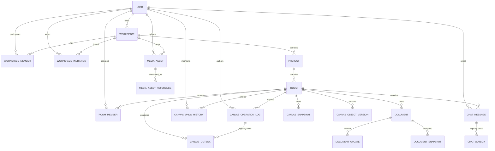

# Database Inventory & Domain Mapping

**Stage:** 0.3.2.1 — Database Inventory & Domain Mapping  
**Project:** Collaborative Visual Workspace  
**Baseline:** PRD v1.0.9, approved 2026-11-08; Stage 0.3.1 architecture documents  
**Status:** Pending Review  
**Evidence date:** 2026-11-08

## 1. Scope and baseline

This document establishes the verified starting point for Stage 0.3.2 Physical
Database Design. It inventories the repository's implemented persistence and
observable data models, maps the PRD/architecture domains, and identifies the
boundaries that later schema work must preserve.

This is an inventory, not a physical schema. It intentionally does not finalize
SQL types, indexes, migration ordering, partitioning, retention jobs, or grants.
All target entities and decisions copied from the PRD or Stage 0.3.1 remain
**proposed** unless explicitly marked as existing implementation.

Evidence labels used below:

- **Existing** — directly present in repository source/configuration.
- **Runtime unverified** — represented in source, but not proven against a
  running database or end-to-end deployment.
- **Proposed** — required or described by the PRD/architecture, but absent from
  the repository implementation.
- **Unresolved** — requires a decision in Stage 0.3.2.2 or later.

Inspected baseline files:

- [PRD.md](../product/PRD.md)
- [ARCHITECTURE_DESIGN.md](../architecture/ARCHITECTURE_DESIGN.md)
- [ARCHITECTURE_DECISIONS.md](../architecture/ARCHITECTURE_DECISIONS.md)
- [ARCHITECTURE_GAP_ANALYSIS.md](../architecture/ARCHITECTURE_GAP_ANALYSIS.md)
- [pom.xml](../../backend/pom.xml)
- [application.properties](../../backend/src/main/resources/application.properties)
- JPA entities, repositories, services, controllers, DTOs, WebSocket
  configuration, tests, and the React room/canvas components under `backend/`
  and `frontend/src/`.

The configured PostgreSQL endpoint is `localhost:5432/whiteboard_db`, and a TCP
reachability check to `localhost:5432` succeeded during this inventory. No
`psql` client is available in the environment, no schema-query command is
committed in the repository, and no credentials were used for an inspection
query. Consequently, the actual database tables and columns are **not verified
against the live database**. The source mappings below are the authoritative
repository evidence available for this stage.

## 2. Existing database implementation audit

### 2.1 Dependencies and configuration

| Area | Finding | Evidence/status |
|---|---|---|
| Database driver | PostgreSQL JDBC runtime dependency | Existing: `backend/pom.xml` |
| Persistence framework | Spring Data JPA / Hibernate | Existing: `backend/pom.xml` |
| Schema management | `spring.jpa.hibernate.ddl-auto=update` | Existing: `application.properties`; not a reviewed migration history |
| Database URL | `jdbc:postgresql://localhost:5432/whiteboard_db` | Existing configuration; local-development oriented |
| Migration tool | No Flyway or Liquibase dependency and no migration directory found | Not implemented |
| Application port | HTTP on `8080` | Existing configuration |
| Database verification | TCP port reachable; schema contents not queried | Runtime connectivity only, not schema verification |

### 2.2 JPA entities and repositories

| Existing entity/table | Key and mapped fields | Relationships | Status |
|---|---|---|---|
| `WhiteboardRoom` / `whiteboard_rooms` | `room_id` string PK, `created_at`, `updated_at` | No JPA relationship to state | Existing source mapping; live table not verified |
| `WhiteboardState` / `whiteboard_states` | `room_id` string PK, `data` `TEXT`, `updated_at` | Logical room association by shared ID; no declared FK | Existing source mapping; live table not verified |

`WhiteboardRoomRepository` and `WhiteboardStateRepository` are Spring Data
repositories keyed by the string room ID. There are no other JPA entities,
repositories, JDBC access objects, migration scripts, or explicit database
constraints in the repository.

`WhiteboardRoomService.createRoom()` creates a random eight-character room and
an initial `{"lines":[]}` state in one Spring transaction. It also contains a
legacy `room-1` compatibility path that can create a room row when a matching
state row exists. `WhiteboardStateController` validates and overwrites the
JSON text state; it accepts `lines` plus optional `shapes` and `texts`, with a
10,000-element limit. The current state save is not versioned and does not
write an operation log or outbox.

### 2.3 Current REST, WebSocket, and JSON models

| Surface | Current model and storage implication | Status |
|---|---|---|
| `POST /api/rooms` | Creates room metadata plus initial JSON state | Existing; unauthenticated |
| `GET /api/rooms/{roomId}` | Returns room ID and timestamps | Existing; no ownership/membership |
| `GET/PUT /api/rooms/{roomId}/state` | Reads/writes a JSON object with `lines`, optional `shapes`/`texts`; response exposes a JVM-local `roomVersion` on load | Existing; version is not durable |
| STOMP `/ws` with `/app` and `/topic` | Simple broker; draw, shape, edit, clear, undo, redo, presence, and cursor messages | Existing; no auth interceptor or durable publication |
| Draw/edit event models | Carry room ID, object identifiers/payloads, and sometimes `roomVersion`, `operationId`, `transactionId`, and client base version | Existing transport contracts; not a durable schema |
| Presence | `sessionId`, display name, joined timestamp in concurrent JVM maps | Existing ephemeral state; not a membership table |
| Canvas JSON | React/Konva state with lines, shapes, texts and export support | Existing legacy persistence model; not the proposed unified versioned JSONB snapshot |

`DrawController` keeps `roomVersions`, room history, redo stacks, and processed
request IDs in JVM memory. `EditController` keeps processed operation IDs in
JVM memory and broadcasts directly. These structures are lost on restart and
cannot coordinate multiple application instances. The current implementation
therefore does not establish durable `room_version`, idempotency, tombstones,
undo lineage, or commit-before-broadcast behavior.

### 2.4 Migration and database evidence conclusion

No committed SQL migration, schema dump, seed script, or database access
administration script was found. The repository's only schema-creation signal is
Hibernate `ddl-auto=update`. The Stage 0.3.1 statement that two JPA tables exist
is a source-level finding, not proof that a particular live database currently
contains exactly those tables or columns.

### 2.5 Room identity and compatibility boundary

The target model must distinguish two concepts:

- **Internal room identity (`room_id`)** — the stable identifier used by
  relationships, authorization, versioning, and persistence. Whether this is a
  string identifier compatible with the legacy model or a UUID-based identity
  remains unresolved until Stage 0.3.2.2.
- **Public room code (`room_code`)** — the user-facing join/share value. Its
  format, uniqueness scope, and whether it is generated from or independent of
  `room_id` remain unresolved.

The existing implementation conflates these concepts: `WhiteboardRoom.roomId`
is both the primary key and the public room value, and
`WhiteboardState.roomId` uses the same value. Any migration to separate
`room_id` and `room_code` must define how existing
`whiteboard_rooms.room_id`/`whiteboard_states.room_id` values are mapped,
whether legacy room URLs remain valid, and whether `room-1` receives a
compatibility mapping. This inventory does not select an identity strategy.

## 3. Domain boundary mapping

| Domain | Responsibility | Main entities | Relationships | Data owner / process | Current state |
|---|---|---|---|---|---|
| IAM | Users, sessions, authentication, revocation, RBAC context | `USER`, `USER_SESSION`, `DEVICE_IDENTITY` | User owns workspace, sessions, devices, authored content | Spring application / PostgreSQL | Proposed |
| Workspace | Workspace lifecycle, owner SSOT, archive/restore, invitations | `WORKSPACE`, `WORKSPACE_INVITATION` | Workspace contains members, projects, assets | Spring application | Proposed |
| Workspace Membership | Membership and inherited workspace roles | `WORKSPACE_MEMBER` | User ↔ Workspace; owner is not a member role | Spring authorization policy | Proposed |
| Project | Project lifecycle within a workspace | `PROJECT` | Workspace contains projects; project contains rooms | Spring application | Proposed |
| Room and Room Membership | Room identity/type, project placement, access and private overrides | `ROOM`, `ROOM_MEMBER` | Room belongs to project; private room may have explicit members | Spring application / PostgreSQL | Room exists partially; membership proposed |
| Visual Canvas | Canonical six-object canvas state and mutation application | `CANVAS_OBJECT_VERSION`, canvas snapshot data | Room owns objects and their durable metadata | Spring application / PostgreSQL | Legacy JSON and transport partial; target proposed |
| Canvas Operation Log | Ordered durable write-ahead history and replay range | `CANVAS_OPERATION_LOG` | Room/version, actor, target object | Spring application / PostgreSQL | Proposed; current history is JVM memory |
| Canvas Snapshot | Read/recovery boundary for full canvas state | `CANVAS_SNAPSHOT` | Room has snapshots; watermark references room version | Canvas persistence / snapshot worker | Proposed |
| Canvas Undo/Redo | Persistent per-user bounded compensating history and conflict guards | `CANVAS_UNDO_HISTORY` | Room and user; object/dependency provenance | Canvas persistence; Spring worker/service | Proposed; current stacks are JVM memory |
| Canvas Outbox | Post-commit, at-least-once canvas event publication with per-room HOL ordering | `CANVAS_OUTBOX` | Room and operation/version | Canvas transaction creates; background dispatcher publishes | Proposed |
| Collaborative Document / Yjs | Durable binary updates, revision sequence, snapshots, state vectors, projection | `DOCUMENT`, `DOCUMENT_UPDATE`, `DOCUMENT_SNAPSHOT` | Room hosts documents; updates/snapshots belong to document | Node Yjs sidecar is sole writer for Yjs data; Spring owns metadata | Proposed; sidecar absent |
| Chat and Chat Outbox | Authorized message history and independent publication/retry | `CHAT_MESSAGE`, `CHAT_OUTBOX` or `DOMAIN_OUTBOX` (choice unresolved) | Room/message sender/reply; outbox does not advance canvas version | Spring transaction creates; background dispatcher publishes | Proposed |
| Media Asset | Upload intent, quarantine, validation, trusted promotion, references | `MEDIA_ASSET`, `MEDIA_ASSET_REFERENCE` | Workspace owns assets; content entities reference assets | Spring metadata + object storage + media worker | Proposed |
| Background Processing | Dispatch, snapshot/compaction, scanning, cleanup and archive lifecycle | Worker execution state is not yet a finalized entity | Operates on canvas/chat/document/media/workspace records | Spring worker roles / PostgreSQL locks and object storage | Worker roles proposed; physical worker state unresolved |

### 3.1 Conceptual relationship map

This is conceptual only. It does not decide cascade behavior, nullable
relationships, cross-domain foreign keys, or the physical representation of
polymorphic references. The operation-log/outbox and message/outbox edges are
logical event-lineage relationships only; they do not assert that every source
row has exactly one outbox row or that a conventional foreign key will be used.
`MEDIA_ASSET_REFERENCE` points to a polymorphic target through logical
`entity_type`/`entity_id` identity. It is not a conventional foreign key to
every possible Canvas, Document, or Chat target table.

## 4. Entity inventory

| Proposed entity | Domain | Primary responsibility | Candidate PK | Important FK relationships | Important uniqueness | Soft delete / retention | Source |
|---|---|---|---|---|---|---|---|
| `USER` | IAM | Identity and account status | UUID | — | Email | Status/suspension; permanent deletion policy unresolved | PRD requirement |
| `USER_SESSION` | IAM | Refresh-token family and revocation | UUID | `user_id → USER` | Refresh-token hash | Revocation and expiry; cleanup policy unresolved | PRD requirement |
| `DEVICE_IDENTITY` | IAM | Optional device public keys for E2EE prototype | UUID | `user_id → USER` | `(user_id, device_id)` | No soft delete stated; lifecycle unresolved | PRD P1 / architecture proposal |
| `WORKSPACE` | Workspace | Workspace owner, lifecycle and archive state | UUID | `owner_id → USER` | Slug | Archive/restore; archive retention is 30 days in PRD | PRD requirement |
| `WORKSPACE_MEMBER` | Membership | Non-owner workspace role | UUID | Workspace and user | `(workspace_id, user_id)` | Membership removal is a state transition/policy decision | PRD requirement |
| `WORKSPACE_INVITATION` | Workspace | Invitation token and acceptance lifecycle | UUID | Workspace and inviter user | Token hash | Expiry, accepted, revoked; 48-hour token expiry | PRD requirement |
| `PROJECT` | Project | Named workspace container for rooms | UUID | `workspace_id → WORKSPACE` | `(workspace_id, name)` | Archive/restore; 30-day archive policy | PRD requirement |
| `ROOM` | Room | Internal room identity, public join code, type, project placement and canvas version boundary | Unresolved: string or UUID internal ID | `project_id → PROJECT` | Public room-code uniqueness/format unresolved | Archive/restore; private flag; 30-day archive policy | Existing room plus PRD/architecture proposal |
| `ROOM_MEMBER` | Room membership | Explicit access override for private rooms | UUID | Room and user | Candidate `(room_id, user_id)`; physical constraint later | Removal/revocation policy unresolved | PRD requirement |
| `CANVAS_OBJECT_VERSION` | Visual Canvas | Durable object version, provenance, dependencies and tombstones | UUID | Room and last modifying user | Candidate `(room_id, object_id)` assumes object IDs are only room-scoped; physical constraint later | Tombstones retained beyond operation-log cleanup | PRD v1.0.9 requirement |
| `CANVAS_SNAPSHOT` | Canvas Snapshot | Full unified object state at a room watermark | UUID | `room_id → ROOM` | Multiple snapshots allowed; latest watermark selection unresolved | Retention/compaction policy unresolved | PRD requirement |
| `CANVAS_OPERATION_LOG` | Operation Log | Ordered atomic canvas operations and replay | BIGSERIAL | Room, actor user | `(room_id, operation_id)`, `(room_id, room_version)` | Transient WAL; delete only after validated snapshot compaction | PRD requirement |
| `CANVAS_IDEMPOTENCY_LEDGER` | Canvas consistency | Durable operation deduplication after log cleanup | UUID | `room_id → ROOM` | `(room_id, operation_id)` | Seven-day TTL; not deleted with operation log | PRD requirement |
| `CANVAS_UNDO_HISTORY` | Undo/Redo | Per-user inverse/redo payload and durable conflict expectations | UUID | Room, user | `(room_id, user_id, operation_id)` | Bounded 50 operations/user/room and seven-day policy | PRD requirement |
| `CANVAS_OUTBOX` | Canvas Outbox | Ordered durable event handoff to STOMP broker | BIGSERIAL | Room and logical source operation/version | Candidate `(room_id, room_version)` assumes one publishable outbox event per room version; event cardinality remains unresolved | Published cleanup after 24 hours is proposed | PRD/OTD-02 proposal |
| `DOCUMENT` | Collaborative Document | Document metadata and revision boundary | UUID | `room_id → ROOM` | Not specified | Archive/restore; policy unresolved | PRD/OTD-01 proposal |
| `DOCUMENT_UPDATE` | Yjs | Incremental binary update at contiguous revision | BIGSERIAL | `document_id → DOCUMENT` | `(document_id, revision)` | Compacted after safe snapshot; retention unresolved | PRD/OTD-01 proposal |
| `DOCUMENT_SNAPSHOT` | Yjs | Binary Y.Doc, state vector and JSON projection | UUID | `document_id → DOCUMENT`, creator user | Multiple snapshots; watermark selection unresolved | Compaction retention unresolved | PRD/OTD-01 proposal |
| `CHAT_MESSAGE` | Chat | Durable room message history | UUID | Room, sender user, optional reply | Message identity; pagination index later | Edit/delete flags; retention unresolved | PRD requirement |
| `CHAT_OUTBOX` or `DOMAIN_OUTBOX` | Chat Outbox | Independent post-commit chat publication and retry | Candidate BIGSERIAL/UUID | Chat aggregate and room | Must be independent from canvas versioning | Retry/published cleanup unresolved | Architecture proposal; choice unresolved |
| `MEDIA_ASSET` | Media | Metadata and quarantine-to-READY lifecycle | UUID | Workspace and uploader user | Trusted storage key | Archive/orphan cleanup; READY gating | PRD/OTD-03 proposal |
| `MEDIA_ASSET_REFERENCE` | Media | Shared references and reference counting | UUID | Asset; logical polymorphic target, not a conventional FK to every target table | Candidate `(asset_id, entity_type, entity_id)` assumes one reference row per asset/target identity; enforcement strategy later | Reference removal; orphan delay unresolved | PRD requirement |

## 5. Relationship and consistency inventory

### 5.1 Ownership and access

- `WORKSPACE.owner_id` is the owner SSOT. `WORKSPACE_MEMBER.role` must not
  contain `OWNER`. Ownership transfer must atomically update the workspace owner,
  promote the former owner to `ADMIN`, and remove the new owner from the member
  role set.
- Project permissions inherit from workspace membership; no `PROJECT_MEMBER`
  domain is proposed for Workspace 1.0.
- Public rooms inherit workspace access. Private rooms require the dual check of
  workspace membership plus explicit `ROOM_MEMBER` access for ordinary members;
  workspace owners/admins retain administrative access.
- The legacy source has no user, workspace, project, owner, or membership
  relationship. Existing room creation is consequently unauthenticated and
  cannot satisfy the target ownership model.

### 5.2 Canvas consistency boundaries

- `ROOM.room_version` is the authoritative per-room canvas sequence. Allocation,
  operation insertion, idempotency ledger insertion, object-version/tombstone
  updates, undo-history updates, canonical/materialized Canvas state or
  projection updates, and canvas outbox creation must be designed as one Canvas
  mutation transaction where applicable. The exact physical representation and
  whether canonical state is stored as rows, JSON, or another projection remain
  for later design.
- A **canonical/materialized Canvas state or projection** is the authoritative
  current representation used by Canvas reads and conflict evaluation. A
  **checkpoint snapshot** is a recovery/compaction artifact containing a
  complete state at a recorded watermark. A mutation does not automatically
  require a new checkpoint snapshot; checkpoints may be produced by a worker
  according to a later cadence and safety policy.
- `CANVAS_OPERATION_LOG` is ordered by room version and may be compacted only
  after a validated snapshot watermark. The idempotency ledger survives log
  cleanup.
- `CANVAS_OBJECT_VERSION` is the durable authority for object conflict metadata,
  including parent/dependency versions, provenance, state hash, and tombstones.
  Checkpoint snapshot JSON is a read/recovery projection and must not become a
  competing metadata authority.
- Undo/redo is compensating durable history, not deletion or mutation of another
  user's original history. Conflict guards must use durable object/dependency
  versions after restart and compaction.

### 5.3 Outbox and publication

- Canvas and chat publication are separate consistency domains. Chat must never
  consume or advance `ROOM.room_version`.
- Canvas outbox dispatch is proposed to use a transaction-held advisory lock and
  strict per-room head-of-line retry ordering. A later event must not bypass an
  older pending/failed event.
- Both outboxes require at-least-once semantics, but broker handoff/confirmation
  is not proof that every client received an event. Client deduplication and
  replay are required.
- The candidate `(room_id, room_version)` uniqueness for `CANVAS_OUTBOX` assumes
  exactly one publishable event represents each Canvas room version. If one
  operation can produce multiple event envelopes, or if a version can produce a
  tombstone plus another event, a separate event identity/cardinality rule is
  required. This is an assumption, not a finalized SQL constraint.
- `CHAT_OUTBOX` versus a generalized `DOMAIN_OUTBOX`, and the independent chat
  sequence/aggregate key, remain unresolved physical design decisions.

### 5.4 Yjs, sidecar, and authorization

- Spring owns document business metadata and IAM/room policy.
- The Node Yjs sidecar is the sole writer for binary update rows, document
  revision allocation, binary snapshots, state vectors, and JSON projection.
  It must lock the document revision and insert each update in one transaction
  before ACK/broadcast.
- The sidecar must not write IAM, workspace membership, Canvas, or chat tables.
  Its database role must be least privilege. Whether it obtains room access
  through an authenticated Spring authorization API or restricted read-only
  membership access remains unresolved.
- A proposed alternative for revision locking is a sidecar-owned
  `YJS_DOCUMENT_STATE` (or equivalent) revision-head record. The sidecar could
  lock that record and allocate the next contiguous document revision in the
  same transaction as the update insert, without writing Spring-owned
  `DOCUMENT` metadata. This remains Proposed/Unresolved: the relationship to
  `DOCUMENT`, snapshot watermarking, grants, failure recovery, and whether a
  separate head duplicates or replaces the document revision field require
  Stage 0.3.2.2 design.
- Authorization is policy-owned by Spring but independently enforced at the
  sidecar boundary; a local signature check alone does not provide revocation.

### 5.5 Media and background processing

- Uploaded objects are untrusted while `STAGING`, `SCANNING`, or `REJECTED`.
  Application reads/renders must allow only `READY` assets.
- Quarantine storage, magic-byte validation, SVG sanitization, malware scanning,
  promotion, reference counting, and delayed orphan cleanup cross the database
  and object-store boundary. Atomic promotion and scanner failure behavior are
  later design items.
- Required worker roles are Canvas Outbox, Canvas Snapshot, Yjs Compaction,
  Media Scanning, Orphan Cleanup, and Archive Lifecycle. Worker deployment
  topology and durable execution/lease records are not yet finalized.

### 5.6 Candidate uniqueness assumptions

The candidate uniqueness items in the entity inventory are conceptual
invariants, not finalized SQL or index definitions:

- `CANVAS_OUTBOX (room_id, room_version)` assumes one outbox event per Canvas
  version. The final event cardinality model may require an event discriminator.
- `CANVAS_OBJECT_VERSION (room_id, object_id)` assumes a Canvas object ID is
  unique within a room and remains addressable while tombstoned. Global object
  IDs or object generations would change this assumption.
- `MEDIA_ASSET_REFERENCE (asset_id, entity_type, entity_id)` assumes one
  logical reference per asset and target identity. Because the target is
  polymorphic, the database cannot rely on a normal FK to every target table;
  application/domain validation or a later integrity mechanism is unresolved.

No item in this subsection finalizes SQL syntax, index shape, nullability, or
physical enforcement.

## 6. Data ownership matrix

| Data category | Authoritative owner | Allowed writer(s) | Read/access boundary | Consistency boundary |
|---|---|---|---|---|
| Identity/session/revocation | Spring IAM | Spring IAM only | Authenticated Spring APIs; sidecar receives bounded auth result/control | IAM transaction and revocation control path |
| Workspace owner/membership | Spring Workspace/IAM | Spring services | Authorization service and room checks | Workspace owner/member transaction |
| Project/room metadata | Spring Room/Project | Spring services | Authorized Spring APIs and sidecar authorization check | Project/room transaction |
| Room canvas version | Canvas persistence | Spring canvas command service | Canvas service/recovery APIs | Row lock + operation transaction |
| Canvas object conflict metadata/tombstones | `CANVAS_OBJECT_VERSION` | Canvas persistence only | Canvas conflict/recovery services | Atomic with mutation and snapshot projection |
| Canvas snapshot | Canvas snapshot worker/service | Canvas persistence/worker under room lock | Canvas load/recovery APIs | Snapshot watermark and continuity transaction |
| Canvas operation/idempotency/undo | Canvas persistence | Canvas command/undo service | Authorized canvas recovery/history APIs | Room version transaction; undo guard transaction |
| Canvas outbox | Canvas command transaction | Canvas persistence inserts; dispatcher status updates | Dispatcher and operational inspection | Commit before publication; per-room HOL |
| Document metadata | Spring Document module | Spring services | Authorized Spring APIs | Document metadata transaction |
| Yjs updates/revisions/snapshots/projection | Node Yjs sidecar | Sidecar/compaction role only | Sidecar protocol and authorized read APIs | Document row lock + contiguous revision |
| Chat history | Spring Chat module | Spring chat service | Authorized room members | Chat message transaction |
| Chat outbox | Background/outbox subsystem | Chat transaction inserts; dispatcher updates | Chat dispatcher | Independent chat ordering and commit-before-send |
| Media metadata/references | Spring Media module | Spring media service and worker | Workspace authorization; READY-only content reads | Asset state transition + reference transaction |
| Quarantine/trusted objects | Object storage plus media worker | Browser only to signed quarantine; worker promotes | Quarantine private; trusted reads require READY | Object validation/promotion plus metadata state |
| Presence/cursors | Realtime process (ephemeral) | STOMP presence/cursor handlers | Authorized live room subscribers | Session lifetime; no durable DB guarantee |

## 7. Existing versus proposed implementation matrix

| Capability | Existing implementation | Verified against DB | Proposed target |
|---|---|---|---|
| PostgreSQL connectivity/configuration | JDBC URL, driver, JPA config | TCP port only; schema not queried | Managed environment and explicit migration process |
| Room identity | `WhiteboardRoom` and room REST endpoints | No | `ROOM` owned by project/workspace with type, access and durable version |
| Canvas state | `WhiteboardState.data` as text JSON | No | Versioned unified JSONB snapshot |
| Canvas operations | In-memory controllers and direct broadcasts | No | Durable operation log, idempotency ledger, object versions and outbox |
| Room version | JVM `AtomicLong` | No | Locked `ROOM.room_version` |
| Undo/redo | JVM participant/room maps and deques | No | Persistent bounded `CANVAS_UNDO_HISTORY` with lineage/conflict guards |
| Presence/cursors | JVM concurrent maps and transient STOMP messages | No | Ephemeral realtime state with authoritative membership checks |
| IAM/workspace/project/membership | None found | No | PostgreSQL entities and Spring authorization |
| Chat/history/outbox | None found | No | Durable chat message plus independent outbox |
| Yjs/document | None found; no Yjs dependency | No | Node sidecar sole-writer persistence boundary |
| Media/quarantine | None found; no object-storage integration | No | Asset lifecycle, quarantine, worker validation and READY gate |
| Background workers | None found | No | Outbox, snapshot, compaction, scan, cleanup and archive roles |
| Migration files | None found | No | Flyway-managed reviewed migrations (PRD AC-8.1) |

## 8. Unresolved questions for Stage 0.3.2.2 onward

1. What is the legacy migration policy for `whiteboard_rooms` and
   `whiteboard_states`, including `room-1`, and is a compatibility reader
   required during cutover?
2. What is the target separation between internal `room_id` and public
   `room_code`? Should internal identity remain a string, become a UUID, or use
   a staged compatibility representation, and how are existing room IDs mapped?
3. Which exact foreign-key and archive/delete actions are safe for workspace,
   project, room, membership, content, and media records?
4. How is the owner/member invariant enforced physically during ownership
   transfer, including concurrent role changes?
5. What exact uniqueness and collision policy applies to room codes, operation
   IDs, versions, object IDs, document revisions, and chat sequencing?
6. What is the canonical/materialized Canvas projection, what is the separate
   checkpoint snapshot for recovery/compaction, and when may checkpoint creation
   occur relative to ordinary mutations?
7. Does each Canvas room version produce exactly one outbox event, or can one
   operation/version produce multiple event envelopes or explicit tombstones?
8. Should `CHAT_OUTBOX` be a dedicated table or should a generalized
   `DOMAIN_OUTBOX` be used, and what is the independent chat-room sequence?
9. Which snapshot retention and operation-log cleanup policy preserves gap
   recovery, undo lineage, tombstones, and the seven-day idempotency window?
10. What exact transaction/isolation and advisory-lock boundaries are required
    for canvas mutation, snapshot compaction, and repeatable-read gap resync?
11. Which physical representation owns canonical canvas object JSON versus
    conflict metadata, and how is atomic snapshot projection guaranteed?
12. How will the Yjs sidecar obtain current authorization: an authenticated
    Spring API or restricted read access to selected membership data?
13. Should a sidecar-owned `YJS_DOCUMENT_STATE` (or equivalent revision-head)
    record provide row locking and revision allocation without sidecar writes to
    Spring-owned `DOCUMENT` metadata?
14. Which database role/grant model prevents the sidecar from writing Spring,
    Canvas, chat, or membership data while allowing required document locks?
15. What are the document snapshot retention, projection versioning, binary
    size limits, and compaction failure/retry rules?
16. What durable worker lease/retry/observability records are needed, if any,
    beyond transaction locks and outbox status?
17. What are media upload-intent expiry, quarantine retention, scanner timeout,
    promotion atomicity, orphan cleanup, and reference-removal rules?
18. How will polymorphic `MEDIA_ASSET_REFERENCE` targets be validated and kept
    consistent without a conventional foreign key to every target table?
19. Which archive retention and permanent deletion rules apply to workspaces,
    projects, rooms, documents, messages, assets, and audit/security records?
20. What operational evidence will certify migrations on a blank PostgreSQL
    database and verify the live schema before Stage 0.3.2 completion?

## 9. Traceability

| Requirement/decision | Inventory impact |
|---|---|
| PRD product structure and ERD (§3.1) | Establishes the User → Workspace → Project → Room → Content hierarchy and candidate entities |
| PRD constraints (§3.2) | Supplies candidate keys, uniqueness, room version, retention and lifecycle rules; physical details remain for later design |
| PRD owner/RBAC model (§4) | Makes `WORKSPACE.owner_id` the owner SSOT and excludes `OWNER` from `WORKSPACE_MEMBER.role` |
| PRD canvas persistence (§5.1) | Requires snapshot, operation log, idempotency ledger, undo history, object versions and tombstones |
| PRD outbox/HOL rules (§5.2) | Separates canvas publication from chat and requires per-room ordered retry |
| PRD gap resync/consistency (§5.3–§5.4) | Requires stable room watermark, snapshot watermark, continuity checks and repeatable-read design |
| PRD Yjs ownership (§6.1 and §9.1) | Makes the sidecar sole writer for binary update/revision/snapshot/projection data |
| PRD media and worker requirements (§9.1) | Requires quarantine, READY gating, reference counting and background processing |
| PRD database acceptance criterion AC-8.1 | Requires future Flyway-created schema on a blank database; no migration is created here |
| OTD-01 — Yjs Runtime | Confirms sidecar boundary and least-privilege database role; remains Proposed |
| OTD-02 — Canvas Outbox Dispatcher | Confirms transaction-held advisory-lock recommendation and HOL ordering; remains Proposed |
| OTD-03 — Media Upload Architecture | Confirms presigned quarantine and trusted promotion boundary; remains Proposed |
| ARCHITECTURE_DESIGN §2–§4 | Confirms modular-monolith ownership, process placement, outbox separation and deployment boundaries |
| ARCHITECTURE_GAP_ANALYSIS §§1–§4 | Confirms current gaps: two JPA tables, text canvas state, JVM-local versions/history, and absent target modules |

## 10. Stage status

**Stage 0.3.2.1 — Pending Review.**

No application source code, SQL migration, PRD content, or database data was
modified by this inventory. The new document is a conceptual baseline only;
Stage 0.3.2.2 onward must resolve the questions above before physical schema
acceptance.
