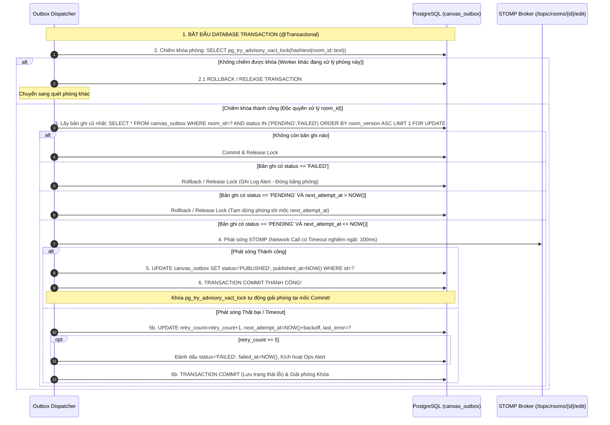
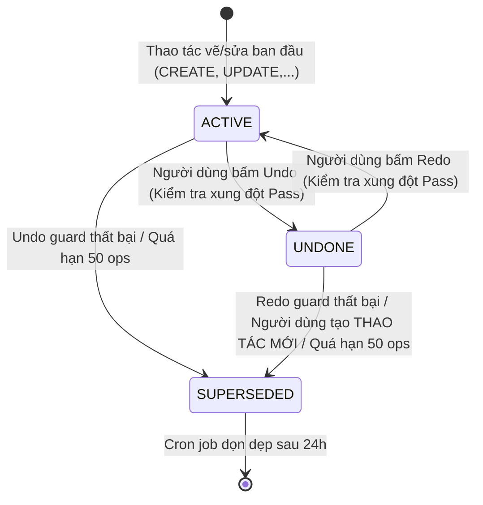

# PRODUCT REQUIREMENTS DOCUMENT (PRD)
# DỰ ÁN: COLLABORATIVE VISUAL WORKSPACE
**Phiên bản tài liệu:** 1.0.9  
**Ngày lập / Cập nhật:** 08/11/2026  
**Cơ sở kỹ thuật:** Báo cáo System Audit (Stage 0.1), Technical Review v1.0.1–v1.0.6 & Final PRD State-Machine & Event-Recovery Directives v1.0.7 & Final Snapshot Boundary & Undo Versioning Patch v1.0.8 & Final Consistency Patch v1.0.9  
**Trạng thái:** Chờ phê duyệt chính thức (Pending Final Approval)

---

## Lịch sử sửa đổi (Revision Summary)

| Phiên bản | Ngày | Người thực hiện | Tóm tắt các thay đổi chính |
| :---: | :---: | :---: | :--- |
| **1.0.0** | 08/11/2026 | System Architecture Team | Khởi tạo PRD tổng thể cho Collaborative Visual Workspace (Canva + Figma + Notion). |
| **1.0.1** | 08/11/2026 | System Architecture Team | Chuẩn hóa ERD chi tiết, ma trận RBAC, phân tầng Yjs persistence, E2EE scope, Media limits, Archive 30 ngày, NFR định lượng, Auth security. |
| **1.0.2** | 08/11/2026 | System Architecture Team | Thống nhất Canvas Snapshot + Operation Log, sửa Yjs compaction, thống nhất SSOT Owner, loại bỏ Billing, chốt 3 quyết định OQ-01, OQ-02, OQ-03. |
| **1.0.3** | 08/11/2026 | System Architecture Team | Bổ sung `room_version`, Transactional Outbox, Idempotency Ledger, Yjs watermark safety, sửa kế thừa RBAC, khởi tạo theo `room_type`, phân biệt VUs/RPS. |
| **1.0.4** | 08/11/2026 | System Architecture Team | Chuẩn hóa Yjs schema (bổ sung `DOCUMENT_UPDATE.revision`, `last_applied_revision`), khóa dòng `DOCUMENT.revision`, Outbox LISTEN/NOTIFY wakeup, rebase boundary, Yjs Sidecar standard, Media quarantine status, benchmark k6 100 RPS. |
| **1.0.5** | 08/11/2026 | System Architecture Team | Sửa replay idempotency snapshot $(last\_applied, watermark]$, bổ sung bảng `CANVAS_UNDO_HISTORY`, tuần tự hóa outbox theo phòng, quản lý retry state outbox, chính xác hóa rebase boundary, nhất quán media quarantine, benchmark k6 arrival-rate. |
| **1.0.6** | 08/11/2026 | System Architecture Team | Sửa lỗi Head-of-Line Retry Ordering của Outbox, chọn Option A Transaction-held Advisory Lock, mở rộng `CANVAS_UNDO_HISTORY`, benchmark k6 phân tách Read/Write/Snapshot, chuẩn hóa Presigned POST Policy S3, Schema Versioned Unified Objects cho Canvas Snapshot, kiểm thực tính liên tục khi replay snapshot. |
| **1.0.7** | 08/11/2026 | System Architecture Team | **Bản vá Trạng thái & Khôi phục Sự kiện Toàn diện Cuối cùng (Final State-Machine & Event-Recovery Patch v1.0.7):**<br>- **Sửa Thứ tự LIFO của Redo Stack:** Điều chỉnh truy vấn Redo thành `ORDER BY last_action_room_version DESC, room_version DESC` để khôi phục đúng thao tác vừa bị Undo gần nhất (chuẩn LIFO); giữ nguyên truy vấn Undo theo `room_version DESC`; cập nhật `last_action_room_version` sau mỗi lần Undo/Redo; chuyển trạng thái từ `UNDONE` sang `ACTIVE`; thực hiện nguyên tử trong 1 transaction.<br>- **Khử Trùng lặp Sự kiện Phía Client Đa tầng (Version-Based Client Deduplication):** Bổ sung quy tắc kiểm tra `event.room_version <= last_contiguous_applied_version` bên cạnh `operationId`, loại bỏ hoàn toàn sự kiện trùng lặp khi client nạp Snapshot mà không lưu giữ toàn bộ danh sách `operationId` trong bộ nhớ.<br>- **Đồng bộ Bù đắp Hổng Phiên bản Nhận biết Snapshot (Snapshot-Aware Gap Resync):** Khi client yêu cầu dải operations đã bị dọn dẹp khỏi log do nén snapshot, API trả về cấu trúc `HISTORY_COMPACTED` kèm watermark snapshot; client tự động nạp snapshot mới, reset local version và áp dụng tiếp các operations liên tục.<br>- **Ngữ nghĩa Xung đột Toàn cục cho CLEAR & Quan hệ Phụ thuộc:** Cấm hoàn tác `CLEAR` nếu có bất kỳ thao tác nào diễn ra sau đó (`current_room_version > clear_room_version`); kiểm tra toàn bộ đối tượng con phụ thuộc khi Undo Frame/Group; từ chối Undo nếu đối tượng con bị sửa/xóa.<br>- **Tường minh hóa Vòng đời Khóa Advisory Cho Snapshot & Yjs Compaction:** Chuẩn hóa việc sử dụng Transaction-level Advisory Lock `pg_try_advisory_xact_lock` cho cả Snapshot Worker và Yjs Compaction Worker (chiếm khóa đầu transaction, thực thi kiểm tra liên tục, ghi dữ liệu, xóa log, tự động giải phóng khi commit/rollback); giải quyết triệt để rủi ro rò rỉ khóa trong connection pool và xử lý crash an toàn.<br>- **Ngân sách Hiệu năng Giao dịch Outbox (Option A Budget):** Làm rõ mốc 100ms trên STOMP send là Failure Bound (ngưỡng giới hạn lỗi mạng tối đa); ngân sách xử lý thông thường của Dispatcher là `< 30ms` (DB lock/fetch 5ms, broker send 15–20ms, commit 5ms), thỏa mãn chỉ tiêu Transit Latency P95 < 80ms; định cỡ connection pool HikariCP (30–50 connections) và transaction timeout (2s); cam kết At-Least-Once Delivery kết hợp Client Version Deduplication.<br>- **Mở rộng Bộ Tiêu chí Nghiệm thu:** Bổ sung kiểm thử 2 thao tác LIFO Redo, kiểm thử xung đột Undo CLEAR / Frame (AC-5.2); kiểm thử thông lượng 15 clients @ 2 ops/s (30 ops/s per room) với backlog chặn trên (AC-5.9); kiểm thử khử trùng lặp sau khi nạp snapshot (AC-5.10); kiểm thử bù đắp hổng phiên bản khi lịch sử đã bị nén (AC-5.12). |
| **1.0.8** | 08/11/2026 | System Architecture Team | **Bản vá Ranh giới Snapshot Cuối cùng & Versioning Undo (Final Snapshot Boundary & Undo Versioning Patch v1.0.8):**<br>- Chuẩn hóa gap resync theo `since >= snapshot.last_applied_version`, kiểm tra đầy đủ và liên tục dải `(since, currentVersion]`, hỗ trợ dải rỗng, trả về watermark snapshot cùng `currentVersion` ổn định, và ngăn client tải lặp cùng Snapshot khi dải đã khả dụng.<br>- Bổ sung metadata version bền vững cho từng Canvas object, expected object/dependency version và tombstone để Undo/Redo vẫn phát hiện xung đột sau khi Operation Log bị dọn dẹp hoặc server restart.<br>- Áp dụng conflict guard đối xứng cho Redo CLEAR để không ghi đè công việc cộng tác viên sau Undo CLEAR.<br>- Làm rõ `PUBLISHED` chỉ phản ánh broker confirmation/handoff theo semantics đã chọn, không tuyên bố mọi WebSocket client đã nhận; giữ At-Least-Once và version deduplication.<br>- Mở rộng AC-5.2 và AC-5.12 bằng các kịch bản boundary, gap, cleanup và conflict có thể kiểm chứng. |
| **1.0.9** | 08/11/2026 | System Architecture Team | **Bản vá Nhất quán Cuối cùng (Final Consistency Patch v1.0.9):**<br>- Bắt buộc Gap Resync dùng một read-only PostgreSQL `REPEATABLE READ` snapshot cho Snapshot watermark, `ROOM.room_version`, Operation Log và kiểm tra continuity; bổ sung xử lý `since > currentVersion` và các kịch bản cạnh tranh với Snapshot Worker.<br>- Định nghĩa durable version lineage cho Undo/Redo, gồm actor/operation provenance, refresh metadata nguyên tử sau compensating operations, và kiểm tra parent-child Frame/Group sau compaction/restart.<br>- Sửa state machine để remote operation không tự động xóa history của user khác; chỉ chuyển `SUPERSEDED` khi conflict guard của Undo/Redo thất bại.<br>- Chốt ownership của object conflict metadata, đồng bộ nguyên tử với Snapshot JSONB, tombstone persistence và composite uniqueness.<br>- Bổ sung pass/fail k6 cho `checks` và `http_req_failed`, cùng tiêu chí backlog Outbox có thể đo được cho AC-5.9. Không tuyên bố implementation hoặc test đã hoàn tất. |

---

## 1. Product Vision

### 1.1 Tầm nhìn sản phẩm (Product Vision)
**Collaborative Visual Workspace** là nền tảng không gian làm việc trực quan cộng tác thời gian thực (Real-time Collaborative Workspace Platform), tích hợp liền mạch giữa tư duy thiết kế đồ họa trực quan (Visual Canvas), trao đổi nội bộ bảo mật (Secure Room Chat), soạn thảo tài liệu phân cấp (Block-based Document) và quản lý tài nguyên tập trung (Media Assets).

Dự án phát triển kế thừa từ nền tảng **Real-time Collaborative Whiteboard** (đã kiểm chứng hoàn thành các chức năng bảng vẽ cốt lõi: vẽ nét tự do, tẩy, xóa bảng, 4 hình khối cơ bản, chữ, chọn/di chuyển/scale/xoay đối tượng, undo/redo cá nhân, presence, live cursors và xuất file PNG/PDF trong giai đoạn Stage 0.1).

### 1.2 Triết lý kết hợp và Định vị sản phẩm
Sản phẩm hội tụ và chắt lọc các điểm mạnh từ ba nền tảng cộng tác tiêu biểu:
- **Canva (Visual Design & Asset Reuse):** Trải nghiệm kéo thả trực quan, quản lý thư viện hình ảnh/asset dùng chung, template mẫu, giao diện thân thiện, dễ tiếp cận cho người dùng phổ thông.
- **Figma (Real-time Canvas Collaboration & Precision):** Khả năng cộng tác trực tuyến thời gian thực mượt mà (Multiplayer Canvas), hiển thị con trỏ chuột trực tiếp (Live Cursors), phân lớp đối tượng (Layers), nhóm đối tượng (Group/Ungroup), đóng khung phân vùng làm việc (Frames/Sections).
- **Notion (Block-based Documents & Knowledge Structuring):** Trình soạn thảo tài liệu cấu trúc dạng khối linh hoạt (Block-based Document), hỗ trợ định dạng phong phú (Headings, Checklists, Quotes, Tables, Code Blocks) và khả năng nhúng Canvas 2 chiều (Bidirectional Embeds).

> [!IMPORTANT]
> **Định vị phạm vi phù hợp nguồn lực:** Sản phẩm không hướng tới việc sao chép toàn bộ bộ tính năng khổng lồ của Canva, Figma hay Notion. Trọng tâm của phiên bản **Workspace 1.0** là tích hợp mượt mà một Canvas trực quan hiệu năng cao, một Document Editor dạng khối không xung đột qua Yjs CRDT, một hệ thống Chat bảo mật phân cấp, và tổ chức dữ liệu chặt chẽ theo cấu trúc `User -> Workspace -> Project -> Room`.

---

## 2. Target Users & User Personas

| Nhóm người dùng | Chân dung & Bối cảnh | Nhu cầu chính (Core Needs) | Vấn đề sản phẩm giải quyết (Pain Points Solved) |
| :--- | :--- | :--- | :--- |
| **1. Cá nhân quản trị Workspace** | Trưởng nhóm (Team Leader), Project Manager, Freelancer quản lý nhiều dự án độc lập. | - Tạo và kiểm soát không gian làm việc riêng biệt.<br>- Phân quyền truy cập chính xác (RBAC).<br>- Giám sát tiến độ và tài nguyên của các dự án. | - Xóa bỏ tình trạng phân mảnh thông tin giữa các công cụ chat rời rạc và bảng vẽ không định danh.<br>- Kiểm soát quyền sở hữu dữ liệu tập trung. |
| **2. Nhóm sinh viên & Nhóm dự án Agile** | Sinh viên làm đồ án tốt nghiệp, nhóm kỹ thuật làm việc nhóm từ xa, startup tinh gọn. | - Brainstorming ý tưởng trên Canvas nhanh chóng.<br>- Soạn thảo tài liệu đặc tả (SRS/PRD) chung.<br>- Trao đổi nhanh trong từng phòng làm việc. | - Không phải chuyển đổi qua lại giữa Google Docs, Miro và Discord/Zalo.<br>- Đồng bộ thời gian thực không độ trễ, lưu trữ tự động. |
| **3. Nhóm thiết kế & Sáng tạo nội dung** | UI/UX Designer, Graphic Creator, Marketing Content Writer. | - Phác thảo Wireframe, Mindmap, Moodboard.<br>- Quản lý thư viện hình ảnh và asset dùng chung.<br>- Xuất bản thiết kế chuẩn xác sang định dạng ảnh/PDF. | - Thư viện Asset dùng chung giữa Canvas và Document.<br>- Phản hồi và để lại comment/chat trực tiếp trên không gian làm việc. |
| **4. Đội ngũ cộng tác chia sẻ thông tin** | Các phòng ban chức năng, nhóm nghiên cứu cần chia sẻ ghi chú và báo cáo. | - Soạn thảo văn bản dạng khối trực quan.<br>- Nhúng hình vẽ minh họa hoặc sơ đồ tư duy vào tài liệu.<br>- Bảo mật thông tin trao đổi nội bộ. | - Hỗ trợ cộng tác thời gian thực không bị ghi đè văn bản.<br>- Kênh chat bảo mật cao, kiểm soát thành viên nghiêm ngặt. |

---

## 3. Product Structure & Domain Model

Khắc phục hoàn toàn hạn chế của giai đoạn tiền thân (nơi mỗi Room là một bảng vẽ trôi nổi độc lập không có chủ sở hữu và không có phân cấp), kiến trúc sản phẩm tổ chức theo mô hình cây thực thể 5 tầng:

$$\mathbf{User} \longrightarrow \mathbf{Workspace} \longrightarrow \mathbf{Project} \longrightarrow \mathbf{Room} \longrightarrow \mathbf{Content}$$

### 3.1 Sơ đồ Thực thể Quan hệ (Entity-Relationship Diagram - ERD)

```mermaid
erDiagram
    USER ||--o{ USER_SESSION : "maintains"
    USER ||--o{ DEVICE_IDENTITY : "owns (E2EE)"
    USER ||--o{ WORKSPACE : "owns (owner_id)"
    USER ||--o{ WORKSPACE_MEMBER : "participates in"
    USER ||--o{ WORKSPACE_INVITATION : "sends"
    USER ||--o{ ROOM_MEMBER : "assigned in private room"
    USER ||--o{ CANVAS_UNDO_HISTORY : "maintains undo stack"
    USER ||--o{ CHAT_MESSAGE : "posts"
    USER ||--o{ MEDIA_ASSET : "uploads"

    WORKSPACE ||--o{ WORKSPACE_MEMBER : "has members"
    WORKSPACE ||--o{ WORKSPACE_INVITATION : "issues"
    WORKSPACE ||--o{ PROJECT : "contains"
    WORKSPACE ||--o{ MEDIA_ASSET : "owns assets"

    PROJECT ||--o{ ROOM : "contains"

    ROOM ||--o{ ROOM_MEMBER : "has private members"
    ROOM ||--o{ CANVAS_SNAPSHOT : "has periodic snapshots"
    ROOM ||--o{ CANVAS_OPERATION_LOG : "records atomic ops"
    ROOM ||--o{ CANVAS_OUTBOX : "buffers events for delivery"
    ROOM ||--o{ CANVAS_IDEMPOTENCY_LEDGER : "preserves deduplication"
    ROOM ||--o{ CANVAS_UNDO_HISTORY : "preserves user undo stack"
    ROOM ||--o{ CANVAS_OBJECT_VERSION : "preserves durable object versions and tombstones"
    ROOM ||--o{ DOCUMENT : "hosts"
    ROOM ||--o{ CHAT_MESSAGE : "logs"

    DOCUMENT ||--o{ DOCUMENT_SNAPSHOT : "has snapshots"
    DOCUMENT ||--o{ DOCUMENT_UPDATE : "has incremental updates"

    MEDIA_ASSET ||--o{ MEDIA_ASSET_REFERENCE : "referenced by"

    USER {
        uuid id PK
        string email UK
        string password_hash
        string display_name
        string avatar_url
        string status "ACTIVE | SUSPENDED"
        timestamp created_at
        timestamp updated_at
    }

    CANVAS_OBJECT_VERSION {
        uuid id PK
        string room_id FK
        string object_id "Canvas object UUID, including deleted objects"
        string object_type "STROKE | SHAPE | TEXT | FRAME | STICKY_NOTE | IMAGE | GROUP"
        bigint last_modified_room_version "Durable object watermark"
        string last_modified_operation_id "Durable provenance of latest mutation"
        uuid last_modified_by FK "Actor of latest mutation"
        bigint tombstone_room_version "Version of deletion, nullable"
        boolean is_deleted
        string state_hash "Hash of persisted object state"
        jsonb dependency_versions "Parent Frame/Group version watermarks"
        timestamp created_at
        timestamp updated_at
    }

    USER_SESSION {
        uuid id PK
        uuid user_id FK
        string refresh_token_hash UK
        uuid family_id "For RTR reuse detection"
        string device_info
        string ip_address
        timestamp expires_at
        timestamp revoked_at
        timestamp created_at
    }

    DEVICE_IDENTITY {
        uuid id PK
        uuid user_id FK
        string device_id "Unique per user device"
        text public_identity_key "Ed25519"
        text public_prekey "X25519"
        text signed_prekey "X25519 signature"
        timestamp last_seen_at
        timestamp created_at
    }

    WORKSPACE {
        uuid id PK
        string name
        string slug UK
        string description
        uuid owner_id FK "Single Source of Truth for Owner"
        boolean is_archived
        timestamp archived_at
        timestamp created_at
        timestamp updated_at
    }

    WORKSPACE_MEMBER {
        uuid id PK
        uuid workspace_id FK
        uuid user_id FK
        string role "ADMIN | MEMBER | VIEWER"
        timestamp joined_at
        timestamp updated_at
    }

    WORKSPACE_INVITATION {
        uuid id PK
        uuid workspace_id FK
        uuid inviter_id FK
        string email
        string role "ADMIN | MEMBER | VIEWER"
        string token_hash UK
        timestamp expires_at
        timestamp accepted_at
        timestamp revoked_at
        timestamp created_at
    }

    PROJECT {
        uuid id PK
        uuid workspace_id FK
        string name
        string description
        boolean is_archived
        timestamp archived_at
        timestamp created_at
        timestamp updated_at
    }

    ROOM {
        string room_id PK "8 chars Base58"
        uuid project_id FK
        string name
        string room_type "CANVAS | DOC | HYBRID"
        bigint room_version "Monotonically increasing canvas version, default 0"
        boolean is_private "False=Inherits, True=Explicit RoomMember"
        boolean is_archived
        timestamp archived_at
        timestamp created_at
        timestamp updated_at
    }

    ROOM_MEMBER {
        uuid id PK
        string room_id FK
        uuid user_id FK
        string role_override "ADMIN | EDITOR | VIEWER"
        timestamp added_at
    }

    CANVAS_SNAPSHOT {
        uuid id PK
        string room_id FK
        jsonb snapshot_data "Full unified canvas objects state, including lastModifiedRoomVersion and tombstones"
        bigint last_applied_version "Room version watermark"
        timestamp created_at
    }

    CANVAS_OPERATION_LOG {
        bigserial id PK
        string room_id FK
        string operation_id "Client UUID for idempotency"
        bigint room_version "Monotonically increasing sequence"
        bigint client_base_version "Version client based its op on"
        string operation_type "CREATE | UPDATE | DELETE | TRANSFORM | MOVE | CLEAR | UNDO | REDO"
        string undone_operation_id "Referenced operation ID for UNDO/REDO"
        string object_type "STROKE | SHAPE | TEXT | FRAME | STICKY_NOTE | IMAGE"
        string object_id "Target entity UUID"
        jsonb payload "Op attributes / deltas"
        uuid applied_by FK "Actor user ID"
        timestamp created_at
    }

    CANVAS_OUTBOX {
        bigserial id PK
        string room_id FK
        string operation_id "Idempotent event UUID"
        bigint room_version "Monotonic version"
        string event_type "DRAW | SHAPE | TEXT | EDIT | CLEAR | UNDO | REDO"
        jsonb payload "Event body"
        string status "PENDING | PUBLISHED | FAILED"
        int retry_count "Delivery attempts"
        timestamp last_attempt_at "Timestamp of last broadcast attempt"
        timestamp next_attempt_at "Scheduled retry timestamp"
        text last_error "Error diagnostic message"
        timestamp failed_at "Timestamp when permanently failed"
        timestamp created_at
        timestamp published_at
    }

    CANVAS_IDEMPOTENCY_LEDGER {
        uuid id PK
        string room_id FK
        string operation_id "Deduplication key per room"
        bigint room_version "Associated version"
        timestamp expires_at "Retention TTL: 7 days"
        timestamp created_at
    }

    CANVAS_UNDO_HISTORY {
        uuid id PK
        string room_id FK
        uuid user_id FK
        string operation_id "Target original operation UUID"
        string undo_operation_id "Compensating UNDO operation UUID"
        string redo_operation_id "Compensating REDO operation UUID"
        bigint room_version "Original room version (Undo sequence)"
        bigint last_action_room_version "Version when undone or redone (Redo LIFO sequence)"
        string target_object_id "Object affected"
        string operation_type "CREATE | UPDATE | DELETE | TRANSFORM | MOVE | CLEAR"
        jsonb inverse_payload "Compensating state/delta to invert"
        jsonb redo_payload "Payload to re-apply"
        bigint expected_object_version "Durable object version after original operation"
        jsonb expected_dependency_versions "Expected parent Frame/Group versions"
        string expected_state_hash "Expected persisted object state hash"
        string state "ACTIVE | UNDONE | SUPERSEDED"
        timestamp created_at
        timestamp updated_at
    }

    DOCUMENT {
        uuid id PK
        string room_id FK
        string title
        bigint revision "Monotonically increasing contiguous revision, default 0"
        boolean is_archived
        timestamp archived_at
        timestamp created_at
        timestamp updated_at
    }

    DOCUMENT_SNAPSHOT {
        uuid id PK
        uuid document_id FK
        bigint last_applied_revision "Watermark of contiguous included revisions"
        bytea state_vector "Vector Clock for sync diff"
        bytea snapshot_data "Full binary Y.Doc snapshot"
        jsonb json_projection "Rendered blocks for search/preview"
        uuid created_by FK
        timestamp created_at
    }

    DOCUMENT_UPDATE {
        bigserial id PK
        uuid document_id FK
        bigint revision "Sequential revision per document"
        bytea update_data "Incremental binary Yjs update"
        timestamp created_at
    }

    CHAT_MESSAGE {
        uuid id PK
        string room_id FK
        uuid sender_id FK
        text content "Plaintext or Ciphertext"
        boolean is_encrypted
        uuid reply_to_id FK
        boolean is_edited
        boolean is_deleted
        jsonb metadata
        timestamp created_at
        timestamp updated_at
    }

    MEDIA_ASSET {
        uuid id PK
        uuid workspace_id FK
        uuid uploader_id FK
        string file_name
        string storage_key UK "Trusted S3/MinIO Object Key"
        string staging_storage_key "Temporary key during quarantine"
        bigint file_size
        string mime_type
        string sha256_hash
        string status "STAGING | SCANNING | READY | REJECTED"
        boolean is_archived
        timestamp archived_at
        timestamp created_at
    }

    MEDIA_ASSET_REFERENCE {
        uuid id PK
        uuid asset_id FK
        string entity_type "CANVAS | DOCUMENT | CHAT"
        string entity_id "Target entity identifier"
        timestamp created_at
    }
```



### 3.2 Bảng đặc tả Ràng buộc & Toàn vẹn Dữ liệu (Constraints Specification)

| Thực thể | Khóa chính (PK) | Khóa ngoại (FK) | Khóa duy nhất (Unique Constraints) | Quy tắc toàn vẹn & Index |
| :--- | :--- | :--- | :--- | :--- |
| `USER` | `id` (UUID) | Không | `email` | Index trên `email`. Mật khẩu băm BCrypt (Cost 12). |
| `USER_SESSION` | `id` (UUID) | `user_id` $\rightarrow$ `USER(id)` | `refresh_token_hash` | Index `(user_id, family_id)`. Xóa cascade khi User bị xóa vĩnh viễn. |
| `DEVICE_IDENTITY` | `id` (UUID) | `user_id` $\rightarrow$ `USER(id)` | `(user_id, device_id)` | Khóa công khai Ed25519/X25519 cho E2EE prototype (P1). |
| `WORKSPACE` | `id` (UUID) | `owner_id` $\rightarrow$ `USER(id)` | `slug` | **Single Source of Truth cho Owner:** `owner_id`. Slug chuẩn URL (lowercase). |
| `WORKSPACE_MEMBER` | `id` (UUID) | `workspace_id` $\rightarrow$ `WORKSPACE(id)`<br>`user_id` $\rightarrow$ `USER(id)` | `(workspace_id, user_id)` | Role chỉ chứa `ADMIN`, `MEMBER`, `VIEWER`. Owner được xác định bởi `Workspace.owner_id`. |
| `WORKSPACE_INVITATION` | `id` (UUID) | `workspace_id`, `inviter_id` | `token_hash` | Token mời hết hạn sau 48h. Index tra cứu theo `token_hash`. |
| `PROJECT` | `id` (UUID) | `workspace_id` $\rightarrow$ `WORKSPACE(id)` | `(workspace_id, name)` | Tên dự án là duy nhất trong cùng Workspace. Kế thừa quyền từ Workspace. |
| `ROOM` | `room_id` (VARCHAR 50) | `project_id` $\rightarrow$ `PROJECT(id)` | Không | Mã phòng 8 ký tự Base58. `room_version BIGINT NOT NULL DEFAULT 0`. Khóa dòng `FOR UPDATE` khi cấp version. |
| `ROOM_MEMBER` | `id` (UUID) | `room_id` $\rightarrow$ `ROOM(room_id)`<br>`user_id` $\rightarrow$ `USER(id)` | `(room_id, user_id)` | **Chỉ áp dụng khi `ROOM.is_private = true`**. |
| `CANVAS_SNAPSHOT` | `id` (UUID) | `room_id` $\rightarrow$ `ROOM(room_id)` | Không | Index `(room_id, last_applied_version DESC)` để lấy snapshot mới nhất. |
| `CANVAS_OPERATION_LOG`| `id` (BIGSERIAL) | `room_id` $\rightarrow$ `ROOM(room_id)` | `(room_id, operation_id)`<br>`(room_id, room_version)` | **Idempotency:** Ngăn trùng op. **Monotonic Order:** Thứ tự tuần tự per-room. WAL tạm thời, được dọn dẹp sau snapshot. |
| `CANVAS_OUTBOX` | `id` (BIGSERIAL) | `room_id` $\rightarrow$ `ROOM(room_id)` | `(room_id, room_version)` | Ngăn duplicate outbox per version. Index `(room_id, status, room_version ASC)` và `(status, created_at ASC)`. Dọn dẹp bản ghi `PUBLISHED` sau 24 giờ. |
| `CANVAS_IDEMPOTENCY_LEDGER`| `id` (UUID) | `room_id` $\rightarrow$ `ROOM(room_id)` | `(room_id, operation_id)` | Lưu vết dedup 7 ngày (TTL); không bị xóa khi dọn Operation Log. |
| `CANVAS_UNDO_HISTORY` | `id` (UUID) | `room_id` $\rightarrow$ `ROOM(room_id)`<br>`user_id` $\rightarrow$ `USER(id)` | `(room_id, user_id, operation_id)` | **Tách biệt khỏi Operation Log.** Undo: `room_version DESC`. Redo: `last_action_room_version DESC, room_version DESC`. Bounded window: tối đa **50 operations / user / room** và TTL 7 ngày (1–55 giữ 6–55, loại bỏ 1–5). Index `(room_id, user_id, state, last_action_room_version DESC, room_version DESC)`. |
| `CANVAS_OBJECT_VERSION` | `id` (UUID) | `room_id` $\rightarrow$ `ROOM(room_id)`<br>`last_modified_by` $\rightarrow$ `USER(id)` | `(room_id, object_id)` | **Nguồn dữ liệu durable authoritative duy nhất** cho conflict metadata: `last_modified_room_version`, `last_modified_operation_id`, `last_modified_by`, `state_hash`, `dependency_versions`, `is_deleted`, `tombstone_room_version`. `CANVAS_SNAPSHOT.snapshot_data` chỉ là bản chiếu state phục vụ replay/read; khi metadata được ghi trong snapshot, phải đồng bộ nguyên tử trong cùng transaction với bảng này. Không xóa tombstone khi dọn Operation Log. |
| `DOCUMENT` | `id` (UUID) | `room_id` $\rightarrow$ `ROOM(room_id)` | Không | `revision BIGINT NOT NULL DEFAULT 0`. Khóa dòng `FOR UPDATE` để tuần tự hóa update, triệt tiêu revision gap. |
| `DOCUMENT_SNAPSHOT` | `id` (UUID) | `document_id` $\rightarrow$ `DOCUMENT(id)` | Không | Lưu nhị phân snapshot `BYTEA`, State Vector và JSON projection. Watermark `last_applied_revision BIGINT NOT NULL`. |
| `DOCUMENT_UPDATE` | `id` (BIGSERIAL) | `document_id` $\rightarrow$ `DOCUMENT(id)` | `(document_id, revision)` | Index `(document_id, revision ASC)`. `id` là khóa thay thế (surrogate key). `revision` tăng đơn điệu liên tục per document. |
| `CHAT_MESSAGE` | `id` (UUID) | `room_id`, `sender_id`, `reply_to_id` | Không | Index `(room_id, created_at DESC)` cho Cursor Pagination. |
| `MEDIA_ASSET` | `id` (UUID) | `workspace_id`, `uploader_id` | `storage_key` | State machine `status` (`STAGING | SCANNING | READY | REJECTED`). Index `(workspace_id, status)`. |
| `MEDIA_ASSET_REFERENCE` | `id` (UUID) | `asset_id` $\rightarrow$ `MEDIA_ASSET(id)` | `(asset_id, entity_type, entity_id)` | **Reference Counting:** Ngăn ngừa xóa nhầm file vật lý đang được dùng chung. |

---

## 4. RBAC & Owner Model (Mô hình Quyền hạn & Sở hữu Thống nhất)

### 4.1 Nguồn Dữ liệu Duy nhất cho Owner (Single Source of Truth)
- **Thiết kế dứt điểm:** Trường `Workspace.owner_id` (FK $\rightarrow$ `USER(id)`) là **nguồn dữ liệu duy nhất (Single Source of Truth - SSOT)** xác định Chủ sở hữu Workspace.
- Bảng `WORKSPACE_MEMBER` chỉ lưu các thành viên thông thường với vai trò: `ADMIN`, `MEMBER`, hoặc `VIEWER`. Bảng này **KHÔNG** chứa role `OWNER` nhằm triệt tiêu hoàn toàn nguy cơ bất đồng bộ dữ liệu giữa hai bảng.
- **Kiểm tra quyền tại Service & Authorization Layer:**
  ```java
  public boolean isOwner(UUID workspaceId, UUID userId) {
      return workspaceRepository.findById(workspaceId)
              .map(ws -> ws.getOwnerId().equals(userId))
              .orElse(false);
  }
  ```
- **Chuyển giao Quyền sở hữu (Ownership Transfer):**
  - Thực hiện trong một Database Transaction duy nhất (`@Transactional`):
    1. Cập nhật `workspace.owner_id = newOwnerId`.
    2. Thêm hoặc cập nhật cựu Owner thành `ADMIN` trong bảng `WORKSPACE_MEMBER`.
    3. Xóa `newOwnerId` khỏi bảng `WORKSPACE_MEMBER` (vì Owner đã được quản lý ở bảng `WORKSPACE`).

### 4.2 Cơ chế Kế thừa & Phân cấp (Permission Inheritance)
1. **Kế thừa cấp Project (Project-level Inheritance):**
   - Phiên bản Workspace 1.0 **KHÔNG** tạo bảng `ProjectMember`. Quyền tại Project kế thừa 100% từ quyền tại Workspace:
     - Workspace `OWNER` / `ADMIN` $\rightarrow$ Toàn quyền quản trị Project và tạo/xóa Room bên trong (`ADMIN`).
     - Workspace `MEMBER` $\rightarrow$ Chỉnh sửa và tạo nội dung trong các Room được cấp quyền (`EDITOR`). **Workspace Member KHÔNG ĐƯỢC tự tạo Room mới trong Workspace 1.0**.
     - Workspace `VIEWER` $\rightarrow$ Chỉ được xem Project và Room (`VIEWER`).
2. **Kế thừa cấp Room (Room-level Inheritance):**
   - **Phòng Công khai (`ROOM.is_private = false`):** Kế thừa trực tiếp quyền của User từ Workspace.
   - **Phòng Riêng tư (`ROOM.is_private = true`):**
     - Thành viên Workspace thông thường (`MEMBER`, `VIEWER`) **KHÔNG THỂ** nhìn thấy hoặc truy cập vào phòng.
     - **Chính sách Quản trị tối cao:** Workspace `OWNER` và Workspace `ADMIN` luôn có quyền quản trị, kiểm duyệt và truy cập vào Private Room nhằm ngăn ngừa thất thoát dữ liệu tổ chức.
     - Người dùng thông thường chỉ được vào phòng nếu có bản ghi gán quyền tường minh trong bảng `ROOM_MEMBER`. Vai trò trong `ROOM_MEMBER` (`ADMIN`, `EDITOR`, `VIEWER`) sẽ ghi đè (override) vai trò kế thừa chỉ trong phạm vi phòng đó.
     - **Quy tắc Kiểm tra Kép (Dual-Check Rule):** Khi kiểm tra quyền vào Private Room, hệ thống bắt buộc kiểm tra đồng thời: User **PHẢI LÀ thành viên còn hoạt động của Workspace** VÀ **thuộc `ROOM_MEMBER`**. Một bản ghi `ROOM_MEMBER` cũ còn sót lại **tuyệt đối không thể bypass** quyền khi user đã bị xóa khỏi Workspace.
3. **Xử lý Thu hồi & Hạ quyền (Permission Revocation):**
   - Khi quyền của người dùng bị thu hồi hoặc hạ cấp:
     - Cache quyền trên RAM/Redis bị xóa tức thì.
     - WebSocket `StompChannelInterceptor` sẽ từ chối ngay lập tức mọi bản tin `SEND` hoặc `SUBSCRIBE` tiếp theo từ session đang hoạt động (`403 Forbidden`).
     - Server chủ động phát một STOMP disconnect frame để đóng kết nối của client bị thu hồi trong vòng `< 1 giây`.

### 4.3 Ma trận Phân quyền Workspace 1.0 (RBAC Matrix)

| Quyền hạn hệ thống | Owner | Admin | Member (Editor) | Viewer |
| :--- | :---: | :---: | :---: | :---: |
| Chuyển quyền sở hữu Workspace / Xóa vĩnh viễn Workspace | ✅ | ❌ | ❌ | ❌ |
| Đổi tên, mô tả Workspace / Lưu trữ (Archive) Workspace | ✅ | ✅ | ❌ | ❌ |
| Mời thành viên mới vào Workspace / Thu hồi lời mời | ✅ | ✅ | ❌ | ❌ |
| Đổi Role thành viên (Admin, Member, Viewer) / Xóa thành viên | ✅ | ✅ | ❌ | ❌ |
| Tạo, sửa tên, lưu trữ (Archive) Project | ✅ | ✅ | ❌ | ❌ |
| Tạo Room mới (Canvas, Doc) / Đổi loại phòng | ✅ | ✅ | ❌ | ❌ |
| Cấu hình Private Room & Phân quyền `ROOM_MEMBER` | ✅ | ✅ | ❌ | ❌ |
| Vẽ, tạo/sửa/xóa đối tượng trên Canvas | ✅ | ✅ | ✅ | ❌ |
| Soạn thảo, chỉnh sửa khối văn bản trên Document (CRDT) | ✅ | ✅ | ✅ | ❌ |
| Gửi tin nhắn Chat / Tải tệp đính kèm | ✅ | ✅ | ✅ | ❌ |
| Tải ảnh/tài liệu lên Media Library | ✅ | ✅ | ✅ | ❌ |
| Ghim tin nhắn Chat / Thu hồi tin nhắn của người khác | ✅ | ✅ | ❌ | ❌ |
| Xem nội dung Canvas, Đọc Document, Đọc Chat | ✅ | ✅ | ✅ | ✅ |
| Xem danh sách thành viên Online / Live Cursors | ✅ | ✅ | ✅ | ✅ |
| Xuất bản vẽ sang PNG / PDF | ✅ | ✅ | ✅ | ✅ |

---

## 5. Canvas Persistence, Concurrency & Transactional Delivery

### 5.1 Kiến trúc Lưu trữ: Snapshot + Operation Log + Idempotency Ledger + Undo History
```
┌────────────────────────────────────────────────────────────────────────┐
│  CANVAS PERSISTENCE ARCHITECTURE                                       │
│                                                                        │
│  1. CANVAS_SNAPSHOT (PostgreSQL JSONB - Versioned Unified Objects)    │
│     - Bản chụp toàn bộ cây đối tượng Canvas tại last_applied_version   │
│     - Nạp nhanh khi mở phòng hoặc khi server khởi động lại             │
│                                                                        │
│  2. CANVAS_OPERATION_LOG (Sequential Transient WAL)                    │
│     - Ghi nhận mọi thao tác nguyên tử (room_version tăng đơn điệu)     │
│     - Replay vi sai và phục hồi; dọn dẹp sau khi snapshot commit       │
│                                                                        │
│  3. CANVAS_IDEMPOTENCY_LEDGER (Deduplication Store - TTL 7 ngày)       │
│     - Lưu vết (room_id, operation_id, room_version)                    │
│     - KHÔNG BỊ XÓA khi dọn Operation Log -> Bảo toàn idempotency        │
│                                                                        │
│  4. CANVAS_UNDO_HISTORY (Bounded User Undo Stack - Max 50 ops/user)    │
│     - Lưu trữ inverse_payload/redo_payload độc lập với Operation Log   │
│     - Giới hạn 50 thao tác/user/room, sống sót sau server restart      │
└────────────────────────────────────────────────────────────────────────┘
```

1. **Monotonically Increasing `room_version`:**
   - Trường `ROOM.room_version` (BIGINT) là số hiệu phiên bản Canvas chính thức per-room.
   - Cấp số hiệu và ghi nhận thao tác thực hiện trong **cùng một Database Transaction duy nhất**.
   - Áp dụng khóa dòng độc quyền:
     ```sql
     SELECT room_version FROM rooms WHERE room_id = ? FOR UPDATE;
     ```
     Đảm bảo server tuần tự hóa tuyệt đối, không bao giờ cấp trùng version giữa các luồng ghi đồng thời.
2. **Object Types hỗ trợ (Đầy đủ 6 đối tượng P0):** `STROKE | SHAPE | TEXT | FRAME | STICKY_NOTE | IMAGE`.

### 5.2 Kiến trúc Outbox: Khắc phục Lỗi Head-of-Line Retry Ordering, Vòng đời Khóa & Deduplication Đa tầng

#### A. Phân tích Giới hạn của `SKIP LOCKED` và Nguy cơ Đảo Thứ tự Sự kiện
Theo tài liệu chuẩn của PostgreSQL, cú pháp `FOR UPDATE SKIP LOCKED` được thiết kế có chủ đích nhằm bỏ qua các dòng đang bị khóa bởi transaction khác để trả về góc nhìn hàng đợi không nhất quán giữa các worker đồng thời. **`SKIP LOCKED` hoàn toàn không bảo đảm thứ tự tuần tự per-room.** Nếu hai sự kiện của cùng một phòng (ví dụ version 11 và version 12) cùng chờ xử lý: Worker A khóa version 11, Worker B bỏ qua version 11 và khóa version 12, dẫn đến nguy cơ version 12 bị phát sóng trước version 11.

Hơn nữa, nếu câu truy vấn lọc trực tiếp điều kiện thời gian:
```sql
-- LỖI BỎ QUA SỰ KIỆN CŨ (Head-of-Line Bug trong các thiết kế ngây thơ)
SELECT * FROM canvas_outbox 
WHERE room_id = ? AND status = 'PENDING' AND (next_attempt_at <= NOW()) 
ORDER BY room_version ASC;
```
Khi version 11 gặp lỗi tạm thời và có `next_attempt_at` trong tương lai (đang lùi giờ thử lại), trong khi version 12 mới phát sinh có `next_attempt_at <= NOW()`, câu truy vấn sẽ bỏ qua version 11 và phát sóng version 12 trước. Điều này phá vỡ tính tuần tự và làm hỏng chuỗi đồng bộ trên client.

#### B. Quy tắc Bắt buộc: Head-of-Line Retry Ordering per Room
1. **Xác định Bản ghi Cũ nhất Chưa Hoàn thành (Oldest Incomplete Event):** Dispatcher bắt buộc phải truy vấn bản ghi có `room_version` nhỏ nhất chưa hoàn tất trong phòng, **bất kể thời gian thử lại của nó đã đến hay chưa**:
   ```sql
   SELECT * FROM canvas_outbox 
   WHERE room_id = ? 
     AND status IN ('PENDING', 'FAILED') 
   ORDER BY room_version ASC 
   LIMIT 1 
   FOR UPDATE;
   ```
2. **Chặn Đầu Hàng Đợi (Head-of-Line Blocking):**
   - Nếu bản ghi cũ nhất có `status = 'PENDING'`:
     - Nếu `next_attempt_at IS NULL OR next_attempt_at <= NOW()`: Bản ghi hợp lệ để phát sóng ngay.
     - Nếu `next_attempt_at > NOW()`: Thời gian giãn cách thử lại chưa tới. Dispatcher **BẮT BUỘC DỪNG XỬ LÝ PHÒNG NÀY NGAY LẬP TỨC** và giải phóng khóa để nhường tài nguyên. **Tuyệt đối không một sự kiện nào có version lớn hơn được phép vượt mặt bản ghi đang chờ thử lại!**
   - Nếu bản ghi cũ nhất có `status = 'FAILED'`:
     - Toàn bộ luồng phát sóng của phòng đó **BỊ ĐÓNG BĂNG HOÀN TOÀN**. Không sự kiện nào phía sau được phát cho đến khi sự cố được khắc phục.
3. **Quy trình Xử lý Vận hành cho Sự kiện `FAILED` (Operational Recovery Procedures):**
   - **Cách 1 - Thử lại Thủ công (Manual Replay):** Quản trị viên kiểm tra `last_error`, sửa lỗi hạ tầng kết nối/credentials của STOMP Broker, sau đó gọi Admin API:
     ```http
     POST /api/admin/outbox/{id}/replay
     ```
     để đặt lại `status = 'PENDING'`, `retry_count = 0`, `next_attempt_at = NOW()`.
   - **Cách 2 - Sửa lỗi Dữ liệu (Corrected Retry):** Nếu payload bị lỗi định dạng, tiến trình bảo trì cập nhật payload hợp lệ và đặt lại trạng thái chờ phát.
   - **Cách 3 - Bỏ qua có Hòa giải Tường minh (Reconciliation Tombstone):** **Tuyệt đối không bao giờ âm thầm xóa hoặc nhảy cóc số hiệu `room_version`** (vì sẽ tạo khoảng trống version khiến client không thể rebase). Nếu một sự kiện buộc phải hủy bỏ, hệ thống phải phát một sự kiện giả lập không thao tác (*Tombstone / No-Op Event*) với đúng số hiệu `room_version` đó, hoặc kích hoạt cờ buộc toàn bộ client trong phòng nạp lại snapshot mới.
4. **Bảo toàn Xử lý Song song Giữa các Phòng (Cross-Room Parallelism):** Sự tắc nghẽn hoặc đóng băng của Room A không ảnh hưởng tới Room B. Các phòng khác nhau được khóa và xử lý hoàn toàn độc lập, song song.

#### C. Lựa chọn Kiến trúc: Option A — Transaction-held Advisory Lock
Nhằm bảo đảm tính tin cậy tuyệt đối và đơn giản hóa trong Workspace 1.0, hệ thống chuẩn hóa **Option A (Khóa Advisory cấp Transaction)** với biên giao dịch và vòng đời tường minh:



- **Cam kết Toàn vẹn Vòng đời Khóa:** Giao dịch Database mở xuyên suốt toàn bộ quá trình: Chiếm khóa $\rightarrow$ Đọc bản ghi $\rightarrow$ Phát sóng STOMP $\rightarrow$ Cập nhật Outbox $\rightarrow$ Commit. Khóa Advisory cấp Transaction (`_xact_lock`) được bảo đảm giữ liên tục và chỉ được giải phóng tự động khi Database Transaction kết thúc.
- **Triệt tiêu Stale Dispatcher:** Không một Dispatcher thứ hai nào có thể chiếm quyền của phòng hoặc phát sóng một version mới hơn trong khi Dispatcher thứ nhất đang xử lý phiên bản trước đó.
- **Xử lý Crash:** Nếu server hoặc worker bị tắt đột ngột trong khi đang gọi STOMP: PostgreSQL tự động hủy connection, rollback transaction và giải phóng khóa. Bản ghi outbox vẫn giữ nguyên `PENDING`. Worker tiếp theo nhặt lại và phát sóng lại; client deduplicate an toàn nhờ `appliedOperationIds` và `last_contiguous_applied_version`.

#### D. Ngân sách Hiệu năng Giao dịch Outbox & Định cỡ Hạ tầng (Performance Budget)
- **Failure Bound vs. Normal Target:** Mốc timeout **100 ms** cho lệnh gửi mạng tới STOMP Broker là **Failure Bound (ngưỡng giới hạn lỗi mạng tối đa)** nhằm ngắt giao dịch khi broker bị đơ, tuyệt đối không phải là mục tiêu độ trễ thông thường.
- **Ngân sách Thời gian Xử lý Thông thường (Normal-Case Processing Budget):**
  - Truy vấn DB + chiếm khóa phòng: $\le 5\text{ ms}$.
  - Kiểm tra logic trong RAM: $\le 1\text{ ms}$.
  - Phát sóng STOMP Broker (mạng nội bộ/LAN): $\le 15 - 20\text{ ms}$.
  - Cập nhật `canvas_outbox` + Commit DB Transaction: $\le 5\text{ ms}$.
  - **Tổng ngân sách xử lý của Dispatcher:** $\le \mathbf{30\text{ ms}}$ cho mỗi sự kiện trong điều kiện vận hành bình thường, bảo đảm biên độ an toàn tuyệt đối cho chỉ tiêu **Transit Latency P95 < 80 ms** tại NFR Mục 8.1.
- **Quy mô Connection Pool & Quản trị Tải:**
  - Transaction giữ ngắn, chỉ xử lý **1 sự kiện tại một thời điểm cho từng phòng**.
  - Kích thước HikariCP connection pool (30–50 connections) và transaction timeout (2s) được định cỡ để xử lý đồng thời nhiều phòng mà không gây cạn kiệt pool.
  - Phân tích rủi ro timeout/mất kết nối: Nếu broker nhận bản tin nhưng connection DB bị đứt trước commit, outbox sẽ phát lại khi phục hồi. Hệ thống là **At-Least-Once Delivery**, không cam kết Exactly-Once tại broker; tính chính xác tuyệt đối được bảo đảm nhờ cơ chế Version-based Client Deduplication.

#### D.1. Ngữ nghĩa PUBLISHED và Xác nhận Broker (Outbox Delivery Semantics)
- `PUBLISHED` chỉ được ghi sau khi ứng dụng đã hoàn tất handoff tới lớp Spring messaging và nhận được semantics xác nhận của broker đã chọn. Nó **không** có nghĩa mọi WebSocket client đã nhận hoặc đã xử lý event.
- Với broker hỗ trợ receipt/confirmation, Dispatcher phải chờ cơ chế receipt/confirmation phù hợp trước khi ghi `PUBLISHED`. Nếu dùng Spring Simple Broker, PRD chỉ coi việc handoff nội bộ thành công là confirmation giới hạn; Simple Broker không cung cấp xác nhận giao tới từng client và giới hạn này phải được ghi rõ trong Stage 0.3.
- Lựa chọn broker cụ thể vẫn để mở dưới **OTD-04**. Client recovery luôn dựa trên Snapshot bền vững + Operation Log; Dispatcher giữ At-Least-Once attempts và client deduplicate theo version/`operationId`. Không tuyên bố Exactly-Once delivery tới từng client.

#### E. Khử Trùng lặp Sự kiện Phía Client Đa tầng (Version-Based Client Deduplication)
Việc chỉ dựa vào tập `appliedOperationIds` trong RAM client là không đủ khi client vừa nạp một Snapshot mới (snapshot chứa nhiều operations cũ nhưng client không lưu giữ toàn bộ UUIDs đó trong RAM). Để khắc phục triệt để, client áp dụng **Quy tắc Khử trùng lặp Đa tầng**:
1. **Quy tắc 1 (Đã phản ánh trong Snapshot/State):** Nếu `event.room_version <= last_contiguous_applied_version`, client lập tức **bỏ qua sự kiện** mà không thực hiện bất kỳ thao tác vẽ lại hay cập nhật state nào.
2. **Quy tắc 2 (Sự kiện kế tiếp hợp lệ):** Nếu `event.room_version == last_contiguous_applied_version + 1`, client áp dụng sự kiện lên Canvas, ghi nhận `operationId` vào tập dedup, và tăng `last_contiguous_applied_version = event.room_version`.
3. **Quy tắc 3 (Phát hiện Hổng phiên bản):** Nếu `event.room_version > last_contiguous_applied_version + 1`, client tạm thời đưa sự kiện vào hàng đợi đệm (Out-of-order Buffer) và kích hoạt tiến trình bù đắp hổng phiên bản (Gap Resynchronization).
4. **Quy tắc 4 (Khử lặp bổ trợ):** Sử dụng `operationId` làm khóa kiểm tra phụ trợ chống lặp cho các event đến trong cùng phiên làm việc.
5. **Quy tắc 5 (Bảo toàn Version):** Tuyệt đối không bao giờ áp dụng cùng một `room_version` hai lần lên Canvas.

#### F. Đồng bộ Bù đắp Hổng Phiên bản Nhận biết Snapshot (Snapshot-Aware Canvas Gap Resync)
Khi client kích hoạt Gap Resynchronization, tiến trình diễn ra như sau:
1. Client gửi yêu cầu:
   ```http
   GET /api/rooms/{roomId}/canvas/operations?since={last_contiguous_applied_version}
   ```
2. **Kiểm tra Phía Server:**
   - Endpoint Gap Resync bắt buộc mở một **read-only PostgreSQL transaction với isolation `REPEATABLE READ`** trước mọi truy vấn. Trong cùng transaction snapshot đó, server phải đọc `CANVAS_SNAPSHOT.last_applied_version`, `ROOM.room_version` làm `currentVersion`, các dòng `CANVAS_OPERATION_LOG` trong **`(since, currentVersion]`**, và thực hiện kiểm tra continuity/duplicate-version. Không được ghép watermark trước compaction với Operation Log sau compaction.
   - Nếu transaction bắt đầu trước Snapshot Worker commit, request thấy snapshot watermark cũ và toàn bộ operation range tương ứng của cùng database snapshot. Nếu bắt đầu sau commit, request thấy watermark mới và trả `HISTORY_COMPACTED` khi `since < snapshotWatermark`. Snapshot Worker chạy đồng thời không được làm request khỏe báo `OPERATION_RANGE_GAP` giả; request chỉ đánh giá dữ liệu trong snapshot isolation của chính nó.
   - Nếu `since > currentVersion`, server không trả dải rỗng thành công; trả lỗi có cấu trúc `CLIENT_VERSION_AHEAD` (HTTP `409 Conflict`) gồm `currentVersion` và `snapshotWatermark`. Client phải dừng áp dụng range, cập nhật/reconcile local version theo `currentVersion` bằng Gap Resync hoặc nạp Snapshot theo quy trình recovery đã định, rồi gửi request mới với `since <= currentVersion`.
   - Server đọc một lần `snapshot.last_applied_version` và khóa một `currentVersion` ổn định cho batch trả về. Nếu `since >= snapshot.last_applied_version`, request được phép tiếp tục; server bắt buộc kiểm tra mọi version kỳ vọng trong khoảng **`(since, currentVersion]`** xuất hiện đúng một lần và theo thứ tự tăng dần liên tục trong `CANVAS_OPERATION_LOG`.
   - *Trường hợp A (Dải đầy đủ):* Nếu kiểm tra thành công, server trả về các operations theo thứ tự `room_version ASC`, cùng `snapshotWatermark = snapshot.last_applied_version` và `currentVersion`. Dải rỗng khi `since == currentVersion` là hợp lệ và trả về `operations: []`. Client áp dụng tuần tự từng operation, nâng `last_contiguous_applied_version`, sau đó xả hàng đợi đệm (buffer).
   - *Trường hợp B (Lịch sử đã bị nén - Snapshot Compacted):* Nếu `since < snapshot.last_applied_version`, server trả về mã lỗi `409 Conflict` (hoặc `410 Gone`) kèm cấu trúc JSON chuẩn:
     ```json
     {
       "error": "STALE_ROOM_VERSION",
       "code": "HISTORY_COMPACTED",
       "currentVersion": 150,
       "snapshotWatermark": 100
     }
     ```
   - *Trường hợp C (Dải bắt buộc bị hổng):* Nếu `since >= snapshot.last_applied_version` nhưng khoảng `(since, currentVersion]` thiếu version, có version trùng, hoặc không tăng liên tục, server không trả về dải không đầy đủ mà trả lỗi resynchronization có cấu trúc, ví dụ:
     ```json
     {
       "error": "RESYNC_REQUIRED",
       "code": "OPERATION_RANGE_GAP",
       "currentVersion": 150,
       "snapshotWatermark": 100,
       "missingVersions": [127]
     }
     ```
     Client không được tải lại Snapshot chỉ vì lỗi này nếu `since >= snapshotWatermark`; client phải thử lại cùng watermark sau khi server khắc phục dải log, hoặc chuyển sang quy trình vận hành được chỉ định. Với `since == snapshotWatermark` và `since == snapshotWatermark + 1`, quy tắc kiểm tra vẫn áp dụng tương ứng.
3. **Phản ứng của Client khi gặp `HISTORY_COMPACTED`:**
   - Client gọi ngay API nạp snapshot mới nhất:
     ```http
     GET /api/rooms/{roomId}/canvas/snapshot
     ```
   - Client nạp lại toàn bộ đối tượng canvas từ snapshot mới, reset `last_contiguous_applied_version = snapshotWatermark` (ví dụ 100).
   - Client gọi tiếp API lấy các operations phát sinh sau snapshot (`since=100` đến `currentVersion`); không tải lại Snapshot khi request mới đã thỏa `since >= snapshotWatermark`.
   - Trong suốt thời gian nạp snapshot, các live events nhận qua STOMP vẫn được giữ trong buffer và chỉ được xả sau khi client đã đạt tới trạng thái liên tục.
   - **Cam kết Toàn vẹn:** Tuyệt đối không bao giờ âm thầm coi một dải operations thiếu là hoàn tất.

### 5.3 Xử lý Xung đột và Ranh giới Lịch sử Rebase (Canvas Conflict & History Boundary)
Khi client gửi thao tác với `client_base_version < currentVersion`:
1. **Nguyên lý Mốc Lịch sử (History Retention Boundary):**
   - Mối quan hệ tương quan giữa 3 mốc: `snapshot.last_applied_version`, chuỗi operations được giữ lại trong `CANVAS_OPERATION_LOG`, và `client_base_version` của client.
   - Khi Snapshot Worker chạy, các operations có `room_version <= snapshot.last_applied_version` sẽ được dọn dẹp khỏi log. Chuỗi operations còn tồn tại trong log bắt đầu từ `snapshot.last_applied_version + 1`.
   - **Trường hợp A (Đủ điều kiện Rebase):**  
     Nếu `client_base_version >= snapshot.last_applied_version` VÀ toàn bộ operations trong khoảng `(client_base_version, currentVersion]` đều có mặt đúng một lần, liên tục và tăng dần trong `CANVAS_OPERATION_LOG` (với `currentVersion` là boundary ổn định của batch):  
     Server cho phép client kéo các operations vi sai này về để tính toán rebase an toàn (nếu không vi phạm quy tắc xung đột phụ thuộc).
   - Dải rỗng khi `client_base_version == currentVersion` là hợp lệ. Với `client_base_version == snapshot.last_applied_version` hoặc `client_base_version == snapshot.last_applied_version + 1`, server vẫn phải kiểm tra dải tương ứng và không dùng `earliest_retained_version` thay thế watermark snapshot.
   - **Trường hợp B (Lịch sử đã bị nén - Từ chối Rebase):**  
     Nếu `client_base_version < snapshot.last_applied_version` (tức phiên bản gốc của client đã bị nén vào snapshot cũ và đã bị dọn khỏi log):  
     Server lập tức từ chối thao tác với mã lỗi:
     ```json
     {
       "error": "STALE_ROOM_VERSION",
       "code": "HISTORY_COMPACTED",
       "currentVersion": 150,
       "snapshotWatermark": 100
     }
     ```
   - Nếu `client_base_version >= snapshot.last_applied_version` nhưng phát hiện gap, trùng bản ghi hoặc thứ tự không liên tục trong dải bắt buộc, server trả `RESYNC_REQUIRED` / `OPERATION_RANGE_GAP` với `snapshotWatermark`, `currentVersion` và các version thiếu; không trả dữ liệu không đầy đủ và không tự động nạp lại cùng Snapshot.
     Client phải thực hiện quy trình resynchronization có cấu trúc; chỉ nạp Snapshot khi server trả `HISTORY_COMPACTED` hoặc quy trình vận hành xác định watermark đã không còn khả dụng. Không nạp lặp cùng Snapshot khi `since >= snapshotWatermark`.
2. **Quy tắc Xung đột Phụ thuộc (Conflict Dependency Rules):**
   - *Xung đột trên cùng đối tượng:* Thao tác sửa đổi trên cùng một `target_object_id` bị chặn rebase tự động.
   - *Xung đột Xóa:* Nếu đối tượng mục tiêu đã bị người khác xóa (`DELETE`), cấm rebase tự động.
   - *Xung đột Toàn cục (`CLEAR`):* Thao tác `CLEAR` xung đột với toàn bộ thao tác đối tượng đang chờ.
   - *Xung đột Phụ thuộc Khung / Nhóm:* Thay đổi trên Frame cha hoặc Group cha bắt buộc tính toán tới các đối tượng con phụ thuộc.
   - **Nguyên tắc cốt lõi:** Chỉ những thao tác mà đối tượng mục tiêu và các quan hệ phụ thuộc hoàn toàn không bị ảnh hưởng mới được phép tự động rebase tọa độ và retry. Nếu có xung đột trực tiếp, client hủy bỏ thao tác local, giữ nguyên trạng thái mới từ server và hiển thị thông báo: *"Đối tượng đã được cập nhật bởi thành viên khác"*.

### 5.4 Cơ chế Snapshot Worker & Vòng đời Khóa Advisory Tường minh (Advisory Lock Lifecycle)

#### A. Tường minh Hóa Vòng đời Khóa Advisory của Snapshot Worker
Để ngăn chặn hoàn toàn rò rỉ khóa (lock leak) trong connection pool HikariCP và bảo đảm khóa tự động giải phóng khi crash, hệ thống chuẩn hóa **Transaction-Level Advisory Lock** cho Snapshot Worker:

```
┌────────────────────────────────────────────────────────────────────────┐
│  SNAPSHOT WORKER TRANSACTION-LEVEL ADVISORY LOCK LIFECYCLE            │
│                                                                        │
│  1. Bắt đầu Giao dịch: @Transactional(propagation = REQUIRES_NEW)      │
│  2. Chiếm Khóa Phòng:                                                  │
│     SELECT pg_try_advisory_xact_lock(hashtext(room_id::text));         │
│     -> Nếu false: Thoát ngay lập tức (Worker khác đang chạy phòng này) │
│     -> Nếu true: Độc quyền thực thi snapshot cho room_id               │
│  3. Thực thi Thao tác Bảo vệ:                                          │
│     a. Nạp snapshot gần nhất (last_applied_version)                    │
│     b. Nạp operations vi sai strictly newer                            │
│     c. KIỂM THỰC LIÊN TỤC (Contiguity Validation: vi+1 = vi + 1)       │
│        -> Nếu vi phạm: Rollback transaction & Báo động khẩn cấp        │
│     d. Áp dụng operations lên snapshot data (Unified Objects)          │
│     e. Ghi bản ghi mới vào CANVAS_SNAPSHOT                             │
│     f. Xóa log cũ: DELETE FROM canvas_operation_log <= watermark       │
│  4. Kết thúc Giao dịch: COMMIT TRANSACTION                             │
│     -> Khóa pg_try_advisory_xact_lock TỰ ĐỘNG GIẢI PHÓNG TỨC THÌ       │
│                                                                        │
│  * Xử lý Sự cố & Connection Pooling:                                  │
│    - Rollback giải phóng khóa tự động.                                 │
│    - Process sập nguồn/ngắt mạng: PostgreSQL giải phóng khóa ngay.    │
│    - Connection trả về HikariCP pool hoàn toàn sạch sẽ, không giữ lock.│
└────────────────────────────────────────────────────────────────────────┘
```

#### B. Quy trình Kiểm thực Tính Liên tục Khi Replay (Contiguity Validation)
1. **Lựa chọn Watermark:** Snapshot Worker chỉ chọn `watermark_version` là mốc version đã được commit đầy đủ vào Database:
   ```sql
   SELECT room_version FROM rooms WHERE room_id = ?;
   ```
2. **Kiểm thực Tính Liên tục Bắt buộc:**
   - Worker nạp snapshot gần nhất: `existing_snapshot = SELECT * FROM canvas_snapshots WHERE room_id = ? ORDER BY last_applied_version DESC LIMIT 1`.
   - Worker nạp danh sách operations strictly newer:
     ```sql
     SELECT * FROM canvas_operation_log 
     WHERE room_id = ? 
       AND room_version > :existingLastAppliedVersion 
       AND room_version <= :watermarkVersion 
     ORDER BY room_version ASC;
     ```
   - **Kiểm tra Tính Liên tục (Strict Contiguity Guard):**
     - Worker duyệt qua danh sách operations và kiểm tra: $v_1 = \text{existingLastAppliedVersion} + 1$, $v_{i+1} = v_i + 1$, và $v_n = \text{watermarkVersion}$.
     - Nếu phát hiện bất kỳ **khoảng trống nào ($v_{i+1} > v_i + 1$) hoặc bản ghi trùng lặp**: Worker **LẬP TỨC HỦY BỎ (ABORT) TIẾN TRÌNH SNAPSHOT**, rollback transaction (tự giải phóng khóa), không ghi dữ liệu mới, không xóa log cũ, và phát đi cảnh báo vận hành khẩn cấp:
       ```
       CRITICAL: SNAPSHOT_CONTIGUITY_VIOLATION in room [room_id]. Expected version [v], found [v'].
       ```
3. **Tạo Snapshot & Commit Bền vững:**
   - Khi và chỉ khi tính liên tục được xác thực 100%, Worker mới áp dụng tuần tự các operations lên cấu trúc Unified Objects của `existing_snapshot`.
   - Ghi bản ghi mới vào `CANVAS_SNAPSHOT` kèm `last_applied_version = watermark_version`.
   - Xóa các dòng log cũ: `DELETE FROM canvas_operation_log WHERE room_id = ? AND room_version <= :watermarkVersion`.
   - **Commit Transaction:** Khóa advisory lock tự động giải phóng.
4. **An toàn Tuyệt đối khi Server Sập nguồn Giữa chừng (Crash-Safe Recovery):**
   - Nếu server crash sau khi Snapshot mới commit với watermark 100 nhưng trước khi lệnh `DELETE` log kịp chạy: Khi khởi động lại, Worker nạp snapshot mới có watermark 100. Truy vấn nạp operations chỉ lấy `room_version > 100`, hoàn toàn không nạp lại các operations cũ, loại bỏ triệt để nguy cơ làm méo mó các thao tác non-idempotent như `MOVE`, `TRANSFORM`.

### 5.5 Ngữ nghĩa Hoàn tác / Phục hồi Bền vững Hoàn chỉnh (Complete Persistent Undo / Redo State Machine)

#### A. Cấu trúc Thực thể & Sắp xếp Xác định
Bảng `CANVAS_UNDO_HISTORY` được thiết kế chuyên biệt để duy trì ngăn xếp Undo/Redo độc lập với chu kỳ dọn dẹp log của Snapshot Worker:
- `room_version`: Số hiệu phiên bản gốc khi thao tác được áp dụng lần đầu.
- `undo_operation_id`: UUID của thao tác bù đắp UNDO đã sinh ra khi hoàn tác.
- `redo_operation_id`: UUID của thao tác bù đắp REDO đã sinh ra khi phục hồi.
- `last_action_room_version`: Phiên bản `room_version` mới nhất được cấp khi lệnh Undo hoặc Redo gần nhất diễn ra.
- `expected_object_version`: Version bền vững của object sau thao tác gốc mà Undo/Redo phải quan sát.
- `expected_dependency_versions`: Version kỳ vọng của Frame/Group cha và các dependency liên quan.
- `expected_state_hash`: Hash state bền vững kỳ vọng khi object-level version chưa đủ để chứng minh an toàn.
- Khóa duy nhất: `UNIQUE(room_id, user_id, operation_id)`.

**Durable Conflict Metadata:** Mỗi Canvas object phải mang `lastModifiedRoomVersion` trong unified snapshot state và đồng thời được phản ánh trong `CANVAS_OBJECT_VERSION`. Mọi CREATE, UPDATE, TRANSFORM, MOVE, DELETE và RESTORE đều cập nhật version và state hash. DELETE giữ lại tombstone với `is_deleted`, `tombstone_room_version` và object identity; vì vậy server phân biệt object chưa từng tồn tại, object đã bị xóa, và object đã recreate/restore. Metadata này được snapshot hóa, tồn tại sau restart và không phụ thuộc các dòng `CANVAS_OPERATION_LOG` đã bị dọn.

**Ownership, Atomic Mirroring & Version Lineage Invariant:**
- `CANVAS_OBJECT_VERSION` là nguồn authoritative duy nhất cho durable conflict metadata. `CANVAS_SNAPSHOT.snapshot_data` chứa bản chiếu state cần để phục hồi Canvas, nhưng không phải nguồn độc lập; object version, tombstone, state hash và dependency versions trong snapshot phải được ghi/cập nhật cùng `CANVAS_OBJECT_VERSION` trong cùng transaction với operation, `ROOM.room_version`, Undo history và Outbox.
- Với mọi CREATE, UPDATE, MOVE, TRANSFORM, DELETE, CLEAR, UNDO, REDO và RESTORE, metadata phải mô tả đúng state sau operation. Tombstone của object bị xóa nằm trong `CANVAS_OBJECT_VERSION` (`is_deleted = true`, `tombstone_room_version`, identity, provenance) và được giữ trong snapshot metadata; Snapshot compaction không được làm mất dữ liệu cần cho future conflict checks.
- Mỗi mutation ghi `last_modified_operation_id` và `last_modified_by` cùng `last_modified_room_version`. Vì vậy server phân biệt collaborator modification với compensating UNDO/REDO hợp lệ của chính user bằng persisted provenance, không suy luận an toàn chỉ từ state hash.
- **Lineage example:** User tạo object A tại version 11, sửa A tại version 12, Undo sửa tại version 13. State của A trở về post-state version 11 nhưng `last_modified_room_version = 13`, `last_modified_operation_id` trỏ tới UNDO và `last_modified_by` là user đó. Trong cùng transaction của Undo, server xác nhận state/dependencies sau Undo khớp chính xác expected post-state của history entry CREATE version 11 và cập nhật entry kế tiếp đủ điều kiện để kỳ vọng provenance mới tại version 13. Do đó user vẫn có thể Undo CREATE; collaborator mutation ở giữa sẽ không thỏa provenance/lineage guard và bị reject.
- Redo áp dụng quy tắc đối xứng: sau Redo thành công, nếu state/dependencies khớp expected post-state của entry kế tiếp, refresh expected metadata cùng compensating REDO version/provenance trong cùng transaction. Undo sau Redo tiếp tục kiểm tra lineage hiện hành.
- Lineage phải bao gồm dependency versions của Frame/Group, child tombstones và restoration identity. Metadata và history refresh được commit nguyên tử; persisted provenance tồn tại sau Operation Log compaction và server restart.

#### B. Sắp xếp Ngăn xếp: Phân biệt Thứ tự Undo và Thứ tự Redo LIFO
- **Nguyên lý LIFO Chuẩn mực:** Thao tác bị hoàn tác (Undo) gần đây nhất phải là thao tác được phục hồi (Redo) đầu tiên.
  - *Ví dụ minh họa lỗi nếu sắp xếp theo room_version gốc:*
    - Thao tác A diễn ra tại `room_version = 11`.
    - Thao tác B diễn ra tại `room_version = 12`.
    - Người dùng Undo thao tác B tại `room_version = 13` $\rightarrow$ Thao tác B chuyển sang `UNDONE` với `last_action_room_version = 13`.
    - Người dùng Undo tiếp thao tác A tại `room_version = 14` $\rightarrow$ Thao tác A chuyển sang `UNDONE` với `last_action_room_version = 14`.
    - Nếu truy vấn Redo sắp xếp theo `room_version DESC` gốc, hệ thống sẽ chọn nhầm thao tác B (12 > 11)! Nhưng thao tác vừa bị Undo gần nhất lại là thao tác A!
  - **Quy tắc Sắp xếp Chuẩn hóa:**
    - **Truy vấn Chọn Thao tác để Undo:** Luôn dựa trên số hiệu phiên bản gốc giảm dần:
      ```sql
      SELECT * FROM canvas_undo_history 
      WHERE room_id = ? AND user_id = ? AND state = 'ACTIVE' 
      ORDER BY room_version DESC 
      LIMIT 1 
      FOR UPDATE;
      ```
    - **Truy vấn Chọn Thao tác để Redo:** Bắt buộc dựa trên số hiệu phiên bản hành động gần nhất giảm dần (LIFO Order):
      ```sql
      SELECT * FROM canvas_undo_history 
      WHERE room_id = ? AND user_id = ? AND state = 'UNDONE' 
      ORDER BY last_action_room_version DESC, room_version DESC 
      LIMIT 1 
      FOR UPDATE;
      ```

#### C. Máy Trạng thái Hoàn tác & Chuyển Trạng thái Nguyên tử
Mỗi bản ghi trong `CANVAS_UNDO_HISTORY` chuyển đổi giữa 3 trạng thái nghiêm ngặt (`ACTIVE`, `UNDONE`, `SUPERSEDED`):



    Remote operations không tự động xóa hoặc chuyển `ACTIVE`/`UNDONE` history entry của user khác. History chỉ chuyển `SUPERSEDED` khi chính user đó gọi Undo/Redo và conflict guard được đánh giá là thất bại (hoặc khi entry hết bounded window/TTL, hoặc user tạo action mới theo quy tắc Redo stack). Remote mutation vẫn cập nhật durable object provenance để lần kiểm tra sau phát hiện xung đột.

1. **Quy trình Thực hiện Undo:**
   - Hệ thống tìm bản ghi `ACTIVE` có `room_version DESC` lớn nhất.
   - **Kiểm tra Xung đột Đối tượng & Toàn cục (Conflict Guard):**
     - *Xung đột trên Đối tượng Thường:* Đọc `CANVAS_OBJECT_VERSION`/unified snapshot metadata và so sánh version, dependency versions và state hash hiện tại với các giá trị `expected_*`. Nếu object đã bị người khác sửa đổi, xóa hoặc restore sau thời điểm bản ghi này diễn ra $\rightarrow$ chuyển `SUPERSEDED`, từ chối Undo. Không chỉ dựa vào `CANVAS_OPERATION_LOG`.
     - *Xung đột Toàn cục với Thao tác `CLEAR`:* Nếu thao tác cần Undo là một lệnh `CLEAR` (xóa toàn bộ canvas), hệ thống kiểm tra nếu sau lệnh `CLEAR` đó **đã có bất kỳ thao tác vẽ/sửa nào của bất kỳ ai** (`current_room_version > clear_room_version`) $\rightarrow$ **TỪ CHỐI UNDO NGAY LẬP TỨC** với thông báo: *"Không thể hoàn tác thao tác Xóa Bảng vì các thành viên khác đã vẽ tiếp nội dung mới"*. Tuyệt đối không phục hồi toàn bộ bản chụp cũ đè lên công sức của người khác.
     - *Xung đột Phụ thuộc Khung / Nhóm (`FRAME`, `GROUP`):* Khi Undo một thao tác trên Frame cha, hệ thống kiểm tra toàn bộ các đối tượng con phụ thuộc bên trong Frame. Nếu bất kỳ đối tượng con nào đã bị người khác sửa đổi hoặc xóa, lệnh Undo trên Frame cha bị từ chối với thông báo rõ ràng.
   - Nếu không xung đột: Trong cùng một Database Transaction duy nhất, server sinh thao tác bù đắp mới ghi vào `CANVAS_OPERATION_LOG`, cấp `room_version` mới ($V_{new}$), đẩy vào Outbox. Cập nhật bản ghi: `state = 'UNDONE'`, `undo_operation_id = newOpId`, `last_action_room_version = V_{new}`, `updated_at = NOW()`.
2. **Quy trình Thực hiện Redo:**
   - Hệ thống tìm bản ghi `UNDONE` có `last_action_room_version DESC, room_version DESC` lớn nhất.
   - **Kiểm tra Xung đột Đối tượng:** So sánh durable object/dependency version, tombstone và state hash hiện tại với expected metadata. Kiểm tra xem trong thời gian nằm ở trạng thái `UNDONE`, đối tượng có bị người khác can thiệp hay không. Nếu có xung đột, bản ghi chuyển sang `SUPERSEDED`, từ chối Redo.
   - **Xung đột Toàn cục với Redo `CLEAR`:** Sau khi `CLEAR` đã được Undo, nếu có bất kỳ operation nào của bất kỳ collaborator nào làm thay đổi Canvas được restore, Redo `CLEAR` bị từ chối và entry chuyển `SUPERSEDED` khi phù hợp. Không được dùng full-canvas inverse snapshot để ghi đè state phát sinh sau Undo; nếu không chứng minh được merge an toàn, phải reject.
   - Nếu không xung đột: Trong cùng một Database Transaction duy nhất, server sinh thao tác bù đắp tái kích hoạt ghi vào `CANVAS_OPERATION_LOG`, cấp `room_version` mới ($V_{redo}$), đẩy vào Outbox. Cập nhật bản ghi: `state = 'ACTIVE'`, `redo_operation_id = newOpId`, `last_action_room_version = V_{redo}`, `updated_at = NOW()`.
   - Nếu sau đó người dùng bấm Undo: hệ thống lại tra cứu theo `room_version DESC` để hoàn tác theo đúng thứ tự active.
3. **Thao tác Mới Xóa Ngăn xếp Redo (Clearing Redo Stack on New Action):**
   - Khi một người dùng tự tạo một thao tác mới (vẽ mới, sửa mới): **Toàn bộ các bản ghi đang ở trạng thái `UNDONE` của chính người dùng đó trong phòng sẽ lập tức chuyển thành `SUPERSEDED`**:
     ```sql
     UPDATE canvas_undo_history 
     SET state = 'SUPERSEDED', updated_at = NOW() 
     WHERE room_id = ? AND user_id = ? AND state = 'UNDONE';
     ```
   - Điều này tuân thủ chuẩn mực phân nhánh lịch sử phần mềm: việc tạo nhánh thao tác mới sẽ triệt tiêu nhánh redo trước đó.
4. **Tác động của Người dùng Khác:** Thao tác của người dùng B **KHÔNG** làm xóa ngăn xếp Undo/Redo của người dùng A. Ngăn xếp của mỗi người được cách ly độc lập; việc kiểm tra ảnh hưởng chéo chỉ diễn ra thông qua bước kiểm tra xung đột trạng thái đối tượng tại thời điểm bấm nút.

#### D. Giới hạn Ngăn xếp Có biên Xác định (Bounded Retention Window)
- **Quy tắc Biên 50 Thao tác:** Hệ thống duy trì tối đa **50 thao tác hợp lệ gần nhất** cho mỗi người dùng trong từng phòng, và thời gian sống tối đa **7 ngày (TTL)**.
- **Minh họa chuẩn xác:** Nếu người dùng thực hiện liên tiếp 55 thao tác (được đánh số từ 1 đến 55):
  - Hệ thống lưu giữ chính xác 50 thao tác gần nhất: **từ thao tác số 6 đến thao tác số 55**.
  - **Các thao tác cũ nhất từ 1 đến 5 sẽ bị loại bỏ hoặc đánh dấu `SUPERSEDED`**. (Thao tác số 51 tuyệt đối không bị loại bỏ; thao tác 51 là thao tác mới được giữ lại).
- **Thu dọn Tự động:** Cron job hàng ngày tự động xóa các bản ghi quá 7 ngày hoặc các bản ghi `SUPERSEDED` đã tồn tại quá 24 giờ.
- **Sống sót Sau Sự cố:** Do toàn bộ ngăn xếp và trạng thái nằm trong PostgreSQL, lịch sử Undo/Redo sống sót 100% qua các sự cố server restart và độc lập hoàn toàn với việc Snapshot Worker dọn dẹp `CANVAS_OPERATION_LOG`.

---

## 6. Yjs Persistence & Watermark Safety

### 6.1 An toàn Watermark & Vòng đời Khóa Compaction Tường minh
1. **Tuần tự hóa qua Khóa dòng `DOCUMENT`:**
   - Bảng `DOCUMENT` chứa trường `revision BIGINT NOT NULL DEFAULT 0`.
   - Mọi transaction ghi update Yjs bắt buộc khóa dòng tài liệu:
     ```sql
     SELECT revision FROM documents WHERE id = ? FOR UPDATE;
     ```
     Sau đó tăng `revision = revision + 1` và gán revision này vào bản ghi `DOCUMENT_UPDATE`.
   - **Giao dịch Nguyên tử:** Khóa dòng `DOCUMENT.revision`, chèn bản ghi `DOCUMENT_UPDATE` và cập nhật tăng `document.revision` bắt buộc thực hiện trong **cùng một Database Transaction duy nhất**. Nếu transaction bị rollback, số hiệu revision không bị tăng khống, triệt tiêu hoàn toàn khoảng trống revision (Revision Gap).
2. **Vòng đời Khóa Advisory của Yjs Compaction Worker:**
   - Tương tự như Snapshot Worker, Compaction Worker sử dụng **Transaction-Level Advisory Lock** `pg_try_advisory_xact_lock(hashtext(document_id::text))` để bảo vệ tiến trình:
     1. Mở Transaction (`@Transactional`).
     2. Chiếm khóa tài liệu: `SELECT pg_try_advisory_xact_lock(hashtext(document_id::text))`. Nếu không chiếm được, thoát ngay.
     3. Đặt `watermark_revision = (SELECT revision FROM documents WHERE id = ?)`.
     4. Nạp updates trong khoảng liên tục: `existingLastAppliedRevision < revision <= watermarkRevision`.
     5. **Kiểm thực Revision Liên tục (Contiguity Check):** Worker kiểm tra $r_1 = \text{existingLastAppliedRevision} + 1$, $r_{i+1} = r_i + 1$, và $r_n = \text{watermarkRevision}$. Nếu phát hiện gap hoặc trùng lặp, dừng tiến trình và báo động khẩn cấp.
     6. Khởi tạo `Y.Doc` trong bộ nhớ, thực thi dọn rác (Garbage Collection), xuất bản chụp nhị phân chuẩn qua `Y.encodeStateAsUpdate(doc)` và state vector qua `Y.encodeStateVector(doc)`.
     7. Lưu bản ghi mới vào `DOCUMENT_SNAPSHOT` với `last_applied_revision = watermark_revision`.
     8. Xóa updates cũ: `DELETE FROM document_updates WHERE document_id = ? AND revision <= :watermarkRevision`.
     9. **Commit Transaction:** Ghi dữ liệu bền vững và tự động giải phóng khóa.
   - An toàn 100% với connection pool HikariCP và tự động giải phóng khi crash.

### 6.2 Tiêu chuẩn Tối thiểu Bắt buộc cho Runtime Yjs Sidecar
Dù lựa chọn Phương án A (Node.js Sidecar) hay Phương án B (Yrs Rust JNI FFI) trong Stage 0.3 (OTD-01), giải pháp bắt buộc phải đáp ứng đầy đủ các tiêu chuẩn kỹ thuật tối thiểu sau:
1. **Persistence Adapter Độc lập:** Bộ điều hợp lưu trữ PostgreSQL phải được xây dựng tường minh; không giả định các thư viện stock `y-websocket` tự động tương thích với schema cơ sở dữ liệu của dự án.
2. **Nạp & Phục hồi Trạng thái:** Khi một Document được mở, adapter nạp `DOCUMENT_SNAPSHOT` gần nhất cộng với chuỗi updates có `revision > last_applied_revision`.
3. **Biên Giao dịch Bền vững (Durability Boundary):** Update chỉ được xem là bền vững sau khi Database Transaction commit thành công; server chỉ gửi tín hiệu xác nhận (ACK) hoặc broadcast sau khi commit. Mọi sự cố crash server không được làm mất các updates đã gửi ACK.
4. **Xác thực & Phân quyền Độc lập:** Yjs Service bắt buộc phải tự xác thực JWT AccessToken, kiểm tra quyền thành viên Workspace và quyền `ROOM_MEMBER` (đối với Private Room).
5. **Đồng bộ Thu hồi Quyền:** Khi người dùng bị xóa khỏi Workspace hoặc hạ quyền, kết nối WebSocket của Yjs Sidecar phải bị ngắt tức thì trong `< 1 giây`.
6. **Tương thích Nhị phân:** Kiểm tra nghiêm ngặt tính tương thích mã hóa nhị phân (`lib0` v1/v2 encoding) giữa trình duyệt client và backend runtime.

---

## 7. Khởi tạo Phòng theo Loại phòng (Room Type Initialization)

Nhằm tối ưu hóa tài nguyên cơ sở dữ liệu và bảo đảm tính nhất quán cấu trúc đối tượng, hệ thống chuẩn hóa **Versioned Unified Objects Schema** cho Canvas Snapshot bao phủ toàn bộ 6 loại đối tượng P0 (`STROKE`, `SHAPE`, `TEXT`, `FRAME`, `STICKY_NOTE`, `IMAGE`):

```json
{
  "schemaVersion": 1,
  "viewport": { "x": 0, "y": 0, "zoom": 1.0 },
  "objects": []
}
```
*(Trong đó, mỗi phần tử trong mảng `objects` chứa định danh `id`, phân loại `type`, thứ tự lớp `zIndex`, và thuộc tính riêng biệt `properties`). Cấu trúc này được sử dụng nhất quán trong `CANVAS_SNAPSHOT.snapshot_data`, REST API responses và deserialization tại frontend.*

| Loại phòng (`room_type`) | Tài nguyên Canvas được khởi tạo | Tài nguyên Document được khởi tạo | Kênh STOMP / WebSocket kích hoạt |
| :--- | :--- | :--- | :--- |
| **`CANVAS`** | - Tạo bản ghi `CANVAS_SNAPSHOT` ban đầu (`snapshot_data = '{"schemaVersion":1,"viewport":{"x":0,"y":0,"zoom":1.0},"objects":[]}'`, `last_applied_version = 0`).<br>- Gán `ROOM.room_version = 0`. | **KHÔNG TẠO** bất kỳ bản ghi nào trong bảng `DOCUMENT` hay `DOCUMENT_SNAPSHOT`. | `/topic/rooms/{id}/draw`, `/shape`, `/text`, `/edit`, `/clear`, `/undo`, `/cursor`. |
| **`DOC`** | **KHÔNG TẠO** bất kỳ bản ghi nào trong `CANVAS_SNAPSHOT`, `CANVAS_OPERATION_LOG` hay `CANVAS_UNDO_HISTORY`. `ROOM.room_version` giữ nguyên mặc định 0. | - Tạo 1 bản ghi `DOCUMENT` chính của phòng.<br>- Tạo bản ghi `DOCUMENT_SNAPSHOT` khởi tạo (rỗng) với `last_applied_revision = 0`. | Kênh nhị phân Yjs WebSocket sync protocol (`/doc/{id}`). |
| **`HYBRID`** | Tạo đầy đủ bản ghi khởi tạo `CANVAS_SNAPSHOT` (`last_applied_version = 0`, `room_version = 0`). | Tạo đầy đủ bản ghi `DOCUMENT` và `DOCUMENT_SNAPSHOT` khởi tạo (`last_applied_revision = 0`). | Kích hoạt song song cả kênh Canvas STOMP và kênh Document Yjs. |

*(Kênh Chat `/topic/rooms/{id}/chat` và Presence `/topic/rooms/{id}/presence` luôn được kích hoạt cho mọi loại phòng).*

---

## 8. Non-Functional Requirements (NFR - Tiêu chuẩn Phi chức năng Định lượng)

### 8.1 Chuẩn hóa Phương pháp Đo lường & Quy trình Benchmark Toàn diện (Reproducible Benchmark)
Để bảo đảm tính khoa học và không che giấu lỗi suy giảm hiệu năng tại từng endpoint, k6 được cấu hình phân tách rõ ràng các kịch bản với ngưỡng đo lường riêng biệt:

- **Phân biệt Khái niệm:**
  - **HTTP RPS:** Số lượng HTTP request thực tế hoàn thành trong 1 giây.
  - **k6 Iteration Rate:** Số vòng lặp thực thi của k6 (mỗi iteration thực thi chính xác 1 HTTP request).
  - **WebSocket Messages/sec:** Tần suất khung tin STOMP/WebSocket truyền tải qua broker.
  - **Concurrent Active Sessions:** Số phiên WebSocket đồng thời duy trì kết nối.
  - **Transit Latency:** Thời gian truyền từ khi client gửi frame, server commit, broker broadcast tới khi client khác nhận được.
  - **User-Perceived SLA:** Transit latency cộng với thời gian canvas/DOM render hoàn tất trên giao diện người dùng.

```javascript
import http from 'k6/http';
import { check } from 'k6';

export const options = {
  scenarios: {
    // 1. Giai đoạn Warm-up chung (Khởi động hệ thống, mở kết nối DB pool, JIT compiler)
    warmup: {
      executor: 'constant-arrival-rate',
      rate: 20,
      timeUnit: '1s',
      duration: '30s',
      preAllocatedVUs: 15,
      maxVUs: 30,
      exec: 'readApiWorkflow',
    },
    // 2. Kịch bản Đo thông lượng API Đọc (Read APIs - 70% tải)
    read_api_benchmark: {
      executor: 'constant-arrival-rate',
      rate: 70, // 70 RPS
      timeUnit: '1s',
      duration: '5m',
      startTime: '30s',
      preAllocatedVUs: 35,
      maxVUs: 70,
      exec: 'readApiWorkflow',
    },
    // 3. Kịch bản Đo thông lượng API Ghi (Write APIs - 20% tải)
    write_api_benchmark: {
      executor: 'constant-arrival-rate',
      rate: 20, // 20 RPS
      timeUnit: '1s',
      duration: '5m',
      startTime: '30s',
      preAllocatedVUs: 20,
      maxVUs: 40,
      exec: 'writeApiWorkflow',
    },
    // 4. Kịch bản Lưu Canvas Snapshot định kỳ (Snapshot Save - 10% tải)
    snapshot_save_benchmark: {
      executor: 'constant-arrival-rate',
      rate: 10, // 10 RPS
      timeUnit: '1s',
      duration: '5m',
      startTime: '30s',
      preAllocatedVUs: 15,
      maxVUs: 30,
      exec: 'snapshotSaveWorkflow',
    },
  },
  thresholds: {
    'dropped_iterations': ['count==0'],
    'checks': ['rate>=0.99'],
    'http_req_failed': ['rate<=0.01'],
    'http_req_duration{scenario:read_api_benchmark}': ['p(95)<200'],
    'http_req_duration{scenario:write_api_benchmark}': ['p(95)<350'],
    'http_req_duration{scenario:snapshot_save_benchmark}': ['p(95)<500'],
  },
};

export function readApiWorkflow() {
  const res = http.get('http://localhost:8080/api/workspaces/current/rooms');
  check(res, { 'Read API status 200': (r) => r.status === 200 });
}

export function writeApiWorkflow() {
  const payload = JSON.stringify({ content: 'Benchmark message', roomId: 'test-room' });
  const params = { headers: { 'Content-Type': 'application/json' } };
  const res = http.post('http://localhost:8080/api/rooms/test-room/chat/messages', payload, params);
  check(res, { 'Write API status 200/201': (r) => r.status === 200 || r.status === 201 });
}

export function snapshotSaveWorkflow() {
  const payload = JSON.stringify({ watermarkVersion: 100, snapshotData: { schemaVersion: 1, objects: [] } });
  const params = { headers: { 'Content-Type': 'application/json' } };
  const res = http.post('http://localhost:8080/api/rooms/test-room/canvas/snapshot', payload, params);
  check(res, { 'Snapshot Save status 200/201': (r) => r.status === 200 || r.status === 201 });
}
```

| Hạng mục kỹ thuật | Tiêu chí đo lường | Mục tiêu thiết kế & Ngưỡng nghiệm thu | Phương pháp đo lường chuẩn hóa |
| :--- | :--- | :--- | :--- |
| **1. API Response Time** | Thời gian phản hồi API Đọc (Read P95)<br>Thời gian phản hồi API Ghi (Write P95)<br>API Save Canvas Snapshot P95 | - `[Design Target]` < 120 ms; `[Acceptance Threshold]` **< 200 ms**.<br>- `[Design Target]` < 200 ms; `[Acceptance Threshold]` **< 350 ms**.<br>- `[Design Target]` < 300 ms; `[Acceptance Threshold]` **< 500 ms**. | **Throughput Test:** k6 `constant-arrival-rate` ở mức **100 RPS cố định** (70 Read, 20 Write, 10 Snapshot Save) duy trì liên tục trong 5 phút. `dropped_iterations == 0`. |
| **2. Realtime Transit Latency** | Độ trễ truyền bản tin STOMP Broker (P95)<br>Độ trễ truyền tin nhắn Chat STOMP (P95)<br>Độ trễ truyền mẩu nhị phân Yjs CRDT (P95) | - `[Design Target]` < 40 ms; `[Acceptance Threshold]` **< 80 ms**.<br>- `[Design Target]` < 80 ms; `[Acceptance Threshold]` **< 150 ms**.<br>- `[Design Target]` < 50 ms; `[Acceptance Threshold]` **< 100 ms**. | **Transit Latency Test:** Đo thời gian từ khi Client A phát frame WebSocket, Server commit DB/Outbox, Dispatcher broadcast, tới khi Client B unpack frame. |
| **3. End-to-End User SLA** | Độ trễ cảm nhận người dùng (User-perceived SLA) từ lúc vẽ tới lúc hiển thị ở Client B | - `[Design Target]` < 70 ms; `[Acceptance Threshold]` **< 100 ms** (Mạng LAN RTT < 5ms).<br>- `[Acceptance Threshold]` **< 150 ms** (Mạng WAN RTT < 30ms). | Bao gồm transit latency + thời gian Konva / React render đối tượng lên DOM tại Client B (AC-5.1). |
| **4. Canvas Frame Rate** | Tốc độ khung hình (FPS) khi vẽ liên tục hoặc kéo thả Transformer | - `[Design Target]` **60 FPS**.<br>- `[Acceptance Threshold]` **$\ge$ 45 FPS** trên bảng vẽ có **3,000 đối tượng**.<br>- `[Acceptance Threshold]` **$\ge$ 30 FPS** trên bảng vẽ có **5,000 đối tượng**. | Chrome DevTools FPS Meter khi vẽ nét tự do liên tục và biến đổi khung chọn. |
| **5. Concurrent Capacity** | Số người dùng cộng tác đồng thời tối đa trong cùng 1 Phòng (Room) | - `[Design Target]` **25 VUs**.<br>- `[Acceptance Threshold]` **15 VUs** cùng thao tác vẽ, gõ chữ và gửi chat mà không làm đứt kết nối STOMP. | Kịch bản 15 headless clients kết nối WebSocket vào 1 Room, phát sinh trung bình 2 events/giây/client (30 events/giây room throughput). |
| **6. Reconnection & Recovery** | Thời gian bắt tay kết nối lại khi mất mạng<br>Thời gian tự động đồng bộ lại trạng thái lỡ | - `[Design Target]` < 2 giây; `[Acceptance Threshold]` **< 5 giây**.<br>- `[Design Target]` < 1.5 giây; `[Acceptance Threshold]` **< 3 giây**. | Giả lập Chrome Network Offline trong 10 giây, sau đó bật lại và đo thời gian nhận event bù đắp. |
| **7. Data Consistency** | Tỷ lệ toàn vẹn dữ liệu vẽ và tài liệu | - `[Acceptance Threshold]` **100% không mất dữ liệu** nét vẽ/hình khối sau khi commit DB.<br>- `[Acceptance Threshold]` **100% Strong Eventual Consistency** cho Document CRDT Yjs. | So sánh Hash nội dung Document Yjs giữa 2 client sau phiên gõ đồng thời. |

**Quy tắc Pass/Fail k6:** `dropped_iterations == 0` chỉ chứng minh arrival-rate không bị bỏ iteration; nó không thay thế kiểm tra response. Benchmark chỉ đạt nếu đồng thời `checks rate >= 99%`, `http_req_failed rate <= 1%`, từng ngưỡng `http_req_duration` P95 ở trên đều đạt, và `dropped_iterations == 0`. `http_req_failed` đo request HTTP thất bại; `checks` đo assertion status/payload; `http_req_duration` đo latency của request đã thực hiện. Các metric này phải được báo cáo riêng, không được coi request lỗi trả nhanh là thành công.

---

## 9. Product Scope – Workspace 1.0 Prioritization

### 9.1 P0 – Must Have (Bắt buộc cho phiên bản 1.0)
- **IAM:** Đăng ký, Đăng nhập JWT, Quản lý phiên `USER_SESSION`, Refresh Token Rotation (RTR), Đăng xuất, Phân quyền RBAC 4 cấp (`Owner`, `Admin`, `Member`, `Viewer`).
- **Workspace & Project:** CRUD Workspace, CRUD Project, Tạo Room thuộc Project (chỉ Owner/Admin), Quản lý Lời mời (`WORKSPACE_INVITATION`), Khởi tạo theo loại phòng (`room_type`), Cơ chế Lưu trữ an toàn (Archive) 30 ngày.
- **Visual Canvas Cốt lõi:** Bảo toàn 100% tính năng vẽ verified từ Stage 0.1; bổ sung **Chèn ảnh (`Image Object`)**, **Khung làm việc (`Frame/Section`)**, **Giấy ghi chú (`Sticky Notes`)**, kiến trúc **Snapshot + Operation Log + Transactional Outbox + Idempotency Ledger + Undo History**, cơ chế **Conflict Safe Rebase**, và **Persistent Undo/Redo**.
- **Secure Room Chat (Cấp A):** Nhắn tin realtime qua WSS/STOMP, lưu trữ lịch sử tin nhắn PostgreSQL, kiểm soát quyền vào phòng qua `StompChannelInterceptor`, typing indicator, danh sách online.
- **Collaborative Document Editor Cốt lõi:** Trình soạn thảo dạng khối (Paragraph, H1-H3, Lists, Checklists, Quotes, Images) tích hợp **Yjs CRDT** lưu trữ nhị phân đa tầng (`DOCUMENT_UPDATE`, `DOCUMENT_SNAPSHOT`, State Vector, JSON Projection) có **Watermark Compaction an toàn theo revision**.
- **Media Management Cốt lõi:** Upload ảnh ($\le 10\text{ MB}$) và tài liệu ($\le 25\text{ MB}$), kiểm tra Magic Bytes, SVG Sanitization, quy trình Quarantine/Staging, cơ chế Presigned POST Policy với điều kiện `content-length-range` kết hợp `HeadObject` kiểm tra kích thước thực tế, Reference Counting cho asset dùng chung.
- **Database & Architecture:** Chuyển đổi schema sang Flyway migration chuẩn hóa; chuyển cột lưu trữ canvas state sang `JSONB`.

### 9.2 P1 – Should Have (Nâng cao trải nghiệm người dùng)
- **Canvas Nâng cao:** Lưới tọa độ bắt điểm (`Grid & Snap`), Bảng quản lý Layer Z-index, Nhóm/Rã nhóm (`Group/Ungroup`), Dóng hàng tự động (`Alignment`).
- **Chat Hoàn thiện:** Trả lời trích dẫn (`Reply`), Thả cảm xúc Emoji, Sửa/Thu hồi tin nhắn, Ghim tin nhắn (`Pin`), Tìm kiếm tin nhắn trong phòng.
- **Document Mở rộng:** Khối Code Block có syntax highlight, Khối Table cơ bản, Nhúng Canvas Snapshot vào Document.
- **Collaboration:** Ghim bình luận ngữ cảnh (Comment Pins trên Canvas/Doc), Trung tâm thông báo quả chuông (`Notification Bell`).
- **Secure Chat Cấp B (E2EE Prototype):** Thử nghiệm mã hóa đầu-cuối phía client (tham chiếu MLS RFC 9420) cho 1 phòng chat thử nghiệm.

### 9.3 P2 – Future (Dành cho các phiên bản tiếp theo)
- **Canvas Chuyên sâu:** Đường nối thông minh tự động uốn góc (`Smart Connectors`), Thư viện Canvas Templates phong phú.
- **Doanh nghiệp & Quy mô:** Single Sign-On (SAML / Google OAuth2), Audit Log chuyên sâu cho quản trị viên.
- **Lịch sử phiên bản chuyên sâu:** Tua lại lịch sử vẽ từng giây (Granular Time-travel Versioning).

---

## 10. Acceptance Criteria (Tiêu chí Nghiệm thu Toàn diện cho 100% P0)

*Mọi yêu cầu P0 đều có tiêu chí nghiệm thu định lượng, có thể kiểm chứng được bằng hành vi thực tế:*

| Module | Mã AC | Tiêu chí Nghiệm thu Cụ thể (Verifiable Acceptance Criteria) |
| :--- | :--- | :--- |
| **IAM** | **AC-1.1** | Đăng ký tài khoản thành công với email hợp lệ; từ chối đăng ký nếu email đã tồn tại (`409 Conflict`); từ chối mật khẩu không đủ độ phức tạp (`400 Bad Request`). |
| | **AC-1.2** | Đăng nhập thành công trả về AccessToken (trong body) và RefreshToken (trong cookie HttpOnly, Secure, SameSite=Strict). Truy cập API bảo vệ mà không có token nhận `401 Unauthorized`. |
| | **AC-1.3** | Gọi `/api/auth/refresh` cấp cặp token mới và thu hồi token cũ. Nếu gửi lại Refresh Token cũ đã thu hồi, toàn bộ session trong cùng `family_id` lập tức bị hủy (`401 Token Reuse Detected`). |
| | **AC-1.4** | Người dùng có vai trò `Viewer` khi cố tình gọi API cập nhật bảng vẽ hoặc xóa phòng nhận mã lỗi `403 Forbidden`. Người dùng vai trò `Member` khi cố tình gọi API tạo Room mới nhận mã lỗi `403 Forbidden`. |
| | **AC-1.5** | **Permission Revocation:** Khi một người dùng bị Admin xóa khỏi Workspace hoặc hạ quyền, các request tiếp theo từ session đó lập tức bị chặn (`403 Forbidden`) và kết nối WebSocket bị đóng trong vòng `< 1 giây`. |
| | **AC-1.6** | **Unauthorized STOMP SEND Rejection:** Client cố tình gửi bản tin tới destination `/app/rooms/{id}/**` mà không có quyền thành viên phòng tương ứng bị `StompChannelInterceptor` chặn ngay lập tức và ném lỗi `AccessDeniedException`. |
| | **AC-1.7** | **Unauthorized STOMP SUBSCRIBE Rejection:** Client cố tình đăng ký lắng nghe topic `/topic/rooms/{id}/**` của một phòng mà mình không có quyền truy cập bị từ chối đăng ký và ngắt kênh lắng nghe ngay lập tức. |
| **Workspace & Project** | **AC-2.1** | Tạo mới Workspace thành công; User tạo tự động được gán là Owner duy nhất tại trường `Workspace.owner_id`. |
| | **AC-2.2** | Bấm "Xóa Project/Workspace": Trạng thái chuyển thành `is_archived = true` (không mất dữ liệu); xuất hiện trong mục Thùng rác và có thể bấm "Restore" để phục hồi trong vòng 30 ngày. |
| | **AC-2.3** | Tạo Room mới sinh đúng mã 8 ký tự Base58. Nếu đánh dấu `is_private = true`, người dùng không có tên trong `ROOM_MEMBER` không thể thấy và không thể vào phòng (`403 Forbidden`). |
| | **AC-2.4** | **Workspace Invitations:** Tạo lời mời thành viên sinh ra mã token có hạn 48 giờ; người nhận bấm link chấp nhận lời mời được thêm chính xác vào bảng `WORKSPACE_MEMBER` với vai trò đã chỉ định. |
| | **AC-2.5** | **Invitation Expiration & Revoke:** Lời mời quá 48 giờ tự động hết hạn và không thể dùng để gia nhập; Admin bấm "Revoke" lời mời lập tức vô hiệu hóa token mời. |
| | **AC-2.6** | **Room Type Initialization:** Khi tạo Room loại `CANVAS`, chỉ tạo bản ghi `CANVAS_SNAPSHOT` với schema versioned rỗng (version 0), không tạo bản ghi trong bảng `DOCUMENT`. Khi tạo Room loại `DOC`, chỉ tạo `DOCUMENT` và `DOCUMENT_SNAPSHOT`, không tạo `CANVAS_SNAPSHOT` hay `CANVAS_UNDO_HISTORY`. Khi tạo loại `HYBRID`, cả hai tài nguyên đều được khởi tạo chính xác. |
| | **AC-2.7** | **Private Room Access Revocation via Workspace Removal:** Người dùng đang có tên trong `ROOM_MEMBER` của một Private Room, khi bị xóa khỏi `WORKSPACE_MEMBER`, quyền truy cập vào Private Room lập tức bị thu hồi; bản ghi cũ trong `ROOM_MEMBER` không thể bypass quyền truy cập. |
| **Canvas** | **AC-5.1** | Người A vẽ một nét vẽ hoặc tạo hình khối: Người B trong cùng phòng nhìn thấy đối tượng xuất hiện trên màn hình của mình với độ trễ cảm nhận người dùng `< 100 ms` (mạng LAN) / `< 150 ms` (mạng WAN tiêu chuẩn). |
| | **AC-5.2** | **Persistent Undo/Redo & LIFO Ordering Verification:**<br>1. *LIFO Redo Sequencing:* Người A tạo nét vẽ A (`room_version = 11`), tạo nét vẽ B (`room_version = 12`). Người A bấm Undo B (`room_version = 13`, `last_action_room_version = 13`), bấm tiếp Undo A (`room_version = 14`, `last_action_room_version = 14`). Người A bấm Redo: Hệ thống nạp và khôi phục nét vẽ A trước (vì A vừa bị Undo gần nhất); bấm tiếp Redo lần 2 mới khôi phục nét vẽ B.<br>2. *Xung đột Toàn cục khi Undo CLEAR:* Người A bấm Clear Canvas. Nếu không ai vẽ gì tiếp theo, bấm Undo Clear sẽ phục hồi lại toàn bộ canvas. Nhưng nếu Người B đã vẽ thêm một nét vẽ mới sau lệnh Clear, lệnh Undo Clear của Người A bị từ chối kèm thông báo rõ ràng để bảo vệ công sức của Người B.<br>3. *Xung đột Toàn cục khi Redo CLEAR:* Người A Undo Clear. Sau đó Người B tạo một object mới hoặc thay đổi Canvas. Redo Clear của Người A bị từ chối, entry chuyển `SUPERSEDED` khi phù hợp, và không xóa object/công việc của Người B.<br>4. *Xung đột Phụ thuộc Frame:* Người A tạo Frame chứa 2 hình chữ nhật con. Người B kéo di chuyển 1 hình chữ nhật con ra ngoài. Người A bấm Undo Frame: Server phát hiện xung đột phụ thuộc và từ chối Undo.<br>5. *Chuỗi Hoàn tác / Phục hồi Liên hoàn:* Thực hiện Undo $\rightarrow$ Redo $\rightarrow$ Undo thành công 100%, trạng thái chuyển đổi giữa `ACTIVE` và `UNDONE` nguyên tử.<br>6. *Phục hồi sau Crash:* Server bị tắt đột ngột và bật lại $\rightarrow$ mở lại phòng, ngăn xếp trong `CANVAS_UNDO_HISTORY` nguyên vẹn, thực hiện Undo/Redo bình thường.<br>7. *Độc lập với Dọn Log:* Người A tạo object, Người B sửa object, Snapshot Worker compact và xóa các dòng Operation Log tương ứng; Undo của Người A vẫn bị từ chối an toàn nhờ durable object version/state metadata và tombstone nếu cần.<br>8. *Thao tác Mới Xóa Redo Stack:* Khi Người A tạo một nét vẽ mới, toàn bộ các bản ghi `UNDONE` của chính Người A chuyển sang `SUPERSEDED`.<br>9. *Cửa sổ Lưu trữ 50 Thao tác:* Thực hiện 55 thao tác (1–55), ngăn xếp giữ lại chính xác 50 thao tác gần nhất (6–55); các thao tác cũ nhất 1–5 bị loại bỏ.<br>10. *Version Lineage Successive Undo:* User tạo A ở version 11, sửa A ở 12, Undo sửa ở 13; state trở về post-state 11 với provenance Undo ở 13, sau đó Undo CREATE thành công khi không có collaborator mutation. Lặp lại với nhiều successive edits và kiểm tra mỗi compensating transaction refresh expected metadata đúng lineage.<br>11. *Version Lineage Redo Sequences:* Với cùng object, thực hiện nhiều Redo liên tiếp và chuỗi Undo $\rightarrow$ Redo $\rightarrow$ Undo; mỗi bước kiểm tra `last_modified_operation_id`, `last_modified_by`, dependency versions và expected state được cập nhật nguyên tử.<br>12. *Compaction/Restart Lineage:* Lặp các chuỗi trên sau Snapshot compaction và server restart; Undo/Redo vẫn phân biệt compensating operation hợp lệ với collaborator modification nhờ durable metadata.<br>13. *Collaborator Conflict:* Collaborator sửa object giữa các bước Undo/Redo; conflict guard từ chối an toàn dù state hash cuối cùng có thể trùng, và không cho phép suy luận lineage chỉ từ hash.<br>14. *Remote History Retention:* Remote operation không tự động chuyển history entry của Người A sang `SUPERSEDED`; entry chỉ chuyển trạng thái khi Người A gọi Undo/Redo và guard thất bại. |
| | **AC-5.3** | Chèn thành công đối tượng `Sticky Note` và gõ chữ: Chữ tự động xuống dòng và tự co giãn trong phạm vi thẻ note. |
| | **AC-5.4** | Chèn đối tượng `Frame/Section`: Đặt các hình khối vào trong Frame; khi kéo di chuyển Frame, toàn bộ các hình khối bên trong di chuyển theo chính xác. |
| | **AC-5.5** | Kéo thả file ảnh hợp lệ lên Canvas: Tạo đối tượng loại `IMAGE` hiển thị đúng tỷ lệ, có thể dùng Transformer co giãn/xoay và đồng bộ sang client khác. |
| | **AC-5.6** | Bấm "Export PDF": Tệp PDF tải về mở được trên trình đọc PDF tiêu chuẩn, hình vẽ sắc nét, không bị dính con trỏ chuột hay transformer. |
| | **AC-5.7** | **Canvas Concurrency & Monotonic Version:** Hai client cùng gửi thao tác cập nhật tại cùng một thời điểm: Server sử dụng khóa dòng `FOR UPDATE` trên `ROOM`, tăng `room_version` tuần tự tuyệt đối, commit vào `CANVAS_OPERATION_LOG` trước khi broadcast; client có `baseVersion` cũ nhận được tín hiệu `STALE_ROOM_VERSION`. |
| | **AC-5.8** | **Canvas Snapshot & Contiguity Validation Recovery:**<br>1. *Kiểm thực Liên tục:* Snapshot Worker nạp operations vi sai; nếu phát hiện bất kỳ khoảng trống ($v_{i+1} > v_i + 1$) hoặc trùng lặp, tiến trình lập tức HỦY BỎ và phát cảnh báo `SNAPSHOT_CONTIGUITY_VIOLATION`.<br>2. *Vòng đời Khóa Advisory:* Khóa `pg_try_advisory_xact_lock` mở đầu transaction và tự động giải phóng khi commit/rollback; không gây rò rỉ khóa trong connection pool HikariCP.<br>3. *Crash sau Snapshot Commit:* Giả lập server crash ngay sau khi commit snapshot mới (watermark 100) nhưng trước khi xóa log $\rightarrow$ khi restart, worker nạp watermark 100, không bao giờ replay lặp operations 51–100. |
| | **AC-5.9** | **Canvas Outbox Head-of-Line Ordering, Performance Budget & Lock Boundary:**<br>1. *Head-of-Line Blocking per Room:* Sự kiện v11 bị lỗi thử lại (`next_attempt_at > NOW()`) hoặc bị `FAILED` $\rightarrow$ Dispatcher lập tức dừng xử lý phòng đó; sự kiện v12 tuyệt đối không được phát sóng vượt mặt v11.<br>2. *Khắc phục FAILED:* Quản trị viên kích hoạt Manual Replay qua API $\rightarrow$ v11 chuyển lại `PENDING` và được phát sóng tuần tự trước v12.<br>3. *Xử lý Song song Giữa các Phòng:* Sự cố tắc nghẽn tại Room A không làm gián đoạn việc phát sóng tại Room B.<br>4. *Vòng đời Khóa Option A:* Transaction-held advisory lock được duy trì liên tục từ lúc đọc outbox, gọi STOMP (timeout failure bound 100ms) đến lúc cập nhật status và commit.<br>5. *Ngân sách Hiệu năng Dispatcher (Tải 30 ops/giây):* Giả lập 15 clients trong cùng một phòng, mỗi client phát sinh 2 events/giây (tổng thông lượng 30 ops/giây). Đo lường: Outbox backlog duy trì ở mức thấp và có chặn trên (không bị tăng vô hạn); thời gian xử lý của Dispatcher đạt P95 < 30ms (thỏa mãn Transit Latency P95 < 80ms); connection pool HikariCP không bị bão hòa.<br>6. *Backlog Acceptance:* Trong cùng benchmark, `PENDING` backlog tối đa **<= 100 events** và tuổi event `PENDING` lâu nhất tối đa **<= 5 giây** là **Design Target** cần xác nhận tại Stage 0.3, không phải production guarantee. Sau controlled burst **50 events/giây trong 10 giây** (trên nền 30 events/giây), backlog phải trở về **0 PENDING events trong <= 30 giây** và phải chứng minh giảm đơn điệu sau khi burst kết thúc; nếu chưa xác nhận được các ngưỡng thiết kế này, AC không đạt và phải ghi lại kết quả/điều chỉnh trong Stage 0.3. |
| | **AC-5.10** | **Version-Based Client Event Deduplication:**<br>1. Client tải lại trang hoặc mở phòng mới, nạp bản chụp `CANVAS_SNAPSHOT` có watermark 100 $\rightarrow$ `last_contiguous_applied_version = 100`.<br>2. Do độ trễ mạng hoặc outbox redelivery, server phát lại sự kiện của `room_version = 100` (hoặc sự kiện $\le 100$) $\rightarrow$ Client kiểm tra `event.room_version <= 100`, lập tức bỏ qua sự kiện an toàn, không render đè, không nhân đôi đối tượng.<br>3. Khi nhận sự kiện version 101: áp dụng bình thường và tăng contiguous version lên 101. |
| | **AC-5.11** | **Canvas Idempotency after Snapshot Cleanup:** Tiến trình Snapshot Worker đã chạy và dọn dẹp các bản ghi trong `CANVAS_OPERATION_LOG` đến version 50; một client bị lag gửi lại một operation cũ từ version 30: Server tra cứu `CANVAS_IDEMPOTENCY_LEDGER` (lưu trữ 7 ngày), phát hiện đã xử lý và trả về ACK an toàn mà không tăng version hay ghi trùng lặp. |
| | **AC-5.12** | **Canvas History Boundary & Snapshot-Aware Gap Resync:**<br>1. *Bù đắp Hổng Phiên bản Bình thường:* Client nhận event version 15 trong khi đang ở version 12; gọi API lấy operations 13–14 còn nguyên trong log, áp dụng tuần tự và xả buffer.<br>2. *Boundary bằng Snapshot Watermark:* Với `snapshot.last_applied_version = 100`, request `since = 100` và `since = 101` đều được xét hợp lệ; server kiểm tra mọi version trong `(since, currentVersion]` đúng một lần, liên tục, tăng dần và trả `snapshotWatermark = 100` cùng `currentVersion` ổn định. Request `since == currentVersion` trả `operations: []` thành công.<br>3. *Bù đắp Hổng khi Lịch sử Compacted:* Client bị ngắt mạng tại version 40. Trong thời gian đó, phòng hoạt động đến version 150 và Snapshot Worker đã nén snapshot mới tại watermark 100 (xóa log $\le 100`). Khi client online lại và yêu cầu vi sai từ version 40, server trả về mã lỗi `HISTORY_COMPACTED` kèm `snapshotWatermark = 100`; client tải một lần Snapshot mới, cập nhật local version lên 100, kéo các operations từ 101..150, và không tải lại cùng Snapshot vì dải đã sẵn có.<br>4. *Gap Bắt Buộc:* Nếu một operation trong `(since, currentVersion]` bị thiếu, trùng hoặc sai thứ tự, server trả `RESYNC_REQUIRED` / `OPERATION_RANGE_GAP` với `snapshotWatermark`, `currentVersion` và version thiếu; không trả dải không đầy đủ.<br>5. *Watermark Cũ:* Với `since < snapshot.last_applied_version`, server trả `HISTORY_COMPACTED`.<br>6. *Version Ahead:* Với `since > currentVersion`, server trả `CLIENT_VERSION_AHEAD` cùng `currentVersion`/`snapshotWatermark`; client phải reconcile hoặc nạp Snapshot theo recovery procedure và retry với version hợp lệ, không nhận `operations: []` thành công.<br>7. *Transaction bắt đầu trước compaction:* Bắt đầu Gap Resync `REPEATABLE READ` trước Snapshot Worker commit; request phải thấy old watermark và complete retained range, không false gap.<br>8. *Transaction bắt đầu sau compaction:* Bắt đầu sau Snapshot Worker commit; request phải thấy new watermark và trả `HISTORY_COMPACTED` cho `since < snapshotWatermark`.<br>9. *Compaction trong lúc request chạy:* Snapshot Worker commit trong khi request đang thực thi; request dùng một transaction snapshot duy nhất và không trộn watermark trước compaction với log sau compaction.<br>10. *Xung đột đối tượng:* Thao tác đụng vào cùng một đối tượng bị người khác sửa hoặc xóa: Client hủy bỏ thao tác local và nạp trạng thái mới từ server. |
| **Document** | **AC-6.1** | Gõ phím tắt Slash Command (`/h1`, `/bullet`, `/todo`): Khối tương ứng được tạo lập tức trên giao diện soạn thảo. |
| | **AC-6.2** | Hai người dùng cùng mở 1 Document và cùng gõ chữ đồng thời: Cả hai nhìn thấy con trỏ văn bản của nhau (Live Caret); toàn bộ nội dung gõ xuất hiện đầy đủ, không nuốt ký tự, không bị xung đột ghi đè. |
| | **AC-6.3** | F5 tải lại trang: Toàn bộ nội dung tài liệu được khôi phục nguyên vẹn từ PostgreSQL (thông qua snapshot nhị phân Yjs và updates). |
| | **AC-6.4** | **Yjs Watermark Compaction & Lock Lifecycle:** Tiến trình Compaction chiếm khóa `pg_try_advisory_xact_lock(document_id)`; kiểm tra tính liên tục của `revision`; nạp updates trong khoảng `existing_snapshot.last_applied_revision < revision <= watermark_revision`, gộp thành snapshot nhị phân sạch bằng `Y.encodeStateAsUpdate(doc)`; cập nhật `last_applied_revision = watermark_revision`; các updates mới phát sinh (`revision > watermark_revision`) được bảo toàn 100%. Khóa giải phóng tự động khi commit. |
| | **AC-6.5** | **Document Reconnect Recovery:** Client ngắt mạng khi đang mở Document, gõ một số từ offline, sau đó bật lại mạng: Client bắt tay lại với server, gửi State Vector tính vi sai, tự động hợp nhất văn bản mượt mà mà không bắt người dùng phải tải lại trang. |
| | **AC-6.6** | **Yjs Sidecar Authorization Enforcement:** Client kết nối vào Yjs WebSocket endpoint phải gửi kèm JWT AccessToken hợp lệ. Nếu token hết hạn hoặc người dùng không có quyền truy cập phòng, kết nối bị từ chối ngay lập tức; nếu quyền bị thu hồi trong khi đang kết nối, phiên làm việc bị đóng trong vòng `< 1 giây`. |
| **Secure Chat** | **AC-3.1** | Gửi tin nhắn chat: Tin nhắn xuất hiện tức thì (< 100ms) ở tất cả client đang mở chat trong phòng; tin nhắn được lưu vào PostgreSQL. |
| | **AC-3.2** | Client không thuộc phòng khi cố tình Subscribe vào topic `/topic/rooms/{roomId}/chat` bị WebSocket Interceptor chặn và đóng kết nối. |
| | **AC-3.3** | Khi người dùng gõ phím trong ô chat, các client khác thấy hiển thị "Đang gõ..."; sau khi ngừng gõ 2.5 giây, thông báo tự động biến mất. |
| **Media** | **AC-4.1** | Upload file ảnh vượt quá **10 MB** hoặc tài liệu vượt quá **25 MB** bị từ chối ngay lập tức bởi Presigned POST Policy condition (`content-length-range`) từ tầng MinIO/S3 hoặc backend filter (`413 Payload Too Large`). Backend gọi `HeadObject` xác thực lại dung lượng thực tế trước khi gán `READY`. Upload file thực thi (`.exe`, `.sh`) bị chặn (`415 Unsupported Media Type`). Các file staging quá 24h bị tự động dọn dẹp. |
| | **AC-4.2** | Upload file giả mạo extension (ví dụ đổi file `.exe` thành `.png`): Server kiểm tra Magic Bytes phát hiện không khớp và từ chối tải lên (`400 Bad Request`). |
| | **AC-4.3** | Upload file `.svg` chứa mã script độc hại (`<script>alert(1)</script>` hoặc `onload=...`): Server phân tích cú pháp và sanitize loại bỏ triệt để mã độc trước khi lưu vào MinIO/S3. |
| | **AC-4.4** | **Quarantine Asset Protection:** Tệp tin tải lên có trạng thái khác `READY` (`STAGING`, `SCANNING`, `REJECTED`) tuyệt đối không thể được nhúng vào Canvas, Document, hiển thị trên giao diện hoặc tải về bởi bất kỳ người dùng nào. Chỉ khi vượt qua toàn bộ quy trình kiểm tra bảo mật và chuyển sang `READY` mới được cấp quyền truy cập. |
| **Presence & Collab** | **AC-7.1** | **User Presence:** Khi người dùng vào phòng, avatar xuất hiện trong danh sách online của các thành viên khác; khi đóng tab hoặc ngắt mạng, avatar tự động biến mất sau khi `SessionDisconnectEvent` kích hoạt. |
| | **AC-7.2** | **Live Cursors:** Di chuyển chuột trên Canvas hiển thị con trỏ kèm tên người dùng tương ứng trên màn hình người khác với độ trễ `< 80 ms`; con trỏ tự động ẩn sau 5 giây nếu không di chuyển. |
| | **AC-7.3** | **Live Carets:** Trong Document, vị trí con trỏ của người khác hiển thị dưới dạng thanh màu kèm nhãn tên và di chuyển mượt mà theo từng ký tự đang gõ. |
| | **AC-7.4** | **Reconnection & State Resync:** Khi kết nối WebSocket bị đứt, client tự động thử lại sau 3s, 6s, 12s; khi kết nối lại thành công, tự động bù đắp dữ liệu bị lỡ mà không tải lại toàn bộ trang. |
| **Database** | **AC-8.1** | Khởi động backend trên database trắng: Flyway tự động chạy toàn bộ các file migration SQL tuần tự; toàn bộ bảng và ràng buộc khóa ngoại được tạo chính xác mà không báo lỗi. |

---

## 11. Out of Scope (Phạm vi Loại trừ trong Workspace 1.0)

Các tính năng sau **chính thức nằm ngoài phạm vi phiên bản 1.0**:
1. **Hội nghị truyền hình & Thoại (Audio / Video Calls):** Không tích hợp WebRTC voice/video trực tiếp. Người dùng sử dụng các công cụ chuyên dụng bên ngoài (Google Meet, Discord, Zoom) khi cần họp thoại.
2. **Bộ công cụ thiết kế Vector chuyên sâu:** Không hỗ trợ công cụ Pen Tool vẽ đường cong Bezier phức tạp, bộ lọc màu đa tầng hay mask phức tạp như Adobe Illustrator/Figma Pro.
3. **Chuyển động & Animation:** Không hỗ trợ tạo chuyển động hoạt hình hay timeline keyframe animation.
4. **Trợ lý trí tuệ nhân tạo (Autonomous AI Agents):** Không tích hợp agent tự động vẽ layout hay chatbot sinh tài liệu trong phiên bản 1.0.
5. **Ứng dụng di động Native (Native Mobile Apps):** Tối ưu hóa cho Web Desktop/Laptop. Chưa phát triển app native iOS/Android trong giai đoạn này.
6. **Tích hợp Doanh nghiệp phức tạp:** Chưa hỗ trợ chuẩn SSO SAML, SCIM provisioning, hay thanh toán tự động (Billing/Stripe).
7. **Khách vãng lai không định danh (Guest Access):** Bắt buộc 100% người dùng phải đăng ký tài khoản hợp lệ để tham gia không gian làm việc.

---

## 12. Thống nhất Quyết định Sản phẩm (Adopted Product Decisions)

Các phương án kỹ thuật đã được thống nhất dứt điểm trong **Revision 1.0.8**:

- **QUYẾT ĐỊNH 1 (về OQ-01 - Phạm vi Bảo mật Chat):**  
  *Thống nhất:* Phiên bản Workspace 1.0 chỉ yêu cầu **Secure Transport (TLS 1.3 / WSS), Authentication (JWT), Authorization (RBAC) và Encryption at Rest**. Mã hóa đầu-cuối (E2EE) được xếp vào Prototype P1 cho một phòng thử nghiệm và sẽ là tùy chọn bật/tắt theo phòng trong tương lai. Không tuyên bố WSS/TLS là E2EE.
- **QUYẾT ĐỊNH 2 (về OQ-02 - Cơ chế Lưu trữ & Xung đột Canvas):**  
  *Thống nhất:* Canvas áp dụng kiến trúc **PostgreSQL JSONB Snapshot kết hợp Operation Log, Transactional Outbox với Head-of-Line Blocking, Idempotency Ledger và Bounded Undo History với thứ tự LIFO chuẩn xác**, kiểm soát thứ tự tuần tự tuyệt đối bằng `roomVersion` và thực hiện theo nguyên tắc **Commit Database trước rồi mới Broadcast qua STOMP**. Khử trùng lặp đa tầng phía client dựa trên `room_version <= last_contiguous_applied_version` và `operationId`. Không sử dụng in-memory diffing làm cơ chế toàn vẹn dữ liệu.
- **QUYẾT ĐỊNH 3 (về OQ-03 - Quyền Truy cập Khách vãng lai):**  
  *Thống nhất:* Workspace 1.0 **yêu cầu 100% người dùng phải đăng ký và đăng nhập tài khoản hợp lệ**. Không hỗ trợ Guest Access nặc danh trong giai đoạn này để kiểm soát chặt chẽ an toàn thông tin và phân quyền RBAC.

---

## 13. Open Technical Decisions (Quyết định Kỹ thuật Mở chuyển tiếp sang Stage 0.3)

| Mã OTD | Quyết định Kỹ thuật cần chốt trong Stage 0.3 | Các phương án xem xét | Tiêu chí kỹ thuật bắt buộc phải thỏa mãn |
| :--- | :--- | :--- | :--- |
| **OTD-01** | **Lựa chọn Runtime tích hợp Yjs CRDT với Spring Boot Backend** | **Phương án A:** Dựng Node.js Yjs Collaboration Sidecar Service (chạy `y-websocket`, giao tiếp qua Redis Pub/Sub và lưu trữ PostgreSQL chung).<br>**Phương án B:** Tích hợp engine `Yrs` (Rust implementation của Yjs) trực tiếp vào JVM qua JNI / Java FFI bindings. | Thỏa mãn đầy đủ 6 tiêu chuẩn tối thiểu tại Mục 6.2 (PostgreSQL persistence độc lập, commit trước khi broadcast, JWT/RBAC độc lập, tương thích nhị phân). |
| **OTD-02** | **Cơ chế Điều phối Outbox Dispatcher (Canvas Outbox Publisher)** | **Phương án A (Chuẩn hóa Workspace 1.0):** Transaction-held Advisory Lock `pg_try_advisory_xact_lock` kết hợp `LISTEN/NOTIFY` và Head-of-Line single-event processing (ngân sách xử lý `< 30ms`).<br>**Phương án B (Scale-out Đa Cluster):** Durable Room Dispatch Lease với fencing tokens hoặc Debezium Change Data Capture (CDC). | Đảm bảo độ trễ broadcast < 80ms, per-room ordering theo `room_version`, và an toàn đa worker. |
| **OTD-03** | **Quy trình Xác thực & Quarantine khi Upload Media qua S3 Presigned URL** | **Phương án A:** Presigned POST policy có điều kiện `content-length-range`; S3 Event Notification / Webhook kích hoạt Spring Boot kiểm tra `HeadObject`, Magic Bytes, quét virus, sanitize SVG; nếu hợp lệ thì di chuyển (promote) sang Trusted Key và gán `READY`.<br>**Phương án B:** Client upload multipart trực tiếp qua Spring Boot Controller (backend sanitize trong RAM rồi mới đẩy lên S3). | Cân bằng giữa tải băng thông máy chủ và độ trễ xử lý file. |
| **OTD-04** | **Cấu hình Hạ tầng Message Broker khi Scale-out Đa Node** | **Phương án A:** Dùng Spring Simple Broker cho môi trường đơn node; cấu hình Spring STOMP Broker Relay kết nối tới External Message Broker chuẩn (RabbitMQ có STOMP plugin, ActiveMQ).<br>**Phương án B:** Xây dựng cầu nối ứng dụng (Custom Application Bridge) qua Redis Pub/Sub giữa các node Spring Boot. | Lưu ý: Redis Pub/Sub không phải là drop-in native STOMP Broker Relay; đòi hỏi viết tầng adapter riêng. |
